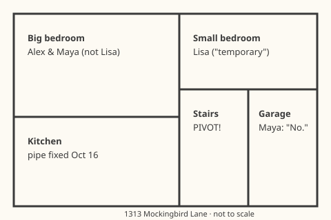

## The plan

Close on **Oct 15**, move on **Oct 31**, find out what finding 31 is.

| Room | Who | Notes |
| --- | --- | --- |
| Big bedroom | Alex & Maya | see history, Lisa |
| Small bedroom | Lisa | "temporary" (Lisa) |
| Attic | raccoons | until Nov 12 |
| Garage | the next car | Maya: "No." |

- [x] Close on the house
- [x] Move in
- [ ] Unpack box 38 of 52
- [ ] Fix the stair railing (finding 12)

> Finding 31: Unexplained noises in the attic at night. Recommend an evaluation by a wildlife specialist.
>
> — Plain Truth Home Inspections

[The listing](https://homes.example/1313-mockingbird-lane)



---

When the deposit comes back (an idea for scripting, not a real API yet):

```python
@on.transaction(sender="Shady Pines Properties")
def deposit_back(tx, vault):
    if tx.amount >= 1150:
        vault.task("Dispute the deposit deductions").status = "done"
        vault.notify("Maya", "We got the whole deposit back. Told you.")
```
