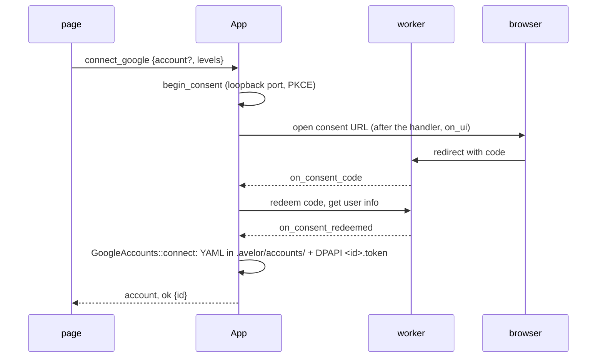

# Avelor — Accounts

> The accounts the app works with: Google accounts (Gmail, Calendar,
> Contacts, Tasks) and AI providers (chat) — their files, secrets and
> states, the Accounts page, and how a feature picks its AI model. What a
> Google account syncs is in `mail.md` and `calendar.md`; the assistant,
> `assistant.md`.

## Accounts in a vault <a id="vault-accounts"></a>

Accounts belong to a vault: entities name the account they arrived from by
its `id` in their `remote:` source block (`vault.md#remote`), and an
assistant's replies the AI account they came through. Each account is a YAML
file in the vault's `.avelor/accounts/` folder (`accounts.md#account-files`);
opening another vault switches to its accounts (`accounts::open`, on every
vault open), and without an open vault there is nowhere to keep an account —
the Accounts page says so. A file without a valid `id` is skipped (and
logged); keys the app doesn't know are kept.

## Secrets <a id="secrets"></a>

An account's secret (a Google refresh token, an API key) stays with the app,
never in a vault: it is a file in the configuration folder
(`%LOCALAPPDATA%\Avelor\`, `architecture.md#storage`) named after
the account's id, `<id>.token` or `<id>.key`, DPAPI-encrypted for the
current Windows user (`av-utils/secret.rs`). On Linux the file is in
`$XDG_CONFIG_HOME/avelor`, holds the secret as it is, and only the
user can read it (0600, `fs::write_private`). So no file in the vault names
its secret, and a backup of the vault never holds one. Only the key's ends
reach the page (`sk-…4f2a`).

## Connection status <a id="connection"></a>

`ConnectionStatus` (`config_files.rs`):

- **connected** — the secret can be read;
- **reconnect** — the secret is missing or can't be decrypted (the vault
  opened on another computer, or as another user), and the file isn't
  marked `disconnected`: the account shows as "needs reconnect" (for an AI
  provider: "needs a key");
- **disconnected** — the user disconnected it: the file is marked
  `disconnected`, which tells a deliberate disconnect from a secret
  missing on this computer, and the secret is deleted. Connecting again
  removes the mark.

Removing an account deletes its file and its secret. A local Ollama
account needs no key; its status is whether the server answers:
`running`, `not running`, or `unknown` (not checked yet).

## Account files <a id="account-files"></a>

Files are named `<kind>_<name>.yaml`: a Google account
`google_<email>.yaml`, e.g. `google_jan@gmail.com.yaml`; a new AI account
`<provider>.yaml`, then `<provider>_2.yaml`, …. The kind of a file is its
top-level key. One pass over `.avelor/accounts/` when a vault opens
(`accounts::load`) hands each file to the loader of its kind.

Every account file has:

* `id`: UUIDv7, unique identifier for the account
* `last-sync`: when the account last synced (optional)

### Google account file <a id="google-file"></a>

* `google`: Google specific account information
  * `email`: the account's email address, recorded on connect
  * `scopes`: one `service: level` entry per granted service; a service
    that isn't listed is off (`accounts.md#access-levels`)
  * `calendars`: the calendars chosen as sources, each with
    * `id`: Google's calendar id
    * `name`, `color`: as Google shows them, refreshed whenever the list is
      loaded
    * `auto-sync`: `true` while the calendar syncs on its own
      (`calendar.md#auto-sync`); absent when off
  * `connected`: when the account was first connected
  * `disconnected`: when the account was disconnected (`accounts.md#connection`)
  * `mail`: what the mail import remembers (`mail.md`), written on each
    fetch:
    * `filter`: the filter of the last fetch, filled in when Fetch mail
      opens again: `labels` (names), `every` (all labels instead of any),
      `starred`, `attachment`, `unread`, `important`, `sent` (by the
      account), `from` and `to` (addresses or domains, any of which may
      match), `words`, `since` (the date preset: `last`, `day`, `week`,
      `month`, `custom`), `after` and `before`
    * `auto-update`: whether the match preview updates as the filter is
      edited (default) or only on request
    * `last-fetch`: when the last fetch without failures started; the
      "Since last time" preset
    * `analysis`: Fetch mail's analysis of new mail (`mail.md#analysis`):
      `level` (`off`, `lite`, `medium`) and the `model` it runs with,
      `{account, model}`, kept while the level is off; absent: off
    * `auto-sync`: the account's mail auto-sync (`mail.md#mail-auto-sync`),
      absent until it is first switched on: `enabled`; `filter`, its own
      filter, apart from the one above and without dates; `since`, from when
      mail is fetched: when it was switched on, then the start of the last
      complete run; `analysis`, its own, as above


```yaml
id: 01a0e1cc-a24c-7490-82fe-e75669985b24
google:
  email: jan@gmail.com
  scopes:
    - email: read
    - calendar: full
  calendars:
    - id: jan@gmail.com
      name: Jan
      color: "#9fe1e7"
      auto-sync: true
  connected: 2026-09-27T10:14:00Z
  mail:
    filter:
      labels: [Umzug, Rechnungen]
      starred: true
      from: [telekom.de, hausverwaltung-krause.de]
      since: week
      after: 2026-09-20T22:00:00Z
    auto-update: true
    last-fetch: 2026-09-22T12:10:00Z
    analysis:
      level: medium
      model:
        account: 0193a7c1-4b0e-7c1a-9d2f-3a51c8e05be0
        model: gpt-5-mini
    auto-sync:
      enabled: true
      filter:
        labels: [Rechnungen]
        from: [stadtwerke-springfield.example]
      since: 2026-09-27T08:00:00Z
last-sync: 2026-09-27T10:30:00Z
```

### AI account file <a id="ai-account-file"></a>

* `anthropic`, `openai`, `mistral`, `gemini`, `ollama`: an AI provider's
  account (the block is named after the provider; `claude` is read as
  `anthropic`)
  * `address`: where the API lives, if not at the provider's default
    address (Ollama: `http://localhost:11434`)
  * `offered`: the models offered wherever a model is picked (ticked on
    the Accounts page; `accounts.md#model-choice`)
  * `spend-limit`: USD a month; once this month's calls cost that much,
    the account takes no more until the next month or a higher limit
  * `connected`: when the account was first connected
  * `disconnected`: when its key was forgotten, as for a Google account

```yaml
id: 0193a7c1-4b0e-7c1a-9d2f-3a51c8e05be0
openai:
  offered: [gpt-5, gpt-5-mini, gpt-5-nano]
  spend-limit: 10
  connected: 2026-09-30T10:00:00Z
```

### Spend file <a id="spend-file"></a>

What an AI account's calls cost is kept beside its file, in
`<name>.spend.yaml` (`openai.yaml` → `openai.spend.yaml`): per month (UTC,
as the providers bill) and per model, the calls, the calls whose price the
app doesn't know (they count as free), the cost in USD from the price
table, and the tokens. It is written after every assistant reply
(`ai::account_used` → `AiAccounts::record_spend`), so the
Accounts page's "This month" survives a restart; a stopped reply records
nothing. The file names the account's `id`; one that names another
account (left by a removed account of the same name) is not taken over.
Disconnecting keeps it; removing the account deletes it.

```yaml
account: 0193a7c1-4b0e-7c1a-9d2f-3a51c8e05be0
months:
  2026-10:
    gpt-5-mini:
      calls: 12
      unpriced-calls: 0
      cost: 0.0123
      input: 3400
      output: 1200
      cache-read: 0
      cache-write: 0
      reasoning: 0
```

## Google access levels <a id="access-levels"></a>

Access is chosen per service — `email` (Gmail), `calendar`, `contacts`,
`tasks` — as Off, Read or Full in the UI, `read` / `full` in the account
file (a service not listed is off), and `av_google::auth::ScopeAccess {
None, ReadOnly, Full }` in the code. Full means read and write; for `email`
it includes sending. Name and email address (identity) are always requested.
There is no Write or Send level; vocabulary elsewhere
maps onto these three.

## The Accounts page <a id="accounts-page"></a>

Workspace → Accounts (`features/workspace/accounts.js`) lists the open vault's
accounts with a detail pane.

- **Google**: Off/Read/Full per service, then "Sign in with Google"
  connects an account; reconnecting (also to change the access) keeps the
  account's id and must sign in as the same email. Disconnecting revokes
  the token and deletes it but keeps the account file, marked
  `disconnected`, so connecting the same Google account again keeps the
  account's `id` (and with it every document's `remote:` link). Removing
  a disconnected account deletes its file. The pane lists the account's
  calendars; a checked one becomes a source (`calendar.md`), with its
  Auto-sync check beside it; the Mail row has its own Auto-sync check and
  filter (`mail.md#mail-auto-sync`).
- **AI providers**: the AI provider menu offers Anthropic, OpenAI, Mistral
  and Gemini with an API key, and Ollama by its address. A key or an address
  is checked by listing the provider's models before it is stored; until
  then it stays an input. The pane lists the models with their price per
  million tokens: ticking one offers it in the features' pickers, and "Used
  by" names, read only, what picked it (`accounts.md#model-choice`): Chats,
  or a watch with its steps that run with it ("Scanner · OCR"); an
  unticked model still names them, as they are refused until they pick
  another. A key provider's pane shows what its calls cost this month
  (`accounts.md#spend-file`); an Ollama account shows whether the server
  answers instead. Disconnecting forgets the key
  but keeps the account and its id, marked `disconnected`; removing
  deletes its files (Ollama accounts are removed directly).
- The page widgets the Workspace pages share are `ui/`'s (`ui/page.js`,
  `ui/field.js`, `ui/segmented.js`); the model picker every feature uses
  is `features/workspace/models.js` (`accounts.md#model-choice`).

## Model choice and the spend limit <a id="model-choice"></a>

Every feature that calls an AI picks its model: one of the models the
vault's AI accounts offer, `{account, model}` (a `ModelChoice`), kept with
the feature's own settings:

| Feature | Kept in | Picked in |
|---|---|---|
| The assistant | the vault's settings, `.avelor/vault.yaml` `chat-model` (`vault.md#vault-config`; `set_vault_settings`) | the assistant's head |
| A watch's steps: reading its files (OCR) | the watch file's `models`, by step (`import.md#watch-files`; `set_watch`) | the step's row in the watch's pane |
| Fetch mail's analysis | the Google account file's `mail.analysis` (`mail.md#analysis`; remembered by `mail_fetch`) | Fetch mail, section Analysis |
| An auto-sync's analysis | the Google account file's `mail.auto-sync.analysis` (`set_mail_sync`) | the account's pane, under the auto-sync's filter |

The host reads the pick where it is kept and checks it,
`AiAccounts::choose(choice, what, now)`: a `Resolved` (account, model,
client) or a `Refusal` in the host's words. The page sends no model with
a request; `aiModelOf(choice)` mirrors the check for its hints. Refused:

- nothing picked: "For chats, pick a model." (`invalid_argument`), or
  "add an AI provider under Accounts." without one (`not_connected`);
- the account gone: "the picked model's account is gone; pick another
  model.";
- its key missing: "enter OpenAI's key again under Accounts."
  (`not_connected`);
- the model no longer offered (unticked): "gpt-5 is no longer offered;
  tick it under Accounts or pick another model.";
- the spend limit reached: the assistant shows "has reached its spend
  limit" and takes no input; the mail analysis stops before its next mail
  (with a notice; `check_limit` before each); a call already running
  finishes (`Error::SpendLimit`).

No other model is ever tried in place of the pick: it could send a
document to another provider. The picker (`aiModelPicker`, `aiShowModels`
in `features/workspace/models.js`) names the picked model, marked while it is refused,
and opens a menu of every account's offered models, by account; an
account without its key is dimmed. Where a pick is refused the page shows
why (`aiMissingHint`), with a button to Accounts where the fix is there.

## Flows

| # | Flow | Trigger → page | Host → events | Result |
|---|---|---|---|---|
| H1 | Open the page | Workspace → Accounts → `openVaultOp('accounts')` → `renderAccounts` | — (the accounts came with the vault: `accounts`) | list + detail pane; without a vault, a hint |
| H2 | Connect Google | Off/Read/Full per service → "Sign in with Google" → `connectGoogle` | `connect_google {levels}` → the browser opened after the handler → consent (loopback, PKCE) → code redeemed and user info fetched on workers → `GoogleAccounts::connect`: account YAML in `.avelor/accounts/` + DPAPI token `<id>.token` → `account`, `ok {id}` | card; sidebar sources |
| H3 | Reconnect / change access | same with the account id | as H2 with `{account, levels}`; must be the same email (`wrong_account`) | id and `remote:` links kept |
| H4 | Cancel sign-in | Cancel | `cancel_connect` → `ok`; the connect answers `cancelled` | — |
| H5 | Calendars as sources | account pane renders → `list_calendars`; checkbox → `set_calendar_source {account, calendar, selected}` | `ok {calendars}` (after `account` if names changed); `account`, `ok` | checked calendars become sources |
| H6 | Disconnect / remove | two clicks within 3 s | `disconnect_account` (revoke on a worker, file marked `disconnected`, token deleted) → `account`, `ok`; `remove_account` (file and token deleted) → `account_removed`, `ok` | — |
| I1 | Add an AI provider | "AI provider" menu → draft pane → key or address → Save → `aiConnect` | `connect_ai {provider, key \| address}` (channel `connect_ai`) → models listed with the new values on a worker → only then stored in `.avelor/accounts/` (the key as `<id>.key`) → `account`, `ok {id, models}` | card with models |
| I2 | Models, refresh, test | pane renders, Refresh, Test | `list_ai_models {account}` → `account` (Ollama: running?), `ok {models}` | — |
| I3 | Offer a model | tick | `set_ai_settings {account, offered}` → `account`, `ok` | pickers offer it |
| I8 | Pick a model | a feature's picker → `aiShowModels` → a model | the feature's own command: `set_vault_settings {chat_model}` → `vault_settings`, `ok`; `set_watch {watch, models}` → `watch`, `ok`; `mail_fetch {…, analysis}`, `set_mail_sync {account, analysis}` → `account` | the feature uses it; "Used by" names the feature |
| I4 | Spend limit | edit field | `set_ai_settings {account, spend_limit}` → `account`, `ok` | enforced: at the limit a chat is refused |
| I5 | Replace key | edit key | `connect_ai {account, key}` | — |
| I6 | Disconnect / remove | two clicks within 3 s | `disconnect_account` / `remove_account`, shared with Google (H6) | — |
| I7 | Spending | an assistant reply | `ai::account_used`: what the ledger recorded → this month in `<name>.spend.yaml` → `account` | "This month", also after a restart |

## Design <a id="design"></a>



The sign-in uses a loopback redirect with PKCE and a 5-minute limit. The
pending sign-in lives in `App` with its own `av_utils::cancel::Cancel`, which ends
the OAuth wait and the requests that redeem the code and ask who signed
in; a new connect, `cancel_connect` or a vault switch cancels it. The
OAuth client is the build's (`AVELOR_GOOGLE_CLIENT_ID`,
`AVELOR_GOOGLE_CLIENT_SECRET`, `av-google/auth.rs`); a build without it
fails, unless it hides Google (the feature `hide-google`): then the host
loads no Google account, the page offers none to connect (`ready`), and
a sign-in is refused (`unsupported`).

What the account files share is in `config_files.rs`:

```rust
pub struct SecretFile(PathBuf);         // <config folder>/<account id>.<token|key>
impl SecretFile {
    pub fn of(secrets: &Path, id: Id, ext: &str) -> Self;
    pub fn read(&self) -> Result<String>;          // FileNotFound, or DPAPI fails
    pub fn write(&self, secret: &str) -> Result<()>; // DPAPI, write_private
    pub fn remove(&self) -> Result<()>;
}
pub enum ConnectionStatus { Connected, Disconnected, Reconnect }
impl ConnectionStatus { pub fn of(secret_read: bool, disconnected: bool) -> Self; }
pub fn write_yaml(path: &Path, value: &impl Serialize) -> Result<()>;
```

plus `load_config_files` and `free_stem` (the next free file name).
`GoogleAccounts` (`google_accounts.rs`) and `AiAccounts`
(`ai_accounts.rs`) are the sub-states that own the files; `accounts.rs`
does what both kinds share (the pass on vault open, disconnect, remove,
the events `accounts` and `account_removed`). The `finish_sync` of
`google.rs` ends every sync of an account (`last-sync`).

av-llm's `Client` speaks to Anthropic, OpenAI (Responses API, not Chat
Completions), Mistral, Gemini and Ollama, with streaming (SSE/NDJSON), a
normalized `Usage`, the price table and a `Ledger` (`architecture.md#crates`). What the app knows of
each provider is one table, `PROVIDERS` (`av-llm/types.rs`): its name in
files (`claude` as an alias of `anthropic`), the name the Accounts page
shows, the default address, whether it takes a key (Ollama is addressed
instead), whether it keeps uploads, and how the key is sent. The account files' kinds, the
key's checks and the error wording read it there.
