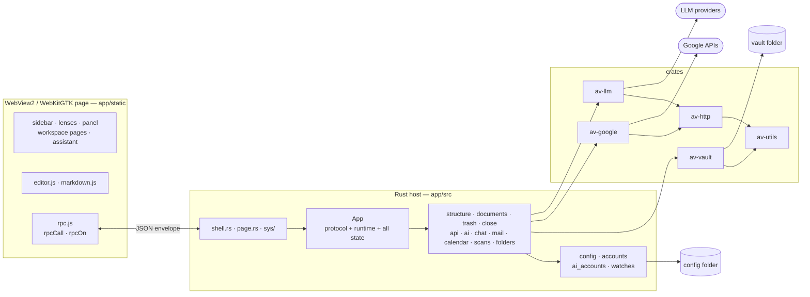
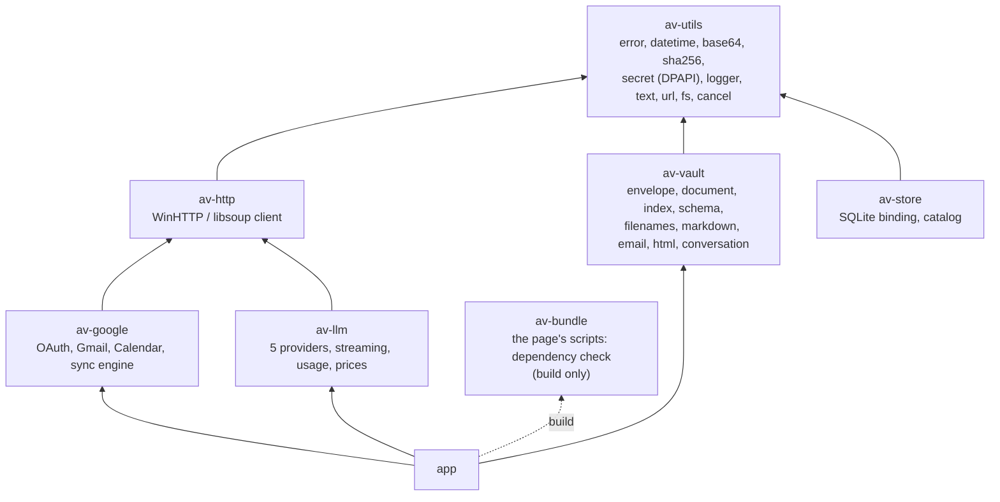

# Avelor — Architecture

> The entry point to the documentation: what the app is, the constraints
> and principles it is built on, how host, page and crates are structured,
> the runtime, storage, build and conventions — and the map of the other
> documents.

## What the app is

Avelor manages personal documents in a **vault**: a folder of plain
markdown and YAML files that the user owns (`vault.md#principles`). It
holds:

* chat messages, emails and letters,
* notes and documents,
* data records and lists,
* tasks, contacts and calendar events,
* bank accounts and transactions.

The app lets the user:

* import, browse and edit documents — a WYSIWYG editor saves straight to
  the file;
* assign documents to projects and group them into threads;
* cross-link documents with each other (bills to payment transactions, a
  task to its letter, …);
* have AI-powered conversations about documents, threads or projects;
* present documents in their native UI (a calendar for events, a board
  for tasks, …).

Imports happen automatically from configured watch folders or by hand,
and add the initial metadata (an identifier, title, creation date, …):
mail from a Google account, events from Google Calendar, scanned pictures
read by OCR.

## Constraints

| Constraint | Consequence |
|---|---|
| Windows and Linux desktop, Rust host + WebView2 page (WebKitGTK on Linux) | Win32 window and message loop, COM, WinHTTP, DPAPI, WIC (`windows` crate); GTK4 and WebKitGTK 6.0 on Linux (`architecture.md#platforms`) |
| Minimal dependencies | Only `serde`, `serde_json`, `serde_yaml_ng`, `log`, `pulldown-cmark`, `windows`, `webview2-com` (+ `oxc`, `embed-resource`, `static_vcruntime` at build time); on Linux `gtk4` (with the `gdk_pixbuf` it brings), `webkit6`, `soup3`, `gio`, `glib`, `glib-unix` and `libc` instead of `windows` and `webview2-com`. SQLite is the system's (`winsqlite3.dll`, libsqlite3), a library of the platform as WinHTTP and libsoup are, through a hand-written binding (`av-store`). UUIDv7, dates are hand-written |
| No npm, no third-party bundler | ES modules, checked and bundled into one classic script by `app/build.rs` with `av-bundle` (`development.md#the-bundled-page`) |
| Small executable | release profile for size (`architecture.md#build`), no async runtime, PNG icon frames, CSS minified; new code and dependencies are measured with a `bloat` profile (`development.md#measuring-size`) |
| The vault is the source of truth | No database of record, no drafts; every edit is written to the file; the index is rebuilt by a scan, and the catalog beside the vault (`av-store`) holds nothing the files don't |
| Host resolves, page presents | Filenames, conflicts, structural rules live in Rust; the page renders and forwards intents |
| One coordinator | `App` alone runs background work (`run*`, `UiQueue`) and posts to the page; workers never reach the webview (no `Send` wrapper around `ICoreWebView2`) |

## Documents <a id="documents"></a>

| Document | Covers |
|---|---|
| **`architecture.md`** | this file: what the app is, principles, structure, runtime, storage, build, conventions |
| `development.md` | checks, the bundled page, testing session end, diagnosis, measuring size, line endings |
| `vault.md` | the file format: identity, roles, types, sources, metadata, file names, layout; opening and scanning a vault, the trash, the Vault page |
| `api.md` | the protocol: transport, rules, the page's side, every command and event |
| `ui.md` | the main window: layout, vault panel and filters, lenses, status bar, jobs panel, keys, New, preferences |
| `panel.md` | the side panel: cards, threads, the day view, the context column, links, labels, projects, structural edits and how they are saved |
| `editor.md` | the WYSIWYG editor |
| `markdown.md` | markdown ⟷ editor DOM: the contract, both converters, their tests |
| `saving.md` | dirty state, autosave, the staleness guard, conflicts, closing |
| `accounts.md` | Google and AI accounts: files, secrets, states, the Accounts page, AI uses and the spend limit |
| `mail.md` | Fetch mail, the mail auto-sync, the mail analysis |
| `calendar.md` | calendar sync, its rules, auto-sync and sync points |
| `import.md` | folder watches, Import scans |
| `assistant.md` | the assistant: conversations, context, streaming |

## Doc conventions

- **One owner per fact**: each fact is described in one document; the
  others link to it.
- **References** point at an id: `` `saving.md#conflicts` `` in the docs,
  with the file name also within `saving.md` itself (`` `#x` `` alone reads
  as an element id), and the same form, ASCII, in code comments
  (`saving.md#conflicts`; every `.md` file is in `docs/`).
  A section something refers to carries its id at the end of its heading
  line: `` ## Conflicts <a id="conflicts"></a> ``. An id is a lowercase
  word or two, at most 16 characters, unique within its file and never
  reused for another section, so a heading can be reworded without
  touching a reference. Headings carry no numbers.
- **`file:line`**: host files are under `app/src/`, page files under
  `app/static/`, crate files under `crates/<crate>/src/` (written
  `av-vault/vault.rs:201`).
- **Flows** have ids by area (A vault, B navigation, C projects, D
  documents and cards, E threads, F lenses, G sync sources, H Google
  accounts, I AI accounts, J watches, K Import scans, L assistant): trigger
  on the page → page functions → command → what the host does and sends
  back → result. Message names are the protocol's (`api.md`).
- **Tables are unaligned** (`|---|`); the docs are LF.

## Principles <a id="principles"></a>

The rules the code follows, and every change to it:

1. **Keep the stack, add no dependency.** Rust + WebView2 (WebKitGTK on
   Linux), hand-written utilities, no npm, no third-party bundler, no async
   runtime.
2. **One way to do each thing.** One message format and one way to answer,
   one job helper, one account persistence, one confirm widget, one place
   that turns vault changes into page updates.
3. **Boundaries by types and rules, not by layers of folders.** The host
   doesn't need `services/` and
   `repositories/`; it needs state that can only be changed through its own
   methods, and modules that don't reach into each other.
4. **Every request gets exactly one answer; every failure is visible.**
5. **The vault crate owns the vault's schema**; the app orchestrates; the
   page presents.
6. **Pure core, thin shell.** Mapping and decision logic are pure functions
   with tests (as `av_google::calendar_sync::plan` is); I/O sits at the
   edges.
7. **One coordinator.** `App` (`app.rs`) is the only place that runs
   background work and posts to the page; no worker gets a path of its own to the webview. Each new
   coordination primitive (`Req`, `on_ui`, the re-entrancy net, the jobs
   helper, the clock) is designed with
   the user before it is built.
8. **The UI thread never waits for the page.** The page is reached only
   through the UI thread's message queue, so a wait for it there needs a
   nested message loop. A Win32 message that needs an answer at once
   (`WM_QUERYENDSESSION`) gets it from what the host already knows, and the
   page keeps the host up to date ahead of time: `set_editing`, saves within a second of a
   pause, the saves a conflict refused. Modal dialogs through `on_ui` stay
   the only modal loops. A request the page can answer later (`WM_CLOSE`)
   is asked, with a timeout.

## Big picture



## Runtime

### Threads

| Thread | Runs | Back to the UI thread via |
|---|---|---|
| UI thread | Win32 message loop (GTK's main loop on Linux); owns `App` and everything in it; every command handler; the vault scan's batches into the index; every vault write | — |
| `avelor-worker`, one new OS thread per `App::run*` (`app.rs`) | the vault scan's walk and reads (`vault_scan.rs`); HTTP (Google, LLMs), the OAuth wait, LLM streams, WIC previews (gdk-pixbuf on Linux); mail header pages fan out to 8 scoped threads (`mail::fetch_headers`); the close's wait | `UiQueue::send_to_ui` → `PostMessageW(WM_TASK)` → `Shell::run_tasks` (`app.rs`, `shell.rs`; on Linux an idle callback) |
| WebView2 processes (WebKitGTK's on Linux) | the page | `PostWebMessageAsString` / `WebMessageReceived` (on Linux `evaluate_javascript` / the script message handler) |

### The run family

Three variants: plain (`run`), with ordered progress callbacks
(`run_with_progress`), and superseding per channel (`run_superseding`;
channels `connect_ai`, `mail-preview`); continuations are `FnOnce(&mut
App, T)`. One OS thread per task is right without an async runtime:
the OAuth wait and AI streams block for minutes, and a bounded pool would
queue previews behind a sign-in. `Task(Cancel)` aborts
(`av-utils/cancel.rs`) and skips `apply` if it isn't queued yet;
dropping a `Task` leaves its work running. A sign-in runs under a
`Cancel` of its own, the pending connect's (`App::begin_connect`), from
the OAuth wait to the last request. Continuations re-check identity themselves
(`writing.id`, `job_id`, batch ids), because an already queued `apply`
still runs, and so does progress queued before the abort.

### Coalesced progress <a id="progress"></a>

`Progress::send_latest` (`app.rs`) replaces a not-yet-delivered update
of the same stream, so at most one `ai_delta` per run of the UI queue. The
reply's worker and the scan read's word count use it; previews keep
`send`, where every item counts.

### One way in <a id="one-way-in"></a>

Every way into `App` — page messages, worker results, the window
state — goes through the `UiQueue` queue, and `App` is taken only
while a task runs:

- `run` owns the `WindowProc` until the message loop has ended, and
  `GWLP_USERDATA` only points to it.
- The wndproc and `with_window` hand out `&WindowProc`; its own fields are
  `Cell`s and `RefCell`s, and no COM call runs while a borrow is held.
- `run_tasks` runs the tasks queued so far, one at a time, each with
  `RefCell<Option<App>>` taken by `try_borrow_mut`. A task queued
  meanwhile (a batch of the vault scan) waits for its own `WM_TASK` (on Linux an idle callback), so
  the message loop runs in between. Nothing else takes `App`, and nothing
  calls `borrow_mut()` on it: with `panic = "abort"` a second borrow ends
  the app.
- A message that finds `App` taken leaves its task in the queue. The task
  holding it re-posts `WM_TASK` (on Linux an idle callback) once it
  returns.
- Because every page message goes through the queue, a later one can't
  run before a deferred one.

### Dialogs

`App::on_ui(work: FnOnce(&Owner) -> T, apply: FnOnce(&mut App, T))`
queues a `UiTask::Modal`, whose `work` runs on the UI thread *after* the
current handler has released `App`. The main window is the dialog's
owner, and `apply` then runs with `App`. While the dialog is open,
other messages run normally, and a close is refused. The folder pickers,
Explorer and opening URLs or files use it. On Linux the dialog
waits in a nested `glib::MainLoop` (`sys/linux/dialogs.rs`), as a Win32
dialog waits in its modal loop.

### Jobs <a id="jobs"></a>

`App::start_job` / `update_job` / `end_job` / `run_job` (`jobs.rs`): a
card per job in the jobs panel (the `job` event, `ui.md#jobs-panel`),
its requests under one `Cancel`, Stop through `cancel_job {id}`. A stopped
job's `apply` still runs, so a calendar sync records the pushes it made
before the stop and ends itself. Feature slots that hold snapshots for
`apply` (`mail.fetch`, `calendar.sync`) stay in their sub-states. A
failure of one item (a mail, an event) is a `notice` plus the job's
summary. A vault switch stops the jobs bound to the vault and the
assistant's replies, and opens the new vault once they have ended
(`switch_vault_when_stopped`). A new long operation becomes a job through
this helper, not a slot with callbacks of its own.

### The clock <a id="the-clock"></a>

Work the app starts on its own goes through `App::on_clock`: the
window's timer (`SetTimer`, once a minute; on Linux a GLib timeout) queues it through the UI queue
as `WM_ACTIVATE` queues `on_activated`, so it runs like every other way
in, with no thread or handle of its own. It starts the mail and calendar
auto-syncs that are due (`mail::auto_sync`, `calendar::auto_sync`, which
wait for the vault scan and for a running fetch or sync); the end of a
vault scan calls them too. Their schedule (`SYNC_EVERY`, `first_due`) is
shared in `google.rs`. A calendar is also made due by its sync points
(`calendar.md#sync-points`).

### Closing

The window's Close asks the page to save first and goes on once the saves
are answered; Windows ending the session waits
for nothing (principle 8); on Linux the session manager's `query-end`,
SIGTERM and SIGHUP end it the same way. Both are
`saving.md#closing-the-app`.

### Vault edits and the outbox <a id="vault-edits"></a>

Every vault edit by the app goes through `App::edit`, which hands the
edit av-vault's `Index` and pushes every entity it wrote or trashed —
also when it failed part-way:

```rust
pub fn set_title(app: &mut App, req: Req, id: Id, title: String) {
    let result = app.edit(|index, changes| index.set_title(&id, title, changes));
    answer(app, req, result, Some(id));
}
```

av-vault's `Changes` names what an edit wrote, trashed, and whose body it
changed, so the same push sends `entity`, `entity_deleted` and `content`
(`post_entity` serves scanned entries and edits alike). The
editor's own save (`Vault::save_content`, answered by `save_doc_content`)
and taking in a change made outside the app (`Vault::reload`,
`Vault::refresh`) aren't edits by the app and stay apart. `Vault` (`app.rs`), the open
vault's folder and index, keeps both private: the index is read through
`Vault::index` and changed only by `App::edit`, the scan and these
methods.

`App` posts through an **outbox** (`Box<dyn Fn(String)>`, given to
`App::new`): the web view in the app, a `Vec<String>` in tests. With the
test running the UI queue itself, a command is dispatched against a
temporary vault and its events and reply asserted (`testing.rs`:
`Harness::call`, `notes`); work on a worker is waited for (`wait_for`,
`wait_scanned`). Every feature module has such dispatch tests;
the assistant's run against a fake Ollama (`testing::FakeOllama`).

## Crates <a id="crates"></a>



| Crate | Owns | Notes |
|---|---|---|
| av-utils | shared `Error`, `DateTime`, `Id` (UUIDv7), base64, SHA-256 (BCrypt), FNV, DPAPI `secret`, logger, random (BCrypt), url, text normalization, charsets, atomic writes (`fs`), MIME types by extension (`mime`), cross-thread `Cancel` | |
| av-http | blocking `Client` / `Request` / `Response`; the process's one session (`Client::shared`); `Request::send_logged`, the one way the APIs are called: logged as `METHOD host/path`, timed, a non-2xx status as `Error::Http` with the reason the caller's parser reads from the body | WinHTTP; libsoup 3 on Linux, one session per worker thread; WinHTTP's IPv6 fast fallback on (a network whose IPv6 goes nowhere cost 21 s per new connection); a streamed read takes what has arrived (`WinHttpQueryDataAvailable`) |
| av-vault | entity model (`envelope.rs`, `document.rs`, `shared.rs`), the schema's names (`schema.rs`), `Index` with structural ops and `Changes`, the entity edits' `Change` (`change.rs`, `Index::edit_entities`), the scan (`scan`, events applied by `Index::apply`), filenames, `to_html`, `MdWriter`, `plain_title`, HTML → markdown, MIME parser, conversation trees | no network, no UI; also hosts mail parsing |
| av-store | what Avelor keeps beside a vault, nothing only it holds: the catalog, a row per file of the index (`Catalog`: `open`, `cached`, `put`, `forget`, `keep_only`; `SETTLED`), the SQLite binding (`sqlite.rs`: `Db`, `Stmt`, closed on drop) | plain types only, no av-vault; the system's SQLite (`architecture.md#platforms`); a connection stays on the thread that opened it |
| av-google | OAuth loopback + PKCE (the wait under a `av_utils::cancel::Cancel`), token refresh, Gmail (filter → query, ids, headers, raw), Calendar v3 subset, the two-way sync engine (`plan` is pure); Google's error bodies (`reason`) | sends through `send_logged` |
| av-bundle | the page's bundler (oxc): the ES modules from the entry through their imports, in the order they run, each a function scope in one classic script; its checks (no import cycle, named imports and exports only, no exported `let`, no write to an import, no name used without its import, the layers; `development.md#the-bundled-page`) | build-only: `app`'s build dependency, nothing of it in the exe |
| av-llm | `Client` over Anthropic, OpenAI (Responses API, not Chat Completions), Mistral, Gemini, Ollama; the providers' facts in one table (`ProviderSpec`, `PROVIDERS`: names, alias, default URL, key, uploads, auth) and one request builder from it (`Client::request`); streaming (SSE/NDJSON); normalized `Usage`, price table, `Ledger`; the providers' error bodies | sends through `send_logged`; dispatch by macro, no trait |

The graph is acyclic and the network
side never touches the vault side; `app` is the only bridge.

### av-vault's core

- **`schema`**: the remote keys and folder names as constants, next to the
  roles they describe; the app imports them (`vault.md#remote`,
  `vault.md#vault-layout`).

  ```rust
  pub mod remote { pub const GMAIL_ID: &str = "gmail-id"; pub const MESSAGE_ID: &str = "message-id"; /* calendar-id, sync-token, time-min, event-id, etag, snapshot */ }
  pub mod layout { pub const PROJECTS: &str = "Projects"; pub const MAIL: &str = "Mail"; /* the folders New writes to, Calendar, Conversations, .trash, .avelor/accounts, .avelor/watches */ }
  ```

- **One copy of the truth in `Document`**: the envelope holds the metadata,
  read through accessors and changed through setters. `envelope` is an
  `Option` — a markdown file without frontmatter stays without one until
  metadata is set, where an empty `Envelope` would write `{}` — and
  `Document` keeps its `id` beside it, since a file without `id` gets one
  made up per scan. `OnDisk` holds what the file held at the last read or
  write, with its stamp (`saving.md#the-stamp`); a failed write in
  `Index::update` puts back a clone of envelope and body.

  ```rust
  pub struct Document {
      id: Id,
      envelope: Option<Envelope>,  // the only copy of the metadata
      content: String,
      format: FileFormat,
      disk: Option<OnDisk>,        // what the file held at the last read or write
      err: Result<()>,
  }
  ```

- **`conversation`**: an `impl Conversation` with `path_to`, `leaf_from`,
  `add`, `activate` and `ConversationMessage::is_reply`, the tree rules the
  assistant follows.

## Host modules

| Module | Responsibility |
|---|---|
| `main.rs` | logger, panic hook, the config (`load_config`) |
| `shell.rs` | what the main window decides on every platform: its state, the UI task loop (`run_tasks`) and the re-entrancy net, Close to `App` (`architecture.md#platforms`) |
| `page.rs` | the page (`app/static/index.html`), the same on every platform, with its preferences and the platform's `BRIDGE_JS` |
| `sys/mod.rs` | the platform layer: what each backend provides (`architecture.md#platforms`) |
| `sys/win32/paths.rs`, `sys/win32/dialogs.rs` | the app's folders (`paths`: the config, the log, the web view's profile); folder picker, message boxes, ShellExecute |
| `sys/win32/mod.rs`, `sys/win32/window.rs` | `run`; Win32 window, wndproc, size persistence, the session's end; the clock's timer (`WM_TIMER` → `App::on_clock`); `UiSignal` (`WM_TASK`, `WM_CLOSE_NOW`); Close to `App` |
| `sys/win32/images.rs` | image previews with WIC (`preview`): decoded, upright by the EXIF orientation, scaled to fit, JPEG; COM on a worker (`ComThread`) |
| `sys/win32/webview.rs` | WebView2 environment/controller, message handler, `NavigateToString`; App's outbox (`PostWebMessageAsString`) |
| `sys/linux/paths.rs`, `sys/linux/dialogs.rs` | the same in the XDG folders, with GTK |
| `sys/linux/mod.rs`, `sys/linux/window.rs` | `run`: the `gtk::Application`, the session's end; the window, size persistence; the clock (a GLib timeout); `UiSignal` (`glib::idle_add_once`); Close to `App` |
| `sys/linux/images.rs` | the same with gdk-pixbuf |
| `sys/linux/webview.rs` | the WebKitGTK web view with its network session, the script message handler `host`, App's outbox (`evaluate_javascript`), `load_html` |
| `app.rs` | `App` (all state) and `Vault` (the open vault's folder and av-vault's `Index`, private: read through `index`, edited through `App::edit`; `content`, `save_content`, `reload`, `refresh`, `changed_at`, `require_written`), the config writes no request asked for (`save_window_state`, `remember_vault`), `on_web_message` (every message to `protocol`), `post_text` / `post_event` through the outbox, `edit`, `run*`, `on_ui`, `Progress` (`send`, coalescing `send_latest`), `UiQueue` / `UiTask` (`close_window`), entity pushes, the pending sign-in, `on_clock` |
| `vault_scan.rs` | the vault scan (`vault.md#opening`): `run_scan` with av-vault's `scan` on a worker, its batches into the index (`Vault::apply_scanned`) and to the page (`vault`, `entity`, `vault_error`, the scan's `job`), a replaced scan's batches dropped, `scanning`; its dispatch tests |
| `protocol.rs` | the protocol: envelope, `Command`, router, `Req`; the dispatch tests |
| `testing.rs` | the test harness: a temporary vault, `Harness::call`, the collected events, `FakeOllama` |
| `close.rs` | closing the app (`CloseState`): the `close` event, its answer `close_ready`, the wait for a page that doesn't answer; the session ending, answered without the page (`on_session_end`); its dispatch tests |
| `jobs.rs` | the jobs helper: start, update, stop and end a job (the `job` event), `run_job`, `cancel_job`, the vault switch that waits for the old vault's jobs; a job's summary note (`count_summary`); its tests |
| `api.rs` | `ready`, vault open (with its accounts, watches and settings), switch and reveal, `set_prefs`, `open_url` |
| `documents.rs` | a document's content in the editors: `load_doc_content`, `save_doc_content`, `check_files`, taking in files changed outside the app (`post_taken_in`); `set_editing`; `DocumentState`, the documents in edit mode and the app's version of each one in conflict; the conflict copy shared with calendar sync (`keep_conflict_copy`, `keep_held`); their dispatch tests |
| `trash.rs` | the trash: `list_trash`, `restore_entity` (an edit, answered like the structural commands), `delete_trashed`, `empty_trash` |
| `structure.rs` | the structural commands: `create_entity`, threads, projects, titles, stars, archiving, labels, links, `edit_entities`, deletes, `reload_entity`; their answers; their dispatch tests |
| `config.rs` | `config.yaml` (`ConfigStore`: read through its getters, each setter writes the file) |
| `accounts.rs` | both kinds of account: the one pass over `.avelor/accounts/` on vault open, the events `accounts` / `account_removed`, `disconnect_account`, `remove_account`; their dispatch tests |
| `google_accounts.rs`, `google.rs` | Google account files, scope levels, the `GoogleAccounts` sub-state; the Google commands (connect, cancel, calendars, disconnect); `finish_sync`, the end of every sync of an account; the auto-syncs' schedule, `SYNC_EVERY` and `first_due` |
| `config_files.rs` | the config-file helpers (`accounts.md#design`): `SecretFile`, `ConnectionStatus`, `write_yaml`, `load_config_files`, `free_stem` |
| `vault_settings.rs` | the vault's own settings (`.avelor/vault.yaml`): the `VaultSettings` sub-state, loaded on vault open, `set_vault_settings`, the event `vault_settings`; its dispatch tests |
| `ai_context.rs` | the context builder: what the AI is told about a conversation's linked document or thread, each as its file, within a budget; its tests |
| `chat.rs` | the assistant: `chat_open`, `chat_send`, `chat_stop`, `chat_select`, the events `conversation` and `ai_delta`; streamed replies, the request from the shown path and the linked item; `create`, a new AI conversation (also the mail analysis's chat); dispatch tests against a fake Ollama |
| `ai_accounts.rs`, `ai.rs` | AI account files, key and spend file, the `AiAccounts` sub-state with `choose` and `check_limit` (a feature's model pick, `ModelChoice`, checked; the spend limit); the AI commands (connect, models, settings) and `account_used` |
| `mail.rs` | Fetch mail: `mail_labels`, `mail_search`, `mail_headers`, `mail_fetch`, `set_mail_sync`; `MailState`; the fetch job as plan → run → apply with its pure pieces (`plan_fetch`, `Downloaded::parse`, `fetch_action`, `email_entity`); the auto-sync (`auto_sync`, `sync_query`); a fetch's new mails handed to the analysis; their tests |
| `enrich.rs` | the mail analysis (`mail.md#analysis`): the vault's `context`, the request per level, its parser and its writes (pure: `request_for`, `parse`, `apply_lite`, `medium_messages`), the analysis job one mail at a time (`analyse`, `EnrichState`); its tests against a fake Ollama |
| `calendar.rs` | Google ⟷ vault event mapping (pure: `from_google`, `to_google`, `event_entity`, `exception_of`); `calendar_sync` and `set_calendar_sync`; `CalendarState`; the sync job as plan → run → apply, with the trash's deletes; the auto-sync (`auto_sync`, `on_auto_listed`) and its sync points (`changed`, `activated`, `waiting_delete`); their dispatch tests |
| `watches.rs`, `folders.rs` | watch files in `.avelor/watches/`, the `Watches` sub-state, globbing, listing; the watch commands, the events `watches` / `watch` / `watch_removed`, their dispatch tests |
| `scans.rs` | Import scans: `scan_list`, `scan_read`, `scan_previews`, `scan_open`, `scan_import`, the events `scan_page` / `scan_preview`, OCR as a job (the account and model resolved, the spend limit checked per page), `scan_document` (pages → document); their dispatch tests |

## Platforms <a id="platforms"></a>

**Platform code, by area**

| Area | Windows | Where | Linux |
|---|---|---|---|
| Folders | `%LOCALAPPDATA%\Avelor` (known folder): config, log, WebView2 profile | `sys/*/paths.rs` | `$XDG_CONFIG_HOME/avelor` for the config; `$XDG_STATE_HOME/avelor/log`; `$XDG_DATA_HOME/avelor/webkit` and the cache folder for the web view |
| Window, main loop, UI queue | Win32 window; `PostMessageW(WM_TASK)` wakes `run_tasks` | `sys/*/window.rs` (`UiSignal`) | `gtk::Application` (`NON_UNIQUE`, one process per start as on Windows) and an `ApplicationWindow`; `glib::idle_add_once` wakes the queue (`MainContext::invoke` would run it at once on the UI thread, inside the task that woke it) |
| Fullscreen | F11 from the controller's `AcceleratorKeyPressed`; the frame removed and the monitor filled, the placement from before restored | `sys/*/window.rs`, `sys/win32/webview.rs` | F11 from an `EventControllerKey` in the capture phase, ahead of the web view; `fullscreen()`, `unfullscreen()` |
| Session end | `WM_QUERYENDSESSION`, `WM_ENDSESSION` | `sys/win32/window.rs`, `sys/linux/mod.rs` | `query-end` (the application registers with the session manager), SIGTERM and SIGHUP; SIGINT closes as the window's Close does |
| Web view | WebView2: `PostWebMessageAsString`, `WebMessageReceived`, `NavigateToString` | `sys/*/webview.rs` (`BRIDGE_JS`); `rpc.js` | WebKitGTK 6.0: a script message handler `host`, `evaluate_javascript`, `load_html` |
| Dialogs and shell | `IFileOpenDialog`, `MessageBoxW`, `ShellExecuteW` | `sys/*/dialogs.rs` | `gtk::FileDialog`, `gtk::AlertDialog`, `gtk::UriLauncher` and `FileLauncher` (they use the XDG desktop portal where there is one) |
| Image previews, EXIF, HEIC | WIC | `sys/*/images.rs` | gdk-pixbuf (`apply_embedded_orientation`); WebP and HEIC where their loaders are installed |
| HTTP | WinHTTP; cancelling closes the handles | `av-http/src/win32.rs`, `linux.rs` | libsoup 3 (`soup3`): it comes with WebKitGTK as WinHTTP comes with Windows; a session per worker thread and timeout, since a libsoup session stays on the thread that made it; cancelled through a `gio::Cancellable` |
| SQLite | `winsqlite3.dll` in System32, linked by `raw-dylib` (no import library) | `av-store/sqlite.rs` | libsqlite3, which WebKitGTK brings; `libsqlite3-dev` to link |
| Secrets at rest | DPAPI | `av-utils/secret.rs`, `fs.rs` | a key file only the user can read: `protect` keeps the bytes, `fs::write_private` writes the file (0600) |
| Random | BCrypt | `av-utils/random.rs` | `getrandom` |
| SHA-256 | BCrypt | `av-utils/sha256.rs` | GLib's `Checksum`, as glib comes with GTK |
| File permissions | `readonly()`, `set_readonly(false)` before deleting from the trash | av-vault `vault.rs` | a Unix form for each: `readonly()` is true only when no one may write; `set_readonly(false)` makes a file world-writable (`delete_trashed`) |
| Editor | developed against WebView2 (Chromium): `contenteditable`, the selection | `editor/editor.js` | WebKitGTK's `contenteditable` and selection differ; `markdown.selftest.html` runs in both (`markdown.md#testing`) |
| Icons and fonts | inline SVGs from Fluent UI System Icons (MIT), one sprite (`app/static/icons`, `build.rs`); Segoe UI | `css/tokens.css` (`--f-chrome`) | the same SVGs, since the Segoe font can't be shipped; `--f-chrome` already ends in `system-ui` |

**The platform layer.** `app/src/sys/` holds a module per platform;
`sys/mod.rs` states the contract and re-exports one backend's items. It is
the only `cfg(target_os)` in `app/src`:

- `paths()`: the config, log and web view folders.
- `run(paths, config)`: the window, the web view and the main loop;
  returns once the window is gone.
- `UiSignal` (`Send + Sync`): `wake()` and `close()`. `UiQueue` holds one instead of an
  `HWND`; tests use `UiSignal::none()`.
- `Owner`: what a `UiTask::Modal` gets instead of an `HWND`.
  `pick_folder(&Owner, title)` waits in the platform's modal loop
  (`IFileOpenDialog`; `gtk::FileDialog` in a nested `glib::MainLoop`), so
  `App::on_ui` keeps its meaning.
- `open_url`, `open_path`, `show_error` (a failed start: `MessageBoxW`, or `gtk::AlertDialog` if GTK
  is up, else stderr), `preview`, the watch folder expansion, and `BRIDGE_JS`.

**The shared shell.** `shell.rs` holds what the main window decides:

- the queue runner and the re-entrancy net (`App` in a
  `RefCell<Option<_>>`, the deferred flag, the modal count;
  `architecture.md#one-way-in`);
- close, the app's own close and the session end;
- the window active again (`App::on_activated`);
- the clock (`App::on_clock`);
- the window state.

Each platform's window only turns its native events into calls on it,
so the subtle part is written once:

| Event | Windows | GTK4 |
|---|---|---|
| Close | `WM_CLOSE` | `close-request` |
| Activation | `WM_ACTIVATE` | `notify::is-active` |
| Clock | `WM_TIMER` | `timeout_add_seconds_local(60)` |
| Window state | `WM_EXITSIZEMOVE`, a change of maximized; never while fullscreen | `notify::maximized`; the size on close (GTK4 has no window position); before fullscreen, never during it |

**The page's bridge.** `page.rs` builds the page for both platforms:
the bundle, the preferences block and the platform's `BRIDGE_JS` inlined
before the bundle. The
bridge defines `window.host.post(text)` and calls
`window.host.receive(text)`, which `rpc.js` sets. On WebKitGTK the page
posts to `webkit.messageHandlers.host`, and a reply is
`evaluate_javascript` of `host.receive(…)` with the text as a JSON string
literal.

**The crates.** av-http's `client.rs` is portable (the builder, logging,
multipart, `send_logged`), with a backend module per platform behind the
same `Client` / `Request` / `Response`; a `Response` isn't
`Send` on either. av-utils picks its `random` and `secret` per platform.
av-store's binding is the same on both; only the library it links
differs (`cfg_attr` on its `extern` block).

## Page <a id="page"></a>

ES modules
make the page, each with its own scope: a file's dependencies are its
`import` lines, and the order the modules run in follows from them
(`development.md#the-bundled-page`). Every module but `app.js`, the entry,
is in a layer folder (`core/`, `editor/`, `model/`, `ui/`, `features/`) and
imports only from its own layer or a lower one, which the build checks;
nothing imports `app.js`.

| File | Role |
|---|---|
| `core/dom.js`, `core/store.js`, `core/cache.js`, `core/format.js` | `$`, the element factory `accEl` (every element `features/` and `ui/` make), `oncePerFrame`, `placeChildren`; observable store (`setState`/`subscribe` with `Object.is`, one selector or an array of them); per-id content cache; the date helpers (`parseDate`, `isoInstant`, `dayStart`, `localDay`, `everyMidnight`, `relativeDay`), every date format of the page (`TIME_FORMAT`, `MONTH_YEAR`, …, `shortDate`, `pageDate`), and counts with their noun (`plural`) |
| `core/rpc.js` | the protocol: `rpcCall`, `rpcOn`, `RpcError` (`api.md#the-page-side`) |
| `core/actions.js` | the action registry and the one global key handler |
| `editor/editor.js`, `editor/markdown.js` | `createEditor`; `serializeMarkdown` |
| `model/state.js` | the store and its schema (the vault's state, the selection and filters, the counters, `dirty_docs`, `conflicts`, `notices`, the preferences); `savePrefs`, `setNotice`, `showError` |
| `model/entities.js` | the Maps `entities`, `projects`, `threads`, `accounts`, `watches`, the vault's settings (`vaultSettings()`); the selectors (`matchesFilter` with `NO_PROJECT`, `projectScope`, `projectsInOrder`, `projectNames`, `sourceKeyOf`, `getMeta`, `knownThreads`, `threadMembers`, `threadProjects`, the chats with an AI); the selection published minus what is gone (`commitExistingSelection`) |
| `model/calendar.js` | what the calendar shows: the events in the filter with their series expanded (RFC 5545 lines), the tasks due, the day an entity shows on (`calendarDayOf`) |
| `model/documents.js` | the save pipeline (`saving.md`): the content cache, the dirty state, saves and autosave, the conflicts, the documents in edit mode (`editorRoots`, `reportEditing`) |
| `model/structure.js`, `model/events.js` | the structural requests (`structureCall`, the panel's `joinThreadLocal`, …, `editEntityLocal`, `reloadEntity`); the host's events into the model (`entity`, `entity_deleted`, `content`, the accounts and watches, `vault`, `vault_settings`, `activated`; `forgetVault`), the only writer of the Maps |
| `ui/icons.js`, `ui/menu.js`, `ui/confirm.js`, `ui/toolbar.js` | the icons (`KIND_ICONS`, `getDocIcon`, `iconEl`); the popup menu (`showMenu`) with its Esc; the two-click confirm (`armedButton`: one armed button page-wide, which a page rebuilt on every change names by a key); the editors' toolbars |
| `ui/page.js`, `ui/field.js`, `ui/segmented.js` | the vault area (`openVaultOp`, `closeVaultArea`) and its pages: their Esc and Ctrl+Enter (`registerVaultPage`), `replaceVaultPage`, which keeps the focus; the parts of a list + detail page (`listDetailPage`, `pageList`, `itemCard`, `addTile`, `detailPane`, `detailHead`, `stats`, `notice`, `failedRetry`, `detailFooter`) and the changes a page shows until the host has them (`sentDrafts`); editing in place (`editTextInPlace`) and the Workspace pages' editable field (`renderEditField`); the segmented control (`accSeg`) |
| `ui/statusbar.js`, `ui/dropzone.js` | the snackbar of the store's notices, failed calls nobody handled among them; what takes a drop and marks where it would land (`dropTarget`, one mark page-wide, every drop target of the page), and dragging an entity between the lenses and the panel (the drag preview, `MEMBER_DRAG` and the lenses that take it, the panel's drop zones) |
| `features/selection.js`, `features/context.js` | the selection (`selectDocument`, `selectById`, `selectDay`, the filter, `openLink`, `panelMode`, the day view's listing, the marks on what shows the selected entity: `markSelection`; kept across restarts: `restoreSelection`); the context column's tabs and the card's buttons that open them |
| `features/lenses/registry.js` | the lens registry: the tabs, the lenses' elements and renders (`registerLens`), at most one render per frame of the shown lens (`invalidateLenses`), the lens shown last on start (`restoreLens`) |
| `features/panel/details.js`, `features/panel/panel.js` | what a card shows of its event, task, mail or document, a task's fields and a genre editable in place; the side panel renderer (day view, thread, standalone card), its chips, the structural edits it starts, its subscriptions |
| `features/dashboard/dashboard.js`, `features/dashboard/cards.js` | the Dashboard lens: its cards' order and the closed ones, the Cards menu, dragging a card; the cards Week, Tasks (a task dragged to another column), Upcoming, Recent files and Recent chats |
| `features/lenses/documents.js`, `features/lenses/timeline.js`, `features/lenses/calendar.js` | lenses; Documents groups its rows by project and thread, takes entities dropped on those rows, and shows an entity on request (`showInDocuments`, `revealInDocuments`); Timeline has the scrubber with its range and the feed of day blocks |
| `features/lenses/types.js` | the type selection of the Documents and Timeline lenses: the types (`DOC_TYPES`, `typeOf`), a lens's bar of toggles and its preferences (`typeBar`), the lens head's Types button |
| `features/workspace/models.js` | the models features pick: the AI providers, `aiModelOf`, the picker (`aiModelPicker`), `aiMissingHint`; its way to the Accounts page is the `accounts.open` action |
| `features/workspace/folders.js`, `features/workspace/accounts.js`, `features/workspace/trash.js` | Workspace pages: the folder watches with their types; the accounts, Google and AI; the trash |
| `features/import/scans.js`, `features/import/mail.js` | Import scans; Fetch mail, and an account's mail auto-sync |
| `features/conflict.js`, `features/close.js` | the conflict dialog (`saving.md#the-dialog`); closing the app: the `close` event leaves edit mode in every editor and answers `close_ready` once the saves are answered |
| `features/jobs.js` | job cards from the `job` event, with Stop |
| `features/header.js`, `features/sidebar.js` | the lens header: the project's name, the active labels and their "+" menu, the project's details and description, `leaveEditModes`; the vault panel: projects, No project and sources with their counts, the filter, the vault menu |
| `features/new.js`, `features/linked.js` | New: the menu of types, the New page, the Task tab, `create_entity`; the Linked tab: links to, linked from, a search to link to |
| `features/workspace/vault.js` | the Vault page; `switchVault`, `revealVault` |
| `features/assistant/tree.js`, `features/assistant/assistant.js` | conversation tree helpers; the assistant |
| `features/layout.js` | the shell's layout: the resizing grips with the widths in the preferences, the vault area's and the panel's layout, the page items, the sidebar's sections, the panel's close and expand buttons |
| `app.js` | the entry: its imports run the modules that act when they load, in the order they act; the lenses' start, the renders wired to the model, the dirty dots, `ready` |
| `css/` | the stylesheets in cascade order (`architecture.md#css`) |
| `icons/` | the icons, Fluent UI System Icons (MIT, `icons/LICENSE`), each a file as it comes, joined into the page's sprite by `build.rs` |

A page is drawn in one of three ways, by what it must keep while it
changes:

- **Rebuilt whole**, the focused input found again by its
  `data-focus-key` (`replaceVaultPage`): the pages of the vault area,
  forms that change as a whole and are small.
- **Built once and patched**: the panel and Fetch mail, whose editors,
  scroll position and inputs must survive a change.
- **Reconciled by key** (`placeChildren`): the lenses and the sidebar,
  long lists whose rows keep their hover, focus and drop state.

### Page state <a id="page-state"></a>

The store (`model/state.js`) holds selection and UI state, the documents
with unsaved edits, the conflicts and the notices, plus revision counters
(`projects_rev`, `threads_rev`, `accounts_rev`, …). The domain data lives
in Maps outside it (`entities`, `projects`, `threads`, `accounts`,
`watches`, in `model/entities.js`), changed in place. Only the host's
events write them, in `model/events.js`, each followed by a counter's
bump; a vault being opened clears them (`forgetVault`). A page that keeps
its own state about an account or a watch (its drafts, what it shows
selected) listens to the same events, and its listener runs after the
model's: `rpcOn` calls the listeners in the order they came, and `app.js`
imports `model/events.js` before every feature.

The model calls no render. The renders subscribe to the store (`app.js`,
the features): the lenses and the sidebar to the counters, the dirty dots
to `dirty_docs`, the conflict dialog to `conflicts`, the status bar to
`notices`. A render that follows several values subscribes with an array
of selectors (`store.subscribe([s => s.selected_project, s =>
s.projects_rev], …)`), called when any of them changed.

A render never sends a change to the host. It may ask once for data it
shows and the page doesn't hold, guarded by a cache that marks it as
loading: an account's calendars and models (`features/workspace/accounts.js`),
an account's mail labels (`features/import/mail.js`).

### Actions <a id="actions"></a>

What a key, a menu or a button starts is registered once
(`registerAction({id, title, shortcut, when, run})`, `runAction(id,
…args)`, `core/actions.js`). One `keydown` handler runs the first action
with the key's shortcut whose `when` holds; a key something else already
handled (`defaultPrevented`, Ctrl+I as italic in an editor) is left
alone. The pages of the expanded vault area register what Esc and
Ctrl+Enter do on them (`registerVaultPage`, `ui/page.js`). An action is
also how a lower layer starts something above it: a new mail's notice
in the status bar runs `documents.show` (`showInDocuments`,
`features/lenses/documents.js`). The keys
in use: `ui.md#keys-and-actions`.

### CSS <a id="css"></a>

The stylesheets are split by cascade layer, not by feature: `index.html`
links them in the order they cascade, and `build.rs` joins them in that
order into the page's one `<style>`. The order stands in one place, as
`app.js`'s imports order the modules.

| File | Holds |
|---|---|
| `css/tokens.css` | the colors, fonts, sizes, insets, heights, radii, shadows and layers |
| `css/base.css` | the box model, the page's ground, links, the global states (`[hidden]`, `.is-resizing`), controls |
| `css/type.css` | the type roles (`label`, `meta`, `row-title`, `page-title`, …) and the utilities (`mono`, `icon`, `truncate-start`, `push`, `stack`) |
| `css/components.css` | what several areas share: `btn`, `tool`, `seg`, `chip`, `check`, `input`, `menu`, `tile`, `list-row`, `section-head`, the forms, `pane-head`, the dialogs, the vault area's `page`, the list + detail page (`ui/page.js`), … |
| `css/areas/*.css` | one file per area, in this order: shell, sidebar (with the jobs), dashboard, documents, timeline, calendar, panel, editor, assistant (with the context column), workspace (the vault area's pages and New), import (Import scans, Fetch mail), header (the lens header, the titles edited in place) |

Conventions the page keeps:

- Tokens for sizes, insets and heights (`--fs-*`, `--p-*`, `--h-*`);
  shared components (`btn`, `tool`, `icon-btn`, `seg`, `chip`, `input`,
  `list-row`, `pane-section`, `page`, the list + detail page's
  `list-detail`, `item-card`, `add-tile`, `detail-head`, `stats`,
  `notice`, `detail-footer`, `edit-field`, …) and type roles (`label`, `meta`,
  `row-title`, `page-title`, …) come before the areas' files, so a block
  rule can override a component; values that must change together live in
  one token or class; BEM without prefix; states as ARIA attributes where
  one fits, `is-*` otherwise; every class used is defined and nothing
  defined goes unused (`development.md#measuring-size`).
- **Layers** (the Recede design): the chrome sits on `--c-shade`, lists on
  `--c-paper`, the active content on `--c-card` with `--shadow-raise` /
  `--shadow-card`. New UI follows these layers.
- **Build from what exists** before adding a class: the utilities `push`,
  `stack`, `truncate-start`; `.page-head`, `.select-bar`; typography that
  must match a role joins that role's selector list. The global `[hidden]`
  rule and button reset aren't repeated per block.
- **Specificity**: a block rule that sets the same property as a component
  overrides it, so a block class and a component are combined only when
  their properties don't overlap. A bare `.is-x` loses to any later block
  rule of the same specificity: qualify it with its block
  (`.panel.is-expanded`), or, for a state
  across blocks, use `!important` like `[hidden]` and `.is-resizing`.
- A small visual change is fine when it simplifies the CSS, as long as it
  is pointed out.

### ASCII-only sources

No literal non-ASCII in `app/static`: `\u2026` in JS, `&#x2026;` in HTML,
`"\2026"` in CSS. The build checks it (`architecture.md#build`).

## Storage and configuration <a id="storage"></a>

The app's configuration lives in `%LOCALAPPDATA%\Avelor\` (`config.rs`,
`config_dir`), on Linux in the XDG folders (`architecture.md#platforms`):

- `config.yaml`: the vault of the last session (`vault`), the window's
  size and maximized state, and the page's preferences (`prefs`,
  `ui.md#preferences`);
- the accounts' DPAPI secrets, `<id>.token` and `<id>.key`
  (`accounts.md#secrets`);
- the WebView2 profile in `…\Avelor\WebView2`;
- the log files, one per run, in `…\Avelor\log`
  (`development.md#diagnosis`).

A broken `config.yaml` is set aside at start, without a question, as
`config.yaml.broken`; an older one is kept, and the broken file is
dropped. A key `config.yaml` doesn't know is kept as it is, so the
settings of another version survive a save. Everything the vault's
entities name by id — accounts — is kept in the vault's `.avelor/`, and so are
the vault's own settings (`vault.md#vault-config`). Every overwriting
write, in the vault and here, is atomic (`saving.md#atomic-writes`).

## Build <a id="build"></a>

`app/build.rs` bundles the page's modules with `av-bundle`, from `app.js`
through its imports, into one classic script (a syntax error, an import
cycle, a missing import or a broken layer fails the build,
`development.md#the-bundled-page`), parses it with oxc on every build, joins
the CSS files `index.html` links in their order (`architecture.md#css`),
minifies JS (oxc, mangling) and CSS (hand-written) in release builds,
inlines both into `index.html` in `OUT_DIR`, with the icons of
`app/static/icons` as one hidden SVG of symbols (an icon nothing refers to,
or a reference to one that isn't there, fails the build), and embeds the
manifest and icon, on Windows. On Linux the desktop entry and the icon are
files (`app/res`), installed as `README.md` says. A page
source with a non-ASCII character fails the build, named by its line and
column. A new module
is in the page once a module there imports it. The markdown selftest gets
a bundle of its own beside it (`markdown.md#testing`). The host fills the
preferences into the page (`page::html`) and loads it with
`NavigateToString`, on Linux with `load_html`.

The release profile is built for size: `opt-level = "z"`, LTO, one codegen
unit, `strip`, `panic = "abort"` (`Cargo.toml`); the panic hook
`log_panics` (`logger.rs`) logs thread, message and location before the
abort. Where the bundle lands and how to measure the size:
`development.md#the-bundled-page`, `development.md#measuring-size`.

## Conventions <a id="conventions"></a>

- **Every import or sync has the same shape**: *plan* on the UI thread from
  the vault (what is there, what to ask for) → *run* on a worker (remote
  I/O, no vault access) → *apply* on the UI thread through the vault edit
  (`App::edit`). Calendar sync (`build_job`, the engine, `apply`) and
  mail fetch (`plan_fetch`, the downloads, `fetch_action`) work this way;
  the scan import has its plan and its apply. The mapping between remote
  data and entities is a pure function with tests (`event_entity`,
  `email_entity`, `scan_document`).

  ```mermaid
  flowchart LR
      plan["plan<br/>UI thread, reads the vault"] --> run["run<br/>worker, remote I/O only"] --> apply["apply<br/>UI thread, App::edit"]
      apply --> events["entity / content / job events"]
  ```

- **AI use** names the model its feature picked (a `ModelChoice`, kept
  with the feature's settings); the host reads the pick there and checks
  it with `AiAccounts::choose`, and never puts another model in its place
  (`accounts.md#model-choice`).
- **Naming**: a feature's commands, sub-state and module share its name.
- **Errors**: one `av_utils::Error` for every layer (`av-utils/error.rs`:
  logging, vault, OAuth, transport, Win32, GTK, SQLite), extended when needed; a
  separate error type only for functions local to one module; expected
  outcomes are success variants, not errors (`SaveOutcome::Conflict`,
  `PushOutcome::Conflict` in av-google). An id that names nothing is
  `NotFound`, one that names something of another kind `WrongKind`; a
  failed write is `FileWrite { path, err }`. A failed HTTP call is
  `Error::Http { status, reason, msg }` (`Request::send_logged`, the
  reason read by the calling crate's parser) or `Error::Network { msg }`;
  the service module reads the status codes it knows by matching
  `Error::Http { status, .. }`. A caller that can't ask the user turns a
  save conflict into `Error::ChangedOutside { path }` through
  `Vault::require_written` (`saving.md#limits`). A function whose failure
  is a reason the user reads, not an error a caller matches on, returns
  those words as a `String` (a page of Import scans that read no text,
  an answer of the mail analysis that wasn't JSON); one that answers a
  request with a code and the host's words returns both
  (`ai_accounts::Refusal`).
- **Entity ops are generic**: a vault or host op is built on a property
  every entity has, for any entity (`Index::set_title`, not
  `rename_project`), even when the UI offers it for one kind. An empty
  value removes the key (an untitled entity is valid) instead of being
  refused.
- **Google access** is Off / Read / Full per service, and nothing else
  (`accounts.md#access-levels`).
- **Remote versions are compared in one place**: the calendar sync
  engine's two hooks (`calendar.md#design`).
- **Sync and commit points come from the edit state**: the host knows the
  documents in edit mode (`set_editing` → `DocumentState`), and an edit
  ends when its document leaves edit mode, not with each autosave. The
  calendar's sync points use it.
- **Reuse before writing**: `av_vault::markdown::plain_title`,
  `jobs::count_summary`,
  `DateTime::from_system_time`, `OneOrMany::{as_slice, from_vec}`; on the
  page the pieces named in `architecture.md#page` and `architecture.md#css`.
  A new shared helper replaces every existing copy of its pattern in the
  same change.
- **Formatting**: Rust code is rustfmt-formatted; `cargo fmt --all` is
  fine on any file at any time.

## Ownership

| Part | Owns | Must not |
|---|---|---|
| av-utils | primitives with no domain (dates, ids, encodings, hashing, DPAPI, atomic writes) | know about vaults, Google, LLMs; carry network types |
| av-http | transport, cancellation | know any API |
| av-vault | the vault's schema, files, index, rules, conversions | do network or UI; start threads (the app decides where scan work runs) |
| av-store | the SQLite binding, the catalog's tables | know av-vault; hold anything the vault's files don't |
| av-google / av-llm | their remote APIs, pure sync and pricing logic | touch the vault or the page's presets |
| `app` feature modules | orchestration: plan → run → apply, accounts and watches files | parse messages, render, reach into other features |
| `app` shell + protocol | Win32, WebView2, GTK, WebKitGTK, dialogs; message decoding and replies | contain feature logic |
| page | rendering, user input, the page's copy of the data | resolve filenames, conflicts or structural rules |
