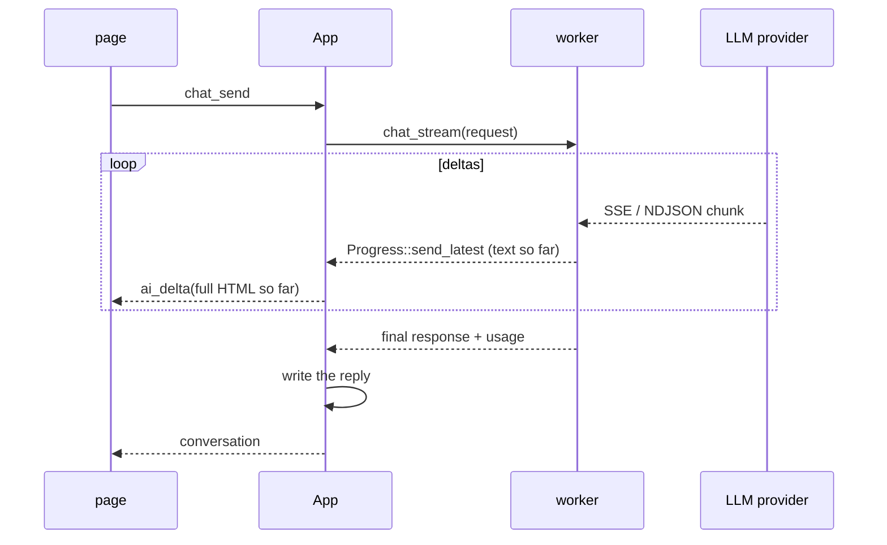

# Avelor — Assistant

> The AI assistant: conversations about the shown document or thread, also
> beside a card in the half-open panel, the context it sends, and how a
> reply streams. The model that answers is
> picked in the
> assistant's head (`accounts.md#model-choice`); the conversation format,
> `vault.md#conversation`; the commands, `api.md#chat`.

## Conversations 

The assistant lives in the Conversation tab of the panel's context column
(`features/assistant/assistant.js`, `panel.md#context-column`). Its chats are saved in
`Conversations/`, each linked to the document or thread the panel showed
when it started.

- A card's chat button opens the assistant beside the card
  (`toggleCardChat`): the card is selected, and the panel opens half-open
  (`panel_size: 'chat'`, `app.js`). As at full width, the panel opens
  over the main view (`.panel.is-chat`), which keeps its layout: the card
  keeps its width, and the context column comes beside it. The vault list
  stays uncovered; in a narrow window the card gives way. The Conversation
  tab is shown, with the input focused.
  The button looks pressed while the chat is open, and a second click
  goes back to the normal panel. At full width the panel stays as it is.
  Expand, collapse and × work as in the normal panel.
- The tab shows the last or newest conversation linked to the shown item
  (`assistantShow`), and follows the selection. The page finds the
  conversations itself, from the `entity` events (`linked_to`). An AI
  conversation entity selected in the table opens itself. A card's chat
  button carries a dot while chats are linked to the card
  (`renderCardChat`, `panel.md#cards`).
- Enter sends the input (`assistantSendInput`). The reply streams in and
  is written once it is complete; Stop ends it, and what it wrote so far
  is kept as the reply. A failed reply is shown with its error and never
  written.
- A click on one's own message edits it; Enter resends it as a new branch
  beside the old one (`assistantResend`), and Retry asks for a new reply.
  ‹ › switch between siblings, which writes the conversation's `active`
  leaf (`chat_select`).
- The switcher menu changes to another linked conversation or starts a new
  one (`assistantSwitch`).
- The head names the model that answers, picked there from the models the
  AI accounts offer (`aiModelPicker`), and kept in the vault's settings
  (`chat-model`, `set_vault_settings`). With no model picked, or one the
  host would refuse (its account gone or without its key, no longer
  offered), the head is marked and a setup guide
  replaces the input (`renderAssistantGuide`), with the menu of models or a
  button to Accounts. A refused message comes back in the host's words,
  nothing written, the draft back in the input.

## Context 

Every question in a chat is sent with the item it is linked to, as it is
now (`ai_context::describe` → `request_for`, `chat.rs`), in the system
prompt, fresh for every request:

- a document as its file: its frontmatter without ids and the source
  block, then its text;
- a thread as its members, oldest first.

Past about 40,000
characters the oldest messages' text is left out, and a document's text
is cut. A chat started with nothing selected sends only
what is typed; the hint of a new chat says which. The request also carries
the conversation's shown path.

The model is the one picked for chats, checked by the host
(`accounts.md#model-choice`). A local Ollama model takes only as much of
a request as its context length allows (often 4k tokens): older Ollama
versions kept the end of a longer one, newer ones refuse it (400,
`exceed_context_size_error`). For long documents, raise the context
length in Ollama's settings. The host sends no `num_ctx`, by choice, so
the server's default applies.

## Flows

| # | Flow | Trigger → page | Host → events | Result |
|---|---|---|---|---|
| L1 | Show for the current item | the shown item changes → `assistantShow` | `chat_open {id}` → `ok {conversation}` | last or newest linked conversation; an AI conversation entity opens itself |
| L2 | Send | Enter → `assistantSendInput` | `chat_send {conversation?, text, parent \| linked_to}` → the host checks the picked model and adds the linked item → user message written (`entity`) → `ok {id, conversation}` (writing) → `ai_delta` × n (coalesced) → `conversation` | reply written when complete; a refusal → `err` in the host's words, nothing written, draft back in the input |
| L3 | Stop | Stop | `chat_stop` → partial reply written, `conversation`, `ok` | — |
| L4 | Retry, edit and resend | click own message, edit, Enter → `assistantResend` | `chat_send {retry}` or `{text, parent}` | sibling branch |
| L5 | Switch sibling | ‹ › | `chat_select` → `active` written → `conversation`, `ok` | — |
| L6 | Switch / new conversation | switcher menu | `chat_open`, or a first `chat_send` | — |
| L7 | Pick the model, setup guide | the head's picker, or the guide's button → `aiShowModels` → a model → `assistantPickModel`; without a provider or key, the guide's button opens Accounts | `set_vault_settings {chat_model}` → `vault_settings`, `ok` | chats answered by the picked model |
| L8 | Chat from a card | card's chat button → `toggleCardChat` → `selectDocument`, `panel_size: 'chat'` (not at full width), `selectContextTab('conversation', true)` | then L1 | the chat beside the card, the input focused; pressed, the button goes back to the normal panel |

## Design 

An AI reply: `run_with_progress` streams from av-llm on a worker; what it has so far is
queued to the UI thread with `Progress::send_latest`, which replaces what
hasn't arrived yet, so there is at most one update per run of the UI queue
(`architecture.md#progress`).

- The reply's worker sends the whole reply so far, rendered from its
  markdown, as `ai_delta`; continuations re-check that the reply is still
  the one being written (`writing.id`), since an already queued `apply`
  still runs after a stop.
- The tree's rules — the path to `active`, the newest leaf below a
  message, adding a message, activating a branch — are av-vault's
  `conversation` (`path_to`, `leaf_from`, `add`, `activate`,
  `ConversationMessage::is_reply`); the page's helpers are
  `features/assistant/tree.js`.
- Opening another vault stops every reply first, writing what it has
  (`architecture.md#jobs`).
- `chat.rs` has dispatch tests against a fake Ollama
  (`testing::FakeOllama`, `development.md#checks`).
