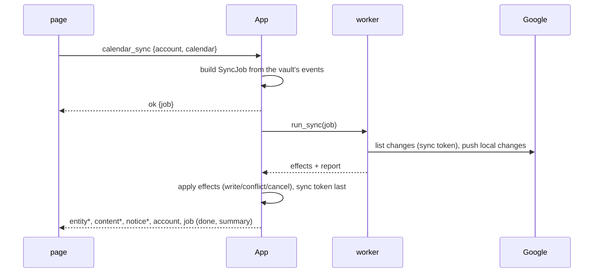

# Avelor — Calendar sync

> Google Calendar ⟷ vault: syncing a checked calendar, the rules of the
> two-way sync and how the sync is built. The account and its calendars are
> `accounts.md`; the event format, `vault.md#event` and `vault.md#remote`; the
> calendar lens, `ui.md#calendar`.

## Syncing a calendar 

Each calendar checked in the account pane is a source in the vault panel.
Its sync button syncs that calendar right away, as a job: the jobs panel
shows it and its summary (new, updated, pushed,
conflicts, skipped occurrences, failed), and its Stop ends it early — what
it already did is kept, the rest waits for the next sync. One calendar
syncs at a time: a sync asked for while another runs is refused, with a
message in the status bar.

The first sync creates the calendar entity in `Calendar/` and fetches the
events from a year back on; later syncs only fetch what changed since
(Google's sync token, `vault.md#remote`). Events are written to a folder
named after the calendar beside it, e.g. `Calendar/Personal/`.

## Two-way sync 

- With Calendar access Full, the sync is two-way: an event changed in the
  vault (title, body, time, location, status) is written back to Google,
  and an event made in the vault in a synced calendar is created there.
  With Read access it only fetches; changes made in the vault stay in the
  vault.
- An event changed on both sides since the last sync is a conflict: the
  vault's version is kept as a new event beside it, tagged `conflict`
  (without the series' exceptions), and Google's version takes the file.
  With Full access, the next sync creates the kept version in Google, so
  neither is lost.
- An event deleted in Google is kept with `status: cancelled` and no
  longer shown in the calendar.
- Guests come from Google only and are never written back.
- A series is one entity; the calendar shows its occurrences. A single
  occurrence moved, renamed, given another place or deleted in Google is
  kept on the series (`event.exceptions`) and shown that way; its card
  says where it was moved from. Its own description and guests aren't
  kept, and single occurrences changed in the vault aren't written back.
  Occurrences of a series that isn't in the vault count as skipped.
- The body is written to Google as HTML and read back as markdown. Bold,
  italic, struck-out text, links and lists (also numbered and nested)
  survive the way back; headings, code and tables come back as plain text.

## Flows

| # | Flow | Trigger → page | Host → events | Result |
|---|---|---|---|---|
| G1 | Sync a calendar | the source's sync button → `syncCalendar` (`features/sidebar.js`) | `calendar_sync {account, calendar}` → `ok {job}` (refused before any job; the first sync's start, a year back, is the host's) → plan on the UI thread, `run_sync` on a worker, effects applied on the UI thread → job events, `entity`, `content`, a `notice` per failed event, `account` | events in `Calendar/<name>/`, summary on the job card |

## Design 

- **Plan → run → apply** (`architecture.md#conventions`): `build_job`
  builds a `SyncJob` from the vault's events on the UI thread (the first
  sync's window from `first_sync_start`); the engine
  (`av-google/calendar_sync.rs`) runs on a worker and talks to Google
  only; its effects are applied on the UI thread through the vault edit,
  the sync token last. The engine's `plan` is pure and tested, and so is
  the mapping between Google's events and entities (`from_google`,
  `to_google`, `event_entity`, `exception_of`). The sync's state lives in
  `CalendarState`.
- **Remote versions are compared in one place**: the engine's two hooks,
  `SyncJob::normalize` (an event the way the vault would push it back) and
  `SyncJob::exception` (a series' instance), both given by `calendar.rs`,
  are the only code that compares Google's version with the vault's. The
  bookkeeping keys (`etag`, `snapshot`, `sync-token`, …) are `vault.md#remote`.
- **Exceptions**: Google's instances are kept on the series as
  `event.exceptions` (moved: start and end; cancelled; a title or place of
  their own), Google → vault only, outside change detection; through
  `SyncJob::exception` an instance that changes nothing kept is no work. A
  new series brings its instances (`CreateLocal`), a known one gets
  `SetExceptions`; those of a series not in the vault are skipped and
  counted. Attendees are likewise Google → vault only, outside change
  detection.
- **Descriptions**: Google → vault goes through
  `av_vault::html::to_markdown` (`body_of`), the mail converter, so the
  lists and emphasis come back as the editor writes them.
- **Resuming**: a sync stopped mid-way (Stop, a close) resumes without
  duplicates. A change pushed but not recorded is matched as equal and
  recorded (`push_one`); an insert is idempotent (`google_id_for`): `plan`
  takes a listed event whose id is `google_id_for` of an unsynced local
  event as that event's own earlier insert — recorded if equal, patched if
  it changed since, never written to the vault a second time.
