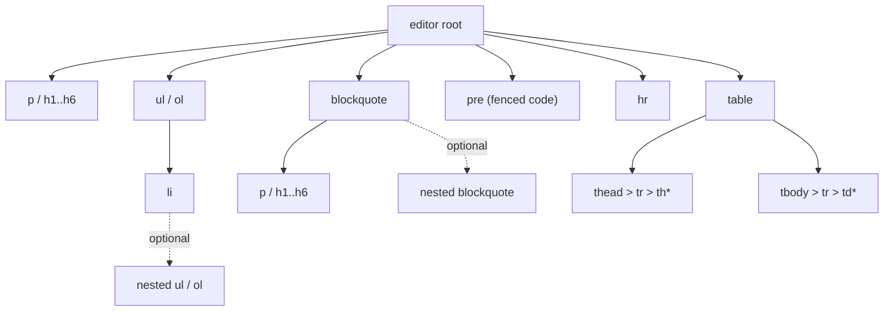
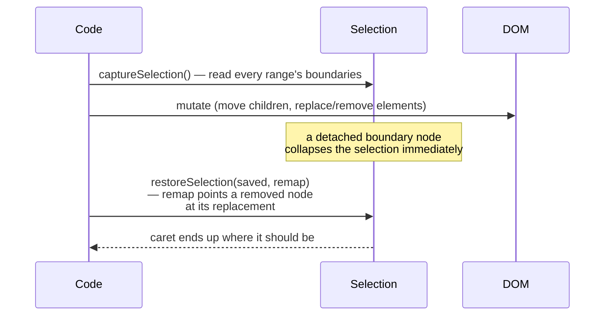
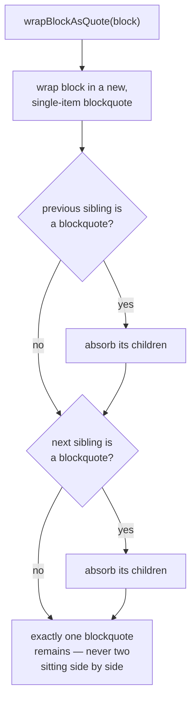

# Avelor — WYSIWYG editor

> `app/static/editor/editor.js`: what the editor is, why it is built this way, and
> what each key and toolbar button does. The conversion between markdown
> and the editor's DOM is `markdown.md`; when an edited document is saved,
> `saving.md`.

## Overview

`editor.js` is a small, self-contained `contenteditable`-based WYSIWYG
editor. It edits **HTML only** and knows nothing about vault documents,
markdown or the host: it produces and consumes HTML, and the save pipeline
(`model/documents.js`) hands its root element to `serializeMarkdown`
(`markdown.md#overview`). It is written to be reusable — one instance per
root element, an optional toolbar.

```js
createEditor(root, {
  toolbar,      // optional <element> whose data-cmd/data-block buttons drive commands
  onChange,     // called after every edit
  onEscape,     // called when Escape is pressed
  onLinkClick,  // called with an href when a link is clicked while read-only
})
```

| Method | Effect |
|---|---|
| `setHTML(html)` | Replaces all content. `html` must already be in the shape `editor.md#block-model` describes. |
| `getHTML()` | Returns the current content as HTML. |
| `setEditable(flag)` | Enters/leaves edit mode; manages the trailing paragraph (`editor.md#trailing`) and the toolbar's visibility. |
| `isEditable()` | Whether the editor is currently in edit mode. |
| `focus()` | Focuses the root element. |
| `destroy()` | Removes all event listeners this instance registered. |

## Guiding principles <a id="principles"></a>

These are the rules nearly every mechanism below exists to uphold:

1. **A block's HTML tag is authoritative.** A `<h2>` is a heading; a `<p>`
   is a paragraph; a `<pre>` is a fenced code block. Nothing about how a
   block is *styled* on screen should ever be true without the tag also
   saying so — because the tag is what the markdown serializer reads.
   Native `contenteditable` merge/split behavior doesn't know this and will
   happily produce a block whose tag and appearance disagree; the editor
   intercepts every operation that could cause that.
2. **The DOM stays in the shape `markdown.rs` produces and `markdown.js`
   consumes** (`markdown.md#dom-contract`). Loading a document and
   changing nothing must not save at all (`saving.md#dirty-state`).
3. **Every structural DOM change preserves the user's selection.** Chrome
   collapses the live `Selection` the instant one of its boundary nodes is
   detached — even momentarily. Any code that replaces or moves an element
   the caret is in or near must capture the selection first and restore it
   after (`editor.md#selection`).
4. **Never let native `contenteditable` decide structure across a tag
   boundary.** Bold/italic toggles are left to `execCommand` because they
   don't cross block boundaries; everything that could merge, split, or
   re-tag a block is done by hand.
5. **Keep the toolset small and orthogonal.** No multi-line quote toggling,
   no table cell merging or alignment editing, no rich link-editing UI —
   each addition is scoped to what a markdown document can actually
   represent, not to what a full word processor could do.

## Block model <a id="block-model"></a>

The editor recognizes a small set of tags and treats everything else as
either "not a block boundary" (inline) or "not editable structure"
(left alone, rendered, but not specially handled).



| Set | Members | Meaning |
|---|---|---|
| `ROOT_BLOCK_TAGS` | `P` `H1`–`H6` `UL` `OL` `BLOCKQUOTE` `PRE` `HR` `TABLE` | Allowed directly under the editor root. Must cover everything `markdown::to_html` can emit — anything else found at root level gets wrapped in a `<p>`. |
| `LEAF_BLOCK_TAGS` | `P` `H1`–`H6` `LI` `PRE` `TH` `TD` | Holds a line of text (and inline markup) directly — this is what "the current block" means when locating the caret, one level deeper than root for list items, quote paragraphs, and table cells. |
| `CONVERTIBLE_TAGS` | `P` `H1`–`H6` | What typed shortcuts and the toolbar may turn into something else (a heading, a list item, a quote, a code block). Lists, tables, rules, and existing quotes/code blocks are not retargeted this way. |
| `SELF_EXITING_TAGS` | `P` `H1`–`H6` `UL` `OL` | Blocks the user can leave with Enter on their own (`editor.md#trailing`). |
| `MERGEABLE_TAGS` | `P` `H1`–`H6` | The only blocks Backspace/Delete will merge into each other (`editor.md#merging`). |

A blockquote's own children are `P`/`H1`–`H6` leaves or nested
blockquotes. CommonMark allows both headings (`> ## text`) and deeper quote
levels (`> > text`), so `wrapBlockAsQuote` keeps the wrapped block's own
tag and Tab can add another quote level. A code block is the opposite:
`<pre>` is flat text and can't contain another block, headings included.

## Mechanisms <a id="mechanisms"></a>

The tables say what happens, given the document's state and what the user
does; edit mode is on unless noted.

### Selection survives every structural edit <a id="selection"></a>

Chrome collapses the live `Selection` the instant one of its boundary nodes
is detached from the document — even if a replacement takes its place in
the very same script. Any function that replaces, moves, or removes a
block or inline element the caret is in must work around this, or the
*next* action the user takes (another click, another toolbar press) finds
no usable selection and silently does nothing.

The shared shape, used throughout the file:



`transplant(block, leaf, root)` is the primitive built on this shape for
block conversions: it moves `block`'s children into `leaf`, swaps `root`
in for `block`, and restores the selection with `block` remapped to
`leaf`. `replaceBlockTag`, `wrapBlockAsListItem`, `wrapBlockAsCode`, and
`wrapBlockAsQuote` are thin wrappers over it. The same
capture-mutate-remap-restore shape recurs, tailored to each operation, in
`renameElement`, `convertListItemToParagraph`, `indentListItem` /
`outdentListItem`, `unwrapFromQuote`, `mergeBlockIntoPrevious`, and
`absorbBlockquote`.

DOM nodes are *moved*, never cloned, when content shifts between blocks. A
text node the caret was inside keeps its identity across the move, so in
the common case no remapping is even needed — `remap` only matters when a
range boundary was anchored on the block *element itself* (which happens
when the block was empty).

The toolbar has a related problem: a plain `click` handler lets the
browser move focus to the button first, which collapses the editor's
selection before the handler even runs, so it reacts to `mousedown`
instead (`editor.md#toolbar`).

### Keeping a caret placeable <a id="caret"></a>

Three Chrome behaviors, worked around near the bottom of the
selection-helper functions:

- **A container with only a zero-length text node refuses a caret.**
  `ensureCaretable(el)` strips any empty text-node children and appends a
  `<br>` if none are left — this is the shape every "empty block" in this
  editor has: a lone `<br>`, never true emptiness.
- **Typing right after a just-closed inline element leaks into it.**
  Finishing `**bold**` and continuing to type plain text lands that text
  *inside* the `<strong>` — regardless of exactly how the caret range is
  constructed afterward. `markJustClosed(el)` records the element and its
  text right after creating it, and `healLeakedTyping()` (called at the top
  of every `input` event) detects growth and moves the grown tail back out
  as a plain sibling. This only ever needs to fire once per closed span.
- **Chromium leaves bare text directly under the editor root** after the
  document is cleared (e.g. select-all-delete). `ensureBlockStructure()`
  wraps meaningful root-level content that isn't already one of
  `ROOT_BLOCK_TAGS` in a fresh paragraph, while discarding whitespace-only
  text nodes introduced by HTML formatting. It runs after essentially every
  edit.

### The trailing paragraph <a id="trailing"></a>

Paragraphs, headings, and lists let the user leave them with Enter on their
own — a list exits on an empty final item, paragraphs/headings just split.
Code blocks, blockquotes, tables, and rules don't: if the document's *last*
block were one of these, there would be nothing after it to click into.

`ensureTrailingParagraph()` appends an empty `<p><br></p>` whenever the
last element isn't in `SELF_EXITING_TAGS`; it runs on entering edit mode
and after every edit. `removeTrailingParagraph()` strips it back out on
leaving edit mode — but only if it's still empty and still sits right
after a non-self-exiting block. That condition is what makes a document
that was loaded and never touched come back out with exactly the DOM it
started with (principle 2).

`exitBlock(block)` — the shared "second Enter exits a quote/code block"
helper — checks for this paragraph and reuses it instead of inserting a
second one right next to it.

| State | Input | Result |
|---|---|---|
| Document's last block is a table, quote, code block, or rule | (always, while editing) | An empty paragraph is kept right after it, so there's always somewhere to type next. |
| That trailing paragraph is still empty and untouched | Edit mode turned off | It's removed — the DOM returns to exactly what was loaded. |

### Backspace and Delete merge blocks <a id="merging"></a>

Native `contenteditable` would merge two adjacent blocks on its own, but
with no notion of "which tag survives" — so the editor intercepts both
keys and merges via `mergeBlockIntoPrevious(block)`, which always merges
`block` into `block.previousElementSibling`, keeping the *previous*
block's tag. Delete calls the same primitive with the next block as its
argument, since "next merges into current" is "current is `prev`" from
that function's point of view.

- Only fires when **both** sides are `MERGEABLE_TAGS`. Merging a list,
  table, or rule's structure into a paragraph would produce invalid
  markdown, so those cases fall through to native/no-op behavior.
- A lone placeholder `<br>` (`editor.md#caret`) is stripped from
  **both** blocks before the merge — from the surviving block so it doesn't
  become a stray mid-paragraph line break, and from the discarded block so
  an empty paragraph disappearing via Backspace doesn't leave one behind.
- List-item Backspace is handled separately and first, by
  `convertListItemToParagraph` (`editor.md#lists`) — un-indenting takes priority
  over merging.

| State | Input | Result |
|---|---|---|
| Caret at the very start of a `P`/heading that has a previous sibling | Backspace | Merges into the previous block; **the previous block's tag wins**; caret lands exactly at the old join point. |
| Caret at the very end of a `P`/heading whose next sibling is a `P`/heading | Delete | The next block merges into the current one; the current block's tag wins. |

### Lists <a id="lists"></a>

- **Backspace at the very start of a list item** un-indents it to a plain
  paragraph first (`convertListItemToParagraph`), splitting the list around
  it if it was in the middle — the same two-step behavior as Notion,
  Google Docs, and Word.
- **Tab** (`indentListItem`) nests the current item as a child list under
  the previous sibling item. **Shift+Tab** (`outdentListItem`) moves it out
  one level, taking any items that followed it along as its own nested
  list; at the top level it becomes a plain paragraph instead.
- **Toolbar bullet/numbered buttons** (`toggleList`) convert the current
  block to a list, or — if already in a list of the other kind — switch
  the whole list between `ul` and `ol` in place.

| State | Input | Result |
|---|---|---|
| Caret in a paragraph, `- ` or `* ` typed | space | Converts to a bullet list item. |
| Caret in a paragraph, `1. ` (or any number followed by `. `) typed | space | Converts to a numbered list item; that number becomes the list's `start`. |
| Caret in a list item with a previous sibling item | Tab | Nests the item one level deeper, under the previous item. |
| Caret in a nested list item | Shift+Tab | Un-nests one level; a top-level item becomes a plain paragraph instead. |
| Caret at the start of an `LI` | Backspace | Un-indents to a plain paragraph (splitting the list if the item was in the middle) — it does **not** merge into the previous item's text. |

### Blockquotes <a id="blockquotes"></a>

**Wrapping.** `wrapBlockAsQuote(block)` always wraps `block` in its own
fresh single-item blockquote first, then absorbs a blockquote sibling on
*either* side of it — one, the other, or both:



Two directly-adjacent `<blockquote>` elements would be ambiguous on a
markdown round-trip (commonly reparsed back as a single quote).
`absorbBlockquote(quote, sibling, atStart)` is the primitive: it moves
`sibling`'s children into `quote` and removes `sibling`, capturing its
insertion point once before the move loop so children land in their
original order.

**Nesting.** Tab wraps the quoted leaf holding the caret in another
blockquote; adjacent nested blockquotes are absorbed into that wrapper.
Shift+Tab uses the same split-aware unwrapping as the toolbar.

**Unwrapping.** `unwrapFromQuote(block)` (the toolbar's quote toggle, on an
already-quoted block) pulls `block` back out, splitting the blockquote
around it — content before `block` stays in the original quote, content
after moves into a fresh one, with the un-quoted block sitting between.

**Exiting on Enter.** A second Enter on an empty line inside a quote exits
it, splitting the quote exactly at that line, since a quote can hold
several paragraphs. When the empty line is the last one, the exit reuses
the trailing paragraph if one is already adjacent; in the middle, the
paragraph between the halves is always a fresh one, never reused from
elsewhere in the document.

| State | Input | Result |
|---|---|---|
| Caret in a paragraph, `> ` typed | space | Wraps the paragraph in a new blockquote. |
| That paragraph's previous *or* next sibling is already a blockquote | (same as above) | Joins the existing blockquote instead of creating a second, adjacent one. |
| A paragraph sits directly between two existing blockquotes | Quote toolbar button / shortcut | All three merge into one blockquote. |
| Caret in a quoted paragraph or heading | Tab | Nests that block one quote level deeper, joining adjacent nested quotes. |
| Caret in a nested quoted block | Shift+Tab | Moves that block outward by one quote level, splitting around it when needed. |
| Caret in a top-level quoted block | Shift+Tab | Removes the quote from that block, splitting the surrounding quote when needed. |
| Caret on an empty line that is the *last* line of a quote | Enter (on that already-empty line) | Exits the quote below it. |
| Caret on an empty line in the *middle* of a multi-paragraph quote | Enter (on that empty line) | The quote splits there: everything before stays quoted, everything after becomes a new quote, with an empty paragraph in between holding the caret. |
| A quote contains only that one empty line | Enter | The whole quote is replaced by a plain paragraph. |

### Code blocks <a id="code-blocks"></a>

- A fenced code block is a bare `<pre>`, never `<pre><code>`. The nested
  form was tried first and dropped: Chrome's native split/merge logic only
  reasons about the nearest block-level ancestor, so backspacing a
  following line into the end of a `<pre><code>` dumped the merged text as
  a stray sibling outside `<code>` entirely. Styling still reads as code
  (`.editor pre, .editor code` share a font in `css/areas/editor.css`); `<code>` is
  exclusively the inline-code-span element.
- Inline code spans don't need a whitespace boundary in CommonMark
  (`` a`b`c `` is valid), so there's no "preceded by whitespace" check the
  way bold/italic have.
- The exit on a second Enter (`tryExitBlockOnEnter`, shared with the quote
  exit) strips the placeholder `<br>`s first so they don't linger as blank
  lines.

| State | Input | Result |
|---|---|---|
| Caret in a paragraph, ` ``` ` typed | 3rd backtick | Converts the block to a fenced code block (a bare `<pre>`). |
| Caret at the end of a code block's last (empty) line | Enter | Exits the code block, into a paragraph below it. |
| Caret anywhere in a code block | Tab | Inserts a literal tab character — never changes focus. |
| Text with backticks around it, e.g. `` `word` `` | typing the closing backtick | Becomes an inline code span (works even with no space before/after, unlike bold/italic). |

### Tables <a id="tables"></a>

`table > thead > tr > th*` plus `tbody > tr > td*` — exactly one header
row, matching what a markdown table can represent. Cells hold inline
content only.

- **Insert table** (toolbar only) is always followed by a paragraph — the
  same "no native exit" reasoning as `editor.md#trailing`, via
  `blockAfter`, which is also what a table needs mid-document.
- **Add/delete row, add/delete column, delete table** are toolbar-only,
  and only shown while the caret is inside a table (`data-table-only`) —
  the "Insert table" button hides at the same time, so there's never a
  choice between the two that doesn't apply.
- **The header row can't be deleted** — a markdown table always has
  exactly one, so there's no "add a header row" operation either. New rows
  always go into the body.
- **Enter never puts a line break into a cell**: markdown table cells are
  single-line, and this is the same class of `contenteditable`
  block-boundary hazard as the code-block nesting issue above.

No alignment editing, no cell merging, no multi-line cells — deliberately
out of scope (principle 5).

| State | Input | Result |
|---|---|---|
| Caret in a cell | Tab | Moves to the next cell, selecting its content so typing replaces it; from the last cell a new row is appended first. Shift+Tab moves to the previous cell. |
| Caret in any cell | Enter | Moves to the cell directly below; from the last row, leaves the table into the block after it. |
| Caret in a cell, "+ Row"/"− Row"/"+ Col"/"− Col" clicked | click | Adds/removes as expected; the header row can't be deleted; deleting the last column deletes the whole table. |
| Caret anywhere editable, "Insert Table" clicked | click | Inserts a 2-column, header + 2-row table at the caret, followed by a paragraph. |

### Typed markdown shortcuts <a id="shortcuts"></a>

Everything below triggers the instant the closing character of its
markdown syntax is typed, mirroring the autoformat conventions of Notion,
Google Docs, and GitHub's markdown editors.

| Typed | Becomes | Trigger |
|---|---|---|
| `# ` … `###### ` | H1–H6 | space |
| `- ` / `* ` | bullet list item | space |
| `1. ` (any number) | numbered list item, using that number as `start` | space |
| `> ` | blockquote | space |
| ` ``` ` | fenced code block | 3rd backtick |
| `` `text` `` | inline code | closing backtick |
| `**text**` / `__text__` | bold (`<strong>`) | closing marker |
| `*text*` / `_text_` | italic (`<em>`) | closing marker |
| `***text***` / `___text___` | bold+italic (`<strong><em>`) | closing marker |
| `~~text~~` | strikethrough (`<del>`) | closing marker |
| `[text](url)` | link | closing `)` |
| `` | image | closing `)` |
| `---` / `***` / `___` alone on a line | horizontal rule | last character |

- Typing `**word**` while already inside a `<strong>` (from a toolbar
  click, or an outer `***…***`) only adds the wrapper that's still
  missing, rather than nesting a redundant second one — checked
  per-wrapper (`STRONG`/`EM`/`DEL` each independently).
- The combined form only recognizes the two flush triple-marker spellings
  (`***text***`, `___text___`); the mixed forms (`**_text_**`,
  `__*text*__`) aren't produced by the editor. All four resolve to the
  same nesting order in CommonMark (`<strong>` outermost, `<em>`
  innermost) — detecting the mixed forms would mean matching a delimiter
  run across an already-existing inline element rather than within one
  text node, a different problem the toolbar/Ctrl+B+Ctrl+I path doesn't
  need, since `execCommand` already nests correctly once `<b>`/`<i>` are
  normalized to `<strong>`/`<em>` (`editor.md#toolbar`).
- None of the inline shortcuts fire inside a code block or an existing
  code span — backticks, asterisks, and underscores are literal there.
- A typed trailing or leading space leaves a U+00A0 behind, which the
  serializer writes as a plain space (`markdown.md#serializing`).
- URLs from `[text](url)` / `` are subject to the same
  scheme allowlist as toolbar-created links (`editor.md#links`).

| State | Input | Result |
|---|---|---|
| Caret in an empty paragraph, `#` through `######` then a space typed | space | Converts to the matching heading level. |
| `***word***` / `___word___` typed | closing marker | Wraps as `<strong><em>word</em></strong>`. |
| Already inside a `<strong>`, `**word**` typed again | closing marker | Only `<em>` is added — no nested `<strong>`. |
| `[text](url)` / `` typed, with a safe URL | closing `)` | Becomes a link / an image. |

### Toolbar and commands <a id="toolbar"></a>

`runCommand(cmd)` is the single entry point both the toolbar and keyboard
shortcuts call through — `bold`, `italic`, `strike`, `code`, `ul`, `ol`,
`quote`, `codeblock`, `hr`, `link`, `image`, `table`, plus the table-only
commands `row-add`, `row-del`, `col-add`, `col-del`, `table-del`. Toolbar
buttons are looked up by `data-cmd`/`data-block` attributes, so the caller
supplies its own markup and the editor doesn't hardcode a layout.

- **Bold/italic/strikethrough** go through `execCommand`, since they never
  cross a block boundary — the one native behavior still trusted.
  `execCommand` produces `<b>`/`<i>`/`<strike>`, though, so
  `normalizeInlineTags()` renames them to `<strong>`/`<em>`/`<del>` after
  every edit, keeping output identical regardless of which input path
  produced it.
- **Everything else** (lists, quote, code block, rule, link, image, table,
  heading level) is manual DOM surgery, reusing the exact same primitives
  the typed shortcuts use — there is no second implementation of "make
  this a bullet list" for the toolbar button versus the typed `"- "`.
- **The toolbar reacts to `mousedown`, not `click`**, with the default
  prevented: a `click` handler runs after the browser has already moved
  focus (and the selection) to the button. `updateToolbarState()` reflects
  which button is "active" from the element structure (is the caret inside
  a `<strong>`? inside a `<blockquote>`?), not from computed style, so a
  bold heading doesn't make the Bold button light up.
- **Keyboard bindings**: Ctrl+B/I bold/italic, Ctrl+E inline code, Ctrl+K
  link, Ctrl+Shift+X strikethrough, Ctrl+Shift+7/8/9 numbered list/bullet
  list/quote. Deliberately no Ctrl+Alt combination anywhere: on many
  keyboard layouts AltGr reports as Ctrl+Alt and is how those layouts type
  ordinary characters (e.g. AltGr+7 types `{` on a German layout).

| State | Input | Result |
|---|---|---|
| Caret in an `H1` | click H2 toolbar button | Becomes `H2`. |
| Caret in an `H2`, H2 toolbar button clicked again | click | Toggles back to a plain paragraph. |
| Bold toggled via toolbar/Ctrl+B | click / Ctrl+B | Produces `<strong>`, never raw `<b>` (renamed immediately). |

### Paste and drop sanitization <a id="paste"></a>

Pasted or dropped HTML is rebuilt from scratch through an allowlist —
never trusted as-is, since it can come from anywhere and could otherwise
carry scripts, styles, or arbitrary markup outside the editor's model.

- `ALLOWED_PASTE_TAGS` maps each supported tag to the small set of
  attributes worth keeping (`href`/`title` on links, `src`/`alt`/`title` on
  images, `start` on ordered lists, `align` on table cells) — everything
  else is dropped, unconditionally. It is the vocabulary of
  `markdown.md#dom-contract`.
- `RENAMED_PASTE_TAGS` folds `<b>`/`<i>`/`<s>`/`<strike>` to
  `<strong>`/`<em>`/`<del>` on the way in, as `normalizeInlineTags` does
  for `execCommand` output.
- `DISCARDED_PASTE_TAGS` (`script`, `style`, `iframe`, `object`, `embed`,
  `svg`, `video`, `audio`, …) are removed entirely, along with their
  content.
- A pasted `<pre><code>` is flattened to a bare `<pre>`
  (`editor.md#code-blocks`).
- A link or image whose URL fails `isSafeUrl` is dropped — a link becomes
  plain text (its content is kept), an image is discarded outright.
- Plain-text clipboard content (no HTML) is inserted as plain text, never
  interpreted as markup.

### Links, images and URL safety <a id="links"></a>

- Typed `[text](url)` / ``, or the toolbar Link/Image buttons
  (which prompt for a URL), both funnel through `isSafeUrl` — only a
  relative URL, an explicit `http`/`https`/`mailto`/`tel` scheme or a link
  into the vault (`id:<uuid>`, `vault.md#links-in-content`) is accepted;
  anything else (`javascript:` above all) is rejected, in typed shortcuts,
  the toolbar, and paste/drop alike.
- **Clicking a link never navigates the page** — not in edit mode (where
  it would only get in the way of positioning the caret) and not in
  read-only mode (where the WebView2 host, like WebKitGTK on Linux, has no
  back button, so navigating away would leave the app). In read-only mode the `href` is
  handed to the optional `onLinkClick` callback. The app passes `openLink`
  (`features/selection.js`) for the cards and the project description: a web, mail or phone link opens in its default app through the
  host (`open_url`); an `id:` link selects its entity, thread or project
  (`selectById`), and an id not in the vault is reported in the status
  bar.
- Clicking an existing link while editing (rather than typing over it)
  removes the link wrapper, keeping its text — there is no separate
  "edit the URL" affordance.

| State | Input | Result |
|---|---|---|
| Read-only/preview mode, a rendered link | click | Handed to `onLinkClick`; the page never navigates. |
| Edit mode, an existing link | click | Just places the caret — the link is not followed. |
| Clipboard holds rich HTML | Ctrl+V | Sanitized down to the supported tags/attributes; scripts, styles, and embeds are dropped; unsafe URLs (`javascript:`, etc.) are stripped. |

### Keeping focus inside the editor

- **Tab never leaves the editor.** It nests/unnests a list item or quoted
  block, moves between table cells, inserts a literal tab in a code block,
  or is swallowed everywhere else — never the browser's default "move to
  the next focusable element."
- **Escape leaves edit mode** by calling the optional `onEscape` callback.
  The editor has no concept of "edit mode" beyond the `contenteditable`
  attribute itself; what leaving it means (the card's Edit button toggled
  off) is up to the caller.
