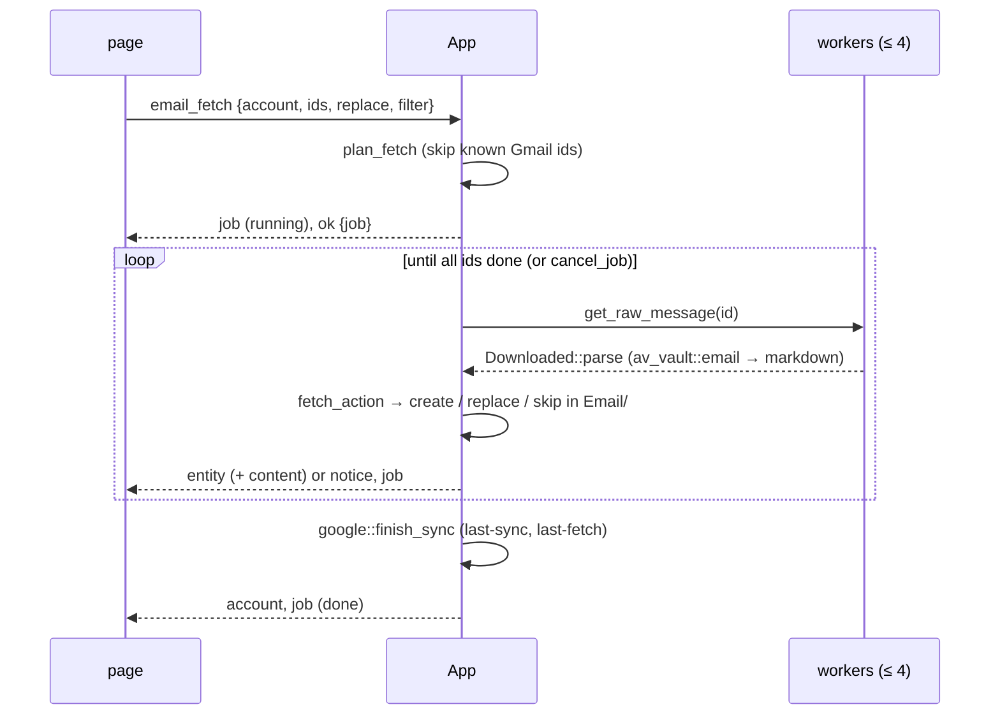

# Avelor — Email

> Email from a Google account into the vault: Fetch email. The
> account and its `fetch-email:` keys are `accounts.md`; the commands,
> `api.md#email`.

## Fetch email 

The Email source's sync button opens Fetch email (`features/import/email.js`) in
the expanded vault area, filled with the account's last filter
(`accounts.md#google-file`).

- **The filter**: labels (any or all of them), starred, with attachment,
  unread, important, sent by the account, from and to (addresses or
  domains, any of which may match), words, and a date preset ("Since last
  time", a day, a week, a month) or a range. It compiles to a Gmail query
  (`av_google::gmail::EmailFilter`).
- **The preview** lists the matches — headers only, 50 per page, at most
  2000 matches — and marks those already in the vault, by their Gmail id
  or Message-ID. It updates as the filter is edited (Auto-update, 500 ms
  after the last change) or on request (Manual).
- **Fetch** (or Ctrl+Enter) downloads the selected emails (select new, all
  or none), converts each body to markdown — plain text: the HTML reduced
  to text, quoted replies as quotes, links kept, attached files named at
  the end — and writes it as an email entity to `Email/` in the vault. A
  selected email that is already in the vault gets its body replaced,
  keeping its frontmatter; the page asks for a second click before doing
  that. The fetch is a job (`ui.md#jobs-panel`); the page closes, and
  Fetch email reads its matches again when the job ends. Esc closes the
  page.

## Flows

| # | Flow | Trigger → page | Host → events | Result |
|---|---|---|---|---|
| G3 | Fetch email | Email source sync button → `openEmailFetch` (`features/import/email.js`) in the expanded vault area → `email_labels`; filter edits (500 ms debounce) → `email_search` (Auto-update; Manual: on Update); paging → `email_headers`; Fetch or Ctrl+Enter → `email_fetch` | answers `{labels}`, `{matches, truncated, headers}`, `{headers}`; then `email_fetch` → `ok {job}` (page closes), job events, `entity` / `content` per email, `account`; the job's end reads the matches again | emails in `Email/`; filter remembered |

## Design 

The fetch is plan → run → apply (`architecture.md#conventions`):

- **plan** on the UI thread: `plan_fetch` skips the Gmail ids the vault
  knows;
- **run** on up to 4 workers: the raw message, parsed by
  `Downloaded::parse` — av-vault's MIME parser (`email.rs`) and its HTML →
  markdown converter (`av_vault::html::to_markdown`);
- **apply** on the UI thread: `fetch_action` decides create, replace or
  skip, and `email_entity` maps the email to an entity (pure, tested); the
  write goes through the vault edit.

`KnownEmails` (`email.rs`) tells which emails are in the vault: by `gmail-id`
from the same account, or by Message-ID from any source. The preview's
header pages are fetched 8 in parallel (av-google's `gmail::get_headers`, scoped
threads). The fetch's state lives in `EmailState`; a newer search
supersedes a running one on the page's `email-preview` channel. A
404 from Gmail is read by matching `Error::Http { status, .. }` in
`email.rs`.
