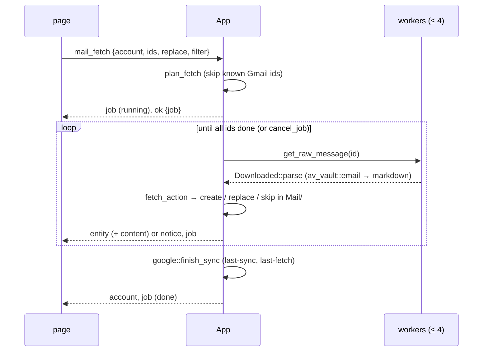

# Avelor — Mail

> Mail from a Google account into the vault: Fetch mail, the auto-sync,
> the new-mail notices and the mail analysis. The
> account and its `mail:` keys are `accounts.md`; the commands,
> `api.md#mail`.

## Fetch mail 

The Mail source's sync button opens Fetch mail (`features/import/mail.js`) in
the expanded vault area, filled with the account's last filter
(`accounts.md#google-file`).

- **The filter**: labels (any or all of them), starred, with attachment,
  unread, important, sent by the account, from and to (addresses or
  domains, any of which may match), words, and a date preset ("Since last
  time", a day, a week, a month) or a range. It compiles to a Gmail query
  (`av_google::gmail::MailFilter`).
- **The preview** lists the matches — headers only, 50 per page, at most
  2000 matches — and marks those already in the vault, by their Gmail id
  or Message-ID. It updates as the filter is edited (Auto-update, 500 ms
  after the last change) or on request (Manual).
- **Fetch** (or Ctrl+Enter) downloads the selected mails (select new, all
  or none), converts each body to markdown — plain text: the HTML reduced
  to text, quoted replies as quotes, links kept, attached files named at
  the end — and writes it as an email entity to `Mail/` in the vault. A
  selected mail that is already in the vault gets its body replaced,
  keeping its frontmatter; the page asks for a second click before doing
  that. The fetch is a job (`ui.md#jobs-panel`); the page closes, and
  Fetch mail reads its matches again when the job ends. Esc closes the
  page.
- **Analysis** (section 2): Off or Lite, with the model it runs
  with; the new mails are analysed after the fetch (`mail.md#analysis`).

## Mail auto-sync 

The Mail row of a connected account's access (Workspace → Accounts) has an
Auto-sync check. Ticked, the account fetches new mail on its own: the mail
that matches the filter set up underneath (Fetch mail's filter form,
`renderMailFilterForm`, without the date) and arrived since auto-sync was
switched on, then since its last complete run.

- It runs once the vault is open and scanned, then every 15 minutes while
  the app runs, one account at a time and never beside a fetch of the page
  (`architecture.md#the-clock`).
- A run that finds nothing new leaves no trace; one that does is a
  "Syncing mail · <email>" job, and the account's `last-sync` moves on.
- Mails already in the vault are skipped, never replaced.
- A failed run is shown once in the status bar, not again until a run
  succeeds.
- The Mail source's sync button stays shown, pressed, while auto-sync is
  on; it still opens Fetch mail.

## New-mail notices

After a fetch or an auto-sync run wrote new mail, the status bar says so
(`mail::new_mail_notice` → `App::inform`, an `info` notice;
`ui.md#status-bar`).

## Mail analysis 

A filter can have its new mail analysed: Fetch mail's (section 2,
Analysis, remembered with the filter as `mail.analysis`;
`accounts.md#google-file`). It is off by default. A filter's analysis has
a level, Off or Lite, and the model it runs with, picked as every feature
picks its model (`accounts.md#model-choice`).

- **Explicit picks**: with the analysis on, Fetch waits for a pick that
  works; the page says why, and the host refuses `mail_fetch` too, before
  anything is fetched.
- **The job**: when a fetch ends (not when it was stopped), the mails it
  created go to "Analysing mail · <email>", one mail after another; Stop
  ends it, and so does a vault switch. The spend limit is checked before
  each mail; once it is reached, the rest is left and a notice says so.
  The note: "18 analysed · 1 failed".
- **Lite**: one request per mail (`enrich::request_for`). It lists the
  labels in use (the 100 used most) and the active projects (the first
  50), then the mail: its subject as it came (`email.subject` once the
  title differs), sender, recipients, date, and the body cut at 8,000
  characters. It asks for one JSON object `{kind, title, labels,
  projects}`: what the mail is — a request (it asks its recipient to do,
  answer, pay or decide something), a reply (to a mail of the
  recipient's), a notification (sent automatically: receipts, shipping,
  alerts, reminders), a newsletter (news, offers or marketing sent to
  many), or other; a clean title in the mail's language (no "Re:", "Fwd:",
  reference numbers or tags, at most 80 characters); up to three labels
  and two projects from the lists, none if unsure. The model's reasoning
  is turned off (`think: false`; sorting a mail needs none), and Ollama
  runs it with a context of 16,384 tokens (`ai::CONTEXT_TOKENS`): its default of 4,096 left a long mail no room for
  the answer, the reasoning filling the rest.
- **The answer** is read by a pure parser (`enrich::parse`): the JSON
  object in it (code fences and text around it ignored); the title trimmed
  and cut at 120 characters, no change if it is empty or the mail's own;
  the kind one of the five in any case, anything else left out; labels and
  projects matched to the lists in any case and kept in the vault's
  spelling, unknown ones and repeats dropped. An answer without
  such an object is asked again, the answer sent back with a reminder of
  the object asked for (an empty one just again), three times in all;
  then the mail counts as failed ("… (asked 3 times)"). An answer that was
  cut off (`StopReason::MaxTokens`) isn't asked again, as it would be cut
  off the same way: "The model ran out of room before it finished its
  answer". Every answer is in the log whole, with the model's reasoning
  (`ChatResponse::thinking`): at debug level, or at info when it couldn't
  be read.
- **Written at once**, one write per mail (`enrich::apply_lite`): the new
  title, the subject kept as `email.subject` and the kind as `email.kind`
  (`vault.md#email`; the card shows it after the sender,
  `panel.md#cards`); the labels added to the mail's own, the projects
  joined. A title the user changed meanwhile stays. A wrong label or
  project is removed on the card like any other.
- **Failures** (the provider's error, an unreadable answer, a failed
  write of the mail) are counted in the job's note and
  told in one notice at its end:
  "Mail analysis · jan@gmail.com: 2 of 20 mails couldn't be analysed;
  “<title>”: <the first error>".
- The Accounts page's "Used by" names "Fetch mail · <email>" while its
  analysis is on.

## Flows

| # | Flow | Trigger → page | Host → events | Result |
|---|---|---|---|---|
| G3 | Fetch mail | Mail source sync button → `openMailFetch` (`features/import/mail.js`) in the expanded vault area → `mail_labels`; filter edits (500 ms debounce) → `mail_search` (Auto-update; Manual: on Update); paging → `mail_headers`; the analysis's level and model; Fetch or Ctrl+Enter → `mail_fetch` | answers `{labels}`, `{matches, truncated, headers}`, `{headers}`; then `mail_fetch` → `ok {job}` (page closes), job events, `entity` / `content` per mail, `account`; the job's end reads the matches again | mails in `Mail/`; filter remembered |
| G4 | Auto-sync mail | Mail row of the account pane → Auto-sync check, filter form (500 ms debounce) | `set_mail_sync {account, enabled?, filter?}` → `account`; later, on the clock: a quiet `list_message_ids` → for new mail a "Syncing mail" job, `entity` per mail, `account` | mails in `Mail/` on their own |
| G5 | Analyse new mail | a fetch with its analysis on ends with new mails | `enrich::analyse` → `AiAccounts::choose` (refused: a `notice`) → job "Analysing mail"; per mail `check_limit`, `chat_stream` on a worker, `parse`, `apply_lite` through the vault edit → `entity`, `job`, `account`; at the end one `notice` for the failures | mails retitled, labelled, in projects, their kind kept; `email.subject` kept |

## Design 

The fetch is plan → run → apply (`architecture.md#conventions`):

- **plan** on the UI thread: `plan_fetch` skips the Gmail ids the vault
  knows;
- **run** on up to 4 workers: the raw message, parsed by
  `Downloaded::parse` — av-vault's MIME parser (`email.rs`) and its HTML →
  markdown converter (`av_vault::html::to_markdown`);
- **apply** on the UI thread: `fetch_action` decides create, replace or
  skip, and `email_entity` maps the mail to an entity (pure, tested); the
  write goes through the vault edit.

The analysis (`enrich.rs`) is plan → run → apply as well: the plan picks
the model and gathers the vault's context and each mail's text on the UI
thread; the run is one request at a time under the job's `Cancel`
(streamed like the assistant's, the pieces unused); the apply reads the
answer and writes it through the vault edit. Each analysis is its own
job in `EnrichState`.

`KnownMails` (`mail.rs`) tells which mails are in the vault: by `gmail-id`
from the same account, or by Message-ID from any source. The preview's
header pages are fetched 8 in parallel (`mail::fetch_headers`, scoped
threads). The fetch's state lives in `MailState`; a newer search
supersedes a running one on the page's `mail-preview` channel. The
auto-sync (`auto_sync`, `sync_query`) runs from the clock with the
schedule it shares with the calendar (`SYNC_EVERY`, `first_due` in
`google.rs`): a quiet search first, and a fetch job only for new mail. A
404 from Gmail is read by matching `Error::Http { status, .. }` in
`mail.rs`.
