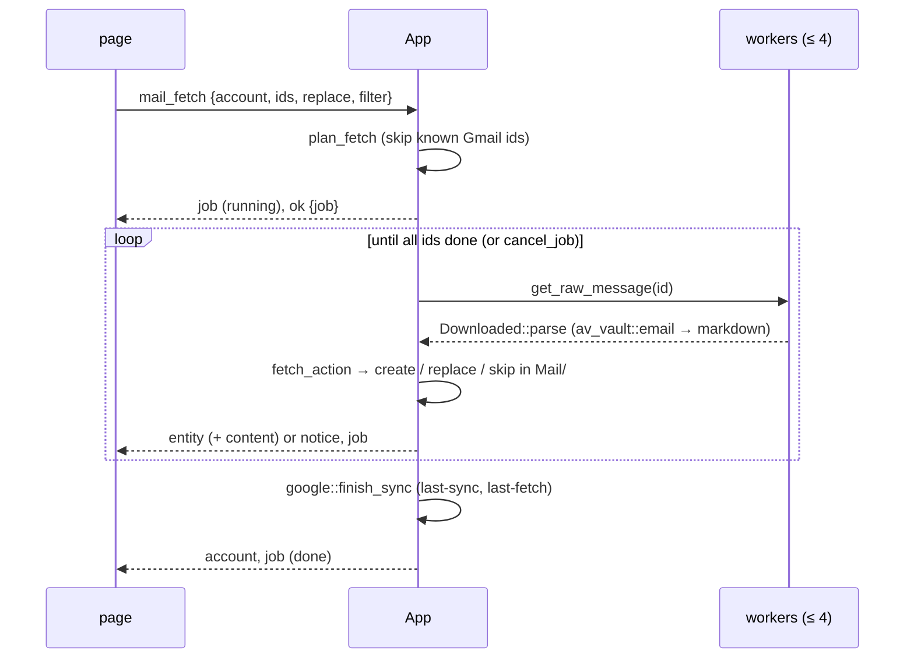

# Avelor — Mail

> Mail from a Google account into the vault: Fetch mail, the auto-sync and
> the new-mail notices. The
> account and its `mail:` keys are `accounts.md`; the commands,
> `api.md#mail`.

## Fetch mail 

The Mail source's sync button opens Fetch mail (`features/import/mail.js`) in
the expanded vault area, filled with the account's last filter
(`accounts.md#google-file`).

- **The filter**: labels (any or all of them), starred, with attachment,
  unread, important, sent by the account, from and to (addresses or
  domains, any of which may match), words, and a date preset ("Since last
  time", a day, a week, a month) or a range. It compiles to a Gmail query
  (`av_google::gmail::MailFilter`).
- **The preview** lists the matches — headers only, 50 per page, at most
  2000 matches — and marks those already in the vault, by their Gmail id
  or Message-ID. It updates as the filter is edited (Auto-update, 500 ms
  after the last change) or on request (Manual).
- **Fetch** (or Ctrl+Enter) downloads the selected mails (select new, all
  or none), converts each body to markdown — plain text: the HTML reduced
  to text, quoted replies as quotes, links kept, attached files named at
  the end — and writes it as an email entity to `Mail/` in the vault. A
  selected mail that is already in the vault gets its body replaced,
  keeping its frontmatter; the page asks for a second click before doing
  that. The fetch is a job (`ui.md#jobs-panel`); the page closes, and
  Fetch mail reads its matches again when the job ends. Esc closes the
  page.

## Mail auto-sync 

The Mail row of a connected account's access (Workspace → Accounts) has an
Auto-sync check. Ticked, the account fetches new mail on its own: the mail
that matches the filter set up underneath (Fetch mail's filter form,
`renderMailFilterForm`, without the date) and arrived since auto-sync was
switched on, then since its last complete run.

- It runs once the vault is open and scanned, then every 15 minutes while
  the app runs, one account at a time and never beside a fetch of the page
  (`architecture.md#the-clock`).
- A run that finds nothing new leaves no trace; one that does is a
  "Syncing mail · <email>" job, and the account's `last-sync` moves on.
- Mails already in the vault are skipped, never replaced.
- A failed run is shown once in the status bar, not again until a run
  succeeds.
- The Mail source's sync button stays shown, pressed, while auto-sync is
  on; it still opens Fetch mail.

## New-mail notices

After a fetch or an auto-sync run wrote new mail, the status bar says so
(`mail::new_mail_notice` → `App::inform`, an `info` notice;
`ui.md#status-bar`).

## Flows

| # | Flow | Trigger → page | Host → events | Result |
|---|---|---|---|---|
| G3 | Fetch mail | Mail source sync button → `openMailFetch` (`features/import/mail.js`) in the expanded vault area → `mail_labels`; filter edits (500 ms debounce) → `mail_search` (Auto-update; Manual: on Update); paging → `mail_headers`; Fetch or Ctrl+Enter → `mail_fetch` | answers `{labels}`, `{matches, truncated, headers}`, `{headers}`; then `mail_fetch` → `ok {job}` (page closes), job events, `entity` / `content` per mail, `account`; the job's end reads the matches again | mails in `Mail/`; filter remembered |
| G4 | Auto-sync mail | Mail row of the account pane → Auto-sync check, filter form (500 ms debounce) | `set_mail_sync {account, enabled?, filter?}` → `account`; later, on the clock: a quiet `list_message_ids` → for new mail a "Syncing mail" job, `entity` per mail, `account` | mails in `Mail/` on their own |

## Design 

The fetch is plan → run → apply (`architecture.md#conventions`):

- **plan** on the UI thread: `plan_fetch` skips the Gmail ids the vault
  knows;
- **run** on up to 4 workers: the raw message, parsed by
  `Downloaded::parse` — av-vault's MIME parser (`email.rs`) and its HTML →
  markdown converter (`av_vault::html::to_markdown`);
- **apply** on the UI thread: `fetch_action` decides create, replace or
  skip, and `email_entity` maps the mail to an entity (pure, tested); the
  write goes through the vault edit.

`KnownMails` (`mail.rs`) tells which mails are in the vault: by `gmail-id`
from the same account, or by Message-ID from any source. The preview's
header pages are fetched 8 in parallel (`mail::fetch_headers`, scoped
threads). The fetch's state lives in `MailState`; a newer search
supersedes a running one on the page's `mail-preview` channel. The
auto-sync (`auto_sync`, `sync_query`) runs from the clock with the
schedule it shares with the calendar (`SYNC_EVERY`, `first_due` in
`google.rs`): a quiet search first, and a fetch job only for new mail. A
404 from Gmail is read by matching `Error::Http { status, .. }` in
`mail.rs`.
