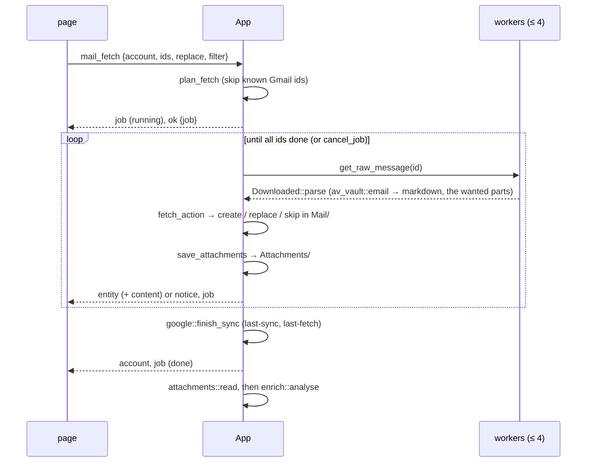

# Avelor — Mail

> Mail from a Google account into the vault: Fetch mail, the auto-sync,
> the attachments, the new-mail notices and the mail analysis. The
> account and its `mail:` keys are `accounts.md`; the commands,
> `api.md#mail`.

## Fetch mail 

The Mail source's sync button opens Fetch mail (`features/import/mail.js`) in
the expanded vault area, filled with the account's last filter
(`accounts.md#google-file`).

- **The filter**: labels (any or all of them), starred, with attachment,
  unread, important, sent by the account, from and to (addresses or
  domains, any of which may match), words, and a date preset ("Since last
  time", a day, a week, a month) or a range. It compiles to a Gmail query
  (`av_google::gmail::MailFilter`).
- **The preview** lists the matches — headers only, 50 per page, at most
  2000 matches — and marks those already in the vault, by their Gmail id
  or Message-ID. It updates as the filter is edited (Auto-update, 500 ms
  after the last change) or on request (Manual).
- **Fetch** (or Ctrl+Enter) downloads the selected mails (select new, all
  or none), converts each body to markdown — plain text: the HTML reduced
  to text, quoted replies as quotes, links kept, attached files named at
  the end — and writes it as an email entity to `Mail/` in the vault. A
  selected mail that is already in the vault gets its body replaced,
  keeping its frontmatter; the page asks for a second click before doing
  that. The fetch is a job (`ui.md#jobs-panel`); the page closes, and
  Fetch mail reads its matches again when the job ends. Esc closes the
  page.
- **Attachments** (section 2): Off or On, the file types, the size they
  are saved up to, and whether they are read, with the model that reads
  them; on, the fetch saves the mails' attached files
  (`mail.md#attachments`).
- **Analysis** (section 3): Off, Lite or Medium, with the model it runs
  with; the new mails are analysed after the fetch (`mail.md#analysis`).

## Mail auto-sync 

The Mail row of a connected account's access (Workspace → Accounts) has an
Auto-sync check. Ticked, the account fetches new mail on its own: the mail
that matches the filter set up underneath (Fetch mail's filter form,
`renderMailFilterForm`, without the date) and arrived since auto-sync was
switched on, then since its last complete run.

- It runs once the vault is open and scanned, then every 15 minutes while
  the app runs, one account at a time and never beside a fetch of the page
  (`architecture.md#the-clock`).
- A run that finds nothing new leaves no trace; one that does is a
  "Syncing mail · <email>" job, and the account's `last-sync` moves on.
- Mails already in the vault are skipped, never replaced.
- Its own attachments, set under its filter, are saved and read with the
  new mails (`mail.md#attachments`); its own analysis, under them, takes
  the new mails after a run (`mail.md#analysis`).
- A failed run is shown once in the status bar, not again until a run
  succeeds.
- The Mail source's sync button stays shown, pressed, while auto-sync is
  on; it still opens Fetch mail.

## Attachments 

A filter can save the files its mails bring: Fetch mail's (section 2,
Attachments, remembered with the filter as `mail.attachments`) and each
auto-sync's (under its filter, `mail.auto-sync.attachments`;
`accounts.md#google-file`). It is off by default; on, it takes the file
types listed (`*.pdf *.jpg *.jpeg *.png` at first; patterns as a watch's,
`import.md#watch-files`) up to a size: 5, 10 (at first) or 25 MB.

- **What is saved**: each part of the mail that isn't its text, whose name
  matches one of the types, within the size. An image the mail's HTML
  shows (a logo, a signature) is never saved. A part without a name is
  `attachment`; a name without an extension takes its type's (`.pdf`,
  `.eml` for an attached mail). The mail's text still names every attached
  file at its end.
- **Where**: a document per file in `Attachments/`, with the file beside it
  as its original (`vault.md#document`): `linked-to` the mail, its source
  the mail's (`remote:` with its account, `message-id` and `gmail-id`),
  titled by the file's name without its extension, dated as the mail, its
  text empty. Each is written in a vault edit of its own after its mail; on
  Windows the file carries the mark of the web, so SmartScreen and
  Office's Protected View treat it as downloaded
  (`architecture.md#platforms`).
- **Once**: a mail whose body is replaced gets only the files it doesn't
  have yet (no document linked to it has an original of the same name and
  size). The mail lookups (`KnownMails`, the replace's) take emails only,
  so an attachment, which names its mail's message too, is never taken for
  it.
- **The job's note** counts them, "12 new · 5 attachments"; a file that
  couldn't be written counts as "1 attachment failed" and is logged, and
  the fetch still counts as complete, since the mail is in the vault.
- **Read**: with Read on (`read`, and the model in `models.read`, picked
  as every feature picks its model, `accounts.md#model-choice`), the
  saved files' text becomes their documents' bodies, so the search finds
  a bill's words. When the fetch ends (not when it was stopped), "Reading
  attachments · <email>" reads them one after another (`attachments.rs`,
  through `reader.rs`): an image (JPEG, PNG, GIF or WebP) or a PDF by the
  model, transcribed into Markdown, a PDF by every provider but Ollama; a
  text file as it is: Markdown, plain text and CSV line by line, HTML and
  an attached mail converted. A file of another type, or a PDF on Ollama,
  stays unread; one that fails keeps its document without text. A body is
  written only while it is still empty. The spend limit is checked before
  each file the model reads. The note: "3 read · 1 failed · 1 unread"; one
  notice names the first failure. Stop ends it, and so does a vault
  switch; the analysis starts when it ends, unless it was stopped, and
  takes the attachments read too (`mail.md#analysis`).
- **Explicit picks**: with Read on, Fetch waits for a pick that works,
  and the host refuses `mail_fetch` before anything is fetched, as for the
  analysis. An auto-sync's pick is checked when a run saved files; refused,
  a notice says why, and the files stay unread.
- **Read later**: a fetch with Replace also reads the replaced mail's
  attachments still without text: those saved while reading was off, or
  whose reading failed.
- **On the card**: the mail's card lists its attachments; a double-click
  or Open opens a file in its app (`panel.md#cards`, `open_file`).

## New-mail notices

After a fetch or an auto-sync run wrote new mail, the status bar says so
(`mail::new_mail_notice` → `App::inform`, an `info` notice;
`ui.md#status-bar`).

## Mail analysis 

A filter can have its new mail analysed: Fetch mail's (section 3,
Analysis, remembered with the filter as `mail.analysis`) and each
auto-sync's (under its filter, `mail.auto-sync.analysis`;
`accounts.md#google-file`). It is off by default. A filter's analysis has
a level, Off, Lite or Medium, and the model it runs with, picked as every
feature picks its model (`accounts.md#model-choice`).

- **Explicit picks**: with the analysis on, Fetch waits for a pick that
  works; the page says why, and the host refuses `mail_fetch` too, before
  anything is fetched. An auto-sync's pick is checked when a run has new
  mail; refused, a notice says why, and the mails stay fetched without it.
- **The job**: when a fetch ends (not when it was stopped), the mails it
  created go to "Analysing mail · <email>", after the attachments' reading
  if the filter reads them (`mail.md#attachments`), one mail after
  another, then the attachments read; Stop ends it, and so does a vault
  switch. The spend limit is checked before each mail and attachment; once
  it is reached, the rest is left and a notice says so.
  The note counts the chats Medium wrote: "18 analysed · 4 chats · 1
  failed".
- **Lite**: one request per mail (`enrich::request_for`). It lists the
  labels in use (the 100 used most) and the active projects (the first
  50), then the mail: its subject as it came (`email.subject` once the
  title differs), sender, recipients, date, the body cut at 8,000
  characters, and the text of its attachments read (the first three, each
  cut at 2,000 characters), so a mail that only says its bill is attached
  is sorted by the bill. It asks for one JSON object `{kind, title, labels,
  projects}`: what the mail is — a request (it asks its recipient to do,
  answer, pay or decide something), a reply (to a mail of the
  recipient's), a notification (sent automatically: receipts, shipping,
  alerts, reminders), a newsletter (news, offers or marketing sent to
  many), or other; a clean title in the mail's language (no "Re:", "Fwd:",
  reference numbers or tags, at most 80 characters); up to three labels
  and two projects from the lists, none if unsure. The model's reasoning
  is turned off (`think: false`; sorting a mail needs none), and Ollama
  runs it with a context of 16,384 tokens (`ai::CONTEXT_TOKENS`): its default of 4,096 left a long mail no room for
  the answer, the reasoning filling the rest.
- **Medium** asks in the same request for three more fields: `check`, up
  to three points a closer look should check (an amount, a deadline, a
  claim, a condition), one sentence each; `reply`, a short reply ready to
  send, in the mail's language, without a signature or placeholders, only
  when the mail expects an answer from its recipient; `questions`, one to
  three questions the recipient might ask about the mail. The points and
  the questions are in the mail's language, as the title is.
- **The answer** is read by a pure parser (`enrich::parse`): the JSON
  object in it (code fences and text around it ignored); the title trimmed
  and cut at 120 characters, no change if it is empty or the mail's own;
  the kind one of the five in any case, anything else left out; labels and
  projects matched to the lists in any case and kept in the vault's
  spelling, unknown ones and repeats dropped. Medium's points and
  questions are trimmed, cut at 300 characters and three at most, the
  reply cut at 4,000; a newsletter keeps none of them, a notification no
  reply, and a mail left with neither a reply nor a point gets no chat
  (questions alone don't make one). An answer without
  such an object is asked again, the answer sent back with a reminder of
  the object asked for (an empty one just again), three times in all;
  then the mail counts as failed ("… (asked 3 times)"). An answer that was
  cut off (`StopReason::MaxTokens`) isn't asked again, as it would be cut
  off the same way: "The model ran out of room before it finished its
  answer". Every answer is in the log whole, with the model's reasoning
  (`ChatResponse::thinking`): at debug level, or at info when it couldn't
  be read.
- **Written at once**, one write per mail (`enrich::apply_lite`): the new
  title, the subject kept as `email.subject` and the kind as `email.kind`
  (`vault.md#email`; the card shows it after the sender,
  `panel.md#cards`); the labels added to the mail's own, the projects
  joined. A title the user changed meanwhile stays. A wrong label or
  project is removed on the card like any other.
- **Attachments**: each attachment read gets a request of its own after
  the mails (`enrich::document_request`), Lite at either level: the genres
  it may get (av-vault's well-known ones, then those the vault's
  documents use, never `note`), the labels and projects, then the file's
  name, the mail it came with and its text cut at 8,000 characters. It
  asks for `{title, date, genre, labels, projects}`: a clean title saying
  what it is and who it is from; the date the document carries; a genre
  from the list. The parser (`enrich::parse_document`) takes the genre
  from the list only, and the date as `YYYY-MM-DD`, written as that day at
  12:00 UTC (the same day in every time zone), dropped before 1900 or
  after the day after the mail. Written at once
  (`enrich::apply_document`): the title and date, unless the user changed
  them meanwhile; the genre, unless the document has one; labels and
  projects as for a mail. An attachment gets no chat: Medium's points to
  check are the mail's, whose request has its text.
- **Medium's chat** (`enrich::medium_messages`, written by `chat::create`
  after the mail): an AI conversation in `Conversations/`, `linked-to` the
  mail, titled "Mail analysis · <the mail's title>". Its first message
  lists the points to check, the second is the quick reply on its own, so
  Save as document keeps just the reply; either is left out when there
  is none. Both are
  the model's replies (`model`, `account`). The questions are the last
  message's `suggestions` (`vault.md#conversation`): chips that ask them
  (`assistant.md#conversations`). The mail's card marks its chat button
  while a chat is linked to it; talking on in the chat sends the points
  and the reply along (`assistant.md#context`).
- **Failures** (the provider's error, an unreadable answer, a failed
  write of the mail or of its chat) are counted in the job's note and
  told in one notice at its end:
  "Mail analysis · jan@gmail.com: 2 of 20 mails couldn't be analysed;
  “<title>”: <the first error>".
- The Accounts page's "Used by" names "Fetch mail · <email>" and
  "Auto-sync · <email>" while their analysis is on.

## Flows

| # | Flow | Trigger → page | Host → events | Result |
|---|---|---|---|---|
| G3 | Fetch mail | Mail source sync button → `openMailFetch` (`features/import/mail.js`) in the expanded vault area → `mail_labels`; filter edits (500 ms debounce) → `mail_search` (Auto-update; Manual: on Update); paging → `mail_headers`; the attachments' types, size and reading, with its model; the analysis's level and model; Fetch or Ctrl+Enter → `mail_fetch` | answers `{labels}`, `{matches, truncated, headers}`, `{headers}`; then `mail_fetch` → `ok {job}` (page closes), job events, `entity` / `content` per mail, `entity` per attachment, `account`; the job's end reads the matches again; then G7, G5 | mails in `Mail/`, their attachments in `Attachments/`; filter remembered |
| G4 | Auto-sync mail | Mail row of the account pane → Auto-sync check, filter form (500 ms debounce), its attachments, its analysis | `set_mail_sync {account, enabled?, filter?, analysis?, attachments?}` → `account`; later, on the clock: a quiet `list_message_ids` → for new mail a "Syncing mail" job, `entity` per mail and attachment, `account`; then G7, G5 | mails in `Mail/` on their own |
| G6 | Open an attachment | the card's Attachments block: Open, or a double-click on a row; an attachment's card: its File row's Open → `openOriginal` (`features/selection.js`) | `open_file {id}` → `on_ui` → ShellExecute (a `FileLauncher` on Linux) | the file in its app |
| G7 | Read attachments | a fetch or an auto-sync run with Read on ends with saved files, or a Replace's without text | `attachments::read` → `AiAccounts::choose` (refused: a `notice`) → job "Reading attachments"; per document `step_for`, for an image or a PDF `check_limit` and `reader::ask` on a worker, for a text file `reader::text_of`; `set_content` through the vault edit → `entity`, `content`, `job`, `account`; at the end one `notice` for the failures, then G5 | the files' text in their documents |
| G5 | Analyse new mail | a fetch or an auto-sync run with its analysis on ends with new mails or attachments read | `enrich::analyse` → `AiAccounts::choose` (refused: a `notice`) → job "Analysing mail"; per mail, then per attachment, `check_limit`, `chat_stream` on a worker, `parse` / `parse_document`, `apply_lite` / `apply_document` through the vault edit, Medium's chat through `chat::create` → `entity`, `job`, `account`; at the end one `notice` for the failures | mails retitled, labelled, in projects, their kind kept; `email.subject` kept; Medium: a chat linked to the mail |

## Design 

The fetch is plan → run → apply (`architecture.md#conventions`):

- **plan** on the UI thread: `plan_fetch` skips the Gmail ids the vault
  knows;
- **run** on up to 4 workers: the raw message, parsed by
  `Downloaded::parse` — av-vault's MIME parser (`email.rs`), which hands
  out each part's bytes decoded, and its HTML → markdown converter
  (`av_vault::html::to_markdown`); the parts the filter's attachments want
  are kept (`attachment_wanted`, pure), the others dropped there;
- **apply** on the UI thread: `fetch_action` decides create, replace or
  skip, and `email_entity` maps the mail to an entity (pure, tested); the
  write goes through the vault edit. Then `save_attachments` writes each
  part the mail doesn't have yet, `attachment_entity` mapping it to a
  document (pure, tested) and `Index::create_with_original` writing the
  file and the document, one vault edit each.

The analysis (`enrich.rs`) is plan → run → apply as well: the plan picks
the model and gathers the vault's context, each mail's text with its
attachments', and each attachment's on the UI thread; the run is one request at a time under the job's `Cancel`
(streamed like the assistant's, the pieces unused); the apply reads the
answer and writes it through the vault edit, Medium's chat through
`chat::create`, which also starts the assistant's chats. Each analysis is
its own job in `EnrichState`, so a fetch's and an auto-sync's can run
side by side.

The attachments' reading (`attachments.rs`) is plan → run → apply too: the
plan, per document, tells what it takes from its body, its original's
name and the model's provider (`step_for`, pure, tested); the run reads
the file on a worker and has the model read an image or a PDF
(`reader::ask`, streamed, the pieces unused); the apply writes the text
through the vault edit. `reader.rs` is shared with Import scans
(`import.md#import-scans`). Each read is its own job in
`AttachmentState`; its end starts the analysis it was handed.

`KnownMails` (`mail.rs`) tells which mails are in the vault: by `gmail-id`
from the same account, or by Message-ID from any source, on emails only. The preview's
header pages are fetched 8 in parallel (`mail::fetch_headers`, scoped
threads). The fetch's state lives in `MailState`; a newer search
supersedes a running one on the page's `mail-preview` channel. The
auto-sync (`auto_sync`, `sync_query`) runs from the clock with the
schedule it shares with the calendar (`SYNC_EVERY`, `first_due` in
`google.rs`): a quiet search first, and a fetch job only for new mail. A
404 from Gmail is read by matching `Error::Http { status, .. }` in
`mail.rs`.
