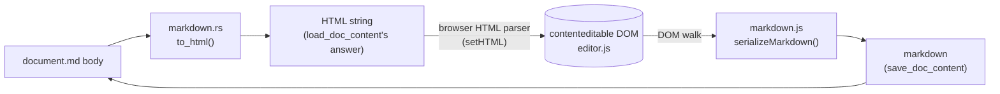

# Avelor — Markdown ⟷ editor DOM

> How a markdown body becomes the DOM the editor edits, how that DOM
> becomes markdown again, and what both sides promise each other. The
> editor that keeps the DOM in shape is `editor.md`; when the serializer
> runs and what the messages carry, `saving.md`.

## Overview <a id="overview"></a>

The conversion between a vault document's markdown body and the WYSIWYG
editor's DOM is split across the host ⟷ webview boundary:

| Direction | Where | Entry point | Input it must cope with |
|---|---|---|---|
| Markdown → HTML | Rust, `crates/av-vault/src/markdown.rs` | `to_html(markdown)` | Arbitrary — any file in the vault, however authored. |
| DOM → Markdown | Webview, `app/static/editor/markdown.js` | `serializeMarkdown(root)` | Controlled — only the editor's own DOM vocabulary. |



The split is deliberate, and follows from the two directions having
different inputs:

- **Markdown → HTML has arbitrary input.** Vault files come from imports
  and other tools and may use any CommonMark construct — setext headings,
  reference links, lazy continuation lines, indented code. That needs a
  spec-compliant parser, which `pulldown-cmark` is. The host also needs a
  markdown parser of its own for indexing and cross-links, so the parser
  is on the host regardless. A JavaScript markdown library is ruled out by
  the app's no-npm constraint and by the risk of a second
  dialect diverging from the host's.
- **DOM → Markdown has controlled input.** It only ever sees the tag
  vocabulary `to_html` produces and `editor.js` maintains
  (`markdown.md#dom-contract`). Reading the live DOM directly means there is
  no browser-serialized HTML string to send and no hand-written HTML parser
  on the host to undo the browser serializer's quirks. Because it is local
  and synchronous, the webview can tell exactly whether the content differs
  from the file (`saving.md#dirty-state`), and a source view can show the
  markdown without a host round trip.
- **The one string channel that remains is benign.** `to_html`'s output is
  parsed by the browser's own HTML parser (`editor.setHTML()` assigns
  `innerHTML`). The producer is under our control and the consumer is
  spec-compliant; nothing hand-written on either end.

Frontmatter never takes part: only the markdown *body* is converted and
edited (`av_vault::document` splits and re-attaches the frontmatter).

## The DOM shape contract <a id="dom-contract"></a>

Both converters, and every editing operation in `editor.js`, keep the DOM
in one exact shape. This is what `to_html` produces, what the editor
preserves (`editor.md#principles`), and what `serializeMarkdown`
expects:

- **No whitespace between block elements.** A stray root-level text node
  would be wrapped into a paragraph by the editor's `ensureBlockStructure`.
- **Fenced code is a bare `<pre>` with `<br>` line breaks**, never
  `<pre><code>`. `contenteditable`'s merge/split logic only understands
  the outer block boundary; a nested `<code>` breaks it.
- **`<strong>` / `<em>` / `<del>`**, never `<b>` / `<i>` / `<s>`
  (`editor.js` renames those on the fly).
- **No attributes on structural elements**, except the few that carry
  information the round trip would otherwise lose: `start` on `<ol>`,
  `data-lang` on `<pre>`, `align` on `<th>`/`<td>`, `href`/`title` on
  `<a>`, `src`/`alt`/`title` on ``. Task-list checkboxes are
  `<input type="checkbox" [checked] disabled>` as the first child of an
  `<li>`.
- **Nested lists are the last child of their `<li>`**, after the item's
  own content — which is where the editor's Tab puts them.
- **A table is `thead > tr > th*` (exactly one header row) plus
  `tbody > tr > td*`**, cells holding inline content only.

### Mapping table <a id="mapping-table"></a>

The editor's vocabulary and its markdown form. Each row is asserted in both
test suites (`markdown.md#testing`): `to_html(markdown)` must produce the
HTML, and `serializeMarkdown` of that HTML must produce the markdown.

| Markdown | Editor HTML |
|---|---|
| `text` | `<p>text</p>` |
| `a` ␤␤ `b` | `<p>a</p><p>b</p>` |
| `a  ` ␤ `b` (hard break) | `<p>a<br>b</p>` |
| `**text**` | `<p><strong>text</strong></p>` |
| `*text*` | `<p><em>text</em></p>` |
| `***text***` | `<p><strong><em>text</em></strong></p>` (or `<em><strong>`, `markdown.md#round-trip`) |
| `~~text~~` | `<p><del>text</del></p>` |
| `` `text` `` | `<p><code>text</code></p>` |
| `# text` … `###### text` | `<h1>text</h1>` … `<h6>text</h6>` |
| `- a` ␤ `- b` | `<ul><li>a</li><li>b</li></ul>` |
| `3. a` ␤ `4. b` | `<ol start="3"><li>a</li><li>b</li></ol>` (no `start` when it is 1) |
| `- a` ␤ `  - b` | `<ul><li>a<ul><li>b</li></ul></li></ul>` (nested lists indent to the marker's width) |
| `- a` ␤␤ `- b` (loose list) | `<ul><li><p>a</p></li><li><p>b</p></li></ul>` |
| `- [x] done` ␤ `- [ ] open` | `<ul><li><input type="checkbox" checked disabled>done</li><li><input …>open</li></ul>` |
| `> a` ␤ `>` ␤ `> b` | `<blockquote><p>a</p><p>b</p></blockquote>` |
| `> a` ␤ `>` ␤ `> > b` | `<blockquote><p>a</p><blockquote><p>b</p></blockquote></blockquote>` |
| `> ## title` | `<blockquote><h2>title</h2></blockquote>` |
| ```` ``` ```` ␤ `line one` ␤ `line two` ␤ ```` ``` ```` | `<pre>line one<br>line two</pre>` |
| ```` ```rust ```` ␤ `fn x() {}` ␤ ```` ``` ```` | `<pre data-lang="rust">fn x() {}</pre>` |
| ```` ``` ```` ␤ ```` ``` ```` (empty) | `<pre><br></pre>` (the `<br>` lets a caret be placed) |
| `---` | `<hr>` |
| `[t](http://x "T")` | `<p><a href="http://x" title="T">t</a></p>` |
| `` | `<p></p>` |
| `\| a \| b \| c \|` ␤ `\| --- \| :---: \| ---: \|` ␤ `\| 1 \| 2 \| 3 \|` | `<table><thead><tr><th>a</th><th align="center">b</th><th align="right">c</th></tr></thead><tbody><tr><td>1</td>…</tr></tbody></table>` |

## Loading

`to_html` is a custom `pulldown-cmark` event writer, not the crate's stock
`push_html` — the stock renderer emits whitespace between blocks and
`<pre><code>`, both of which violate `markdown.md#dom-contract`. Enabled
extensions: tables, strikethrough, task lists.

- **Raw HTML in the source is escaped to visible text**, never rendered.
  Vault content may come from imports and is rendered into a live
  document; nothing in it should execute or inject markup. An HTML block
  becomes a `<p>` holding the escaped source with `<br>` line breaks.
- **Constructs the editor has no form for degrade to their source text**
  rather than being dropped: footnote references (`[^name]`), inline and
  display math (`$…$`, `$$…$$`). Superscript/subscript render as
  `<sup>`/`<sub>` if the parser ever emits them (it doesn't with the
  enabled options).
- **Soft line breaks stay `\n`** inside the paragraph text; hard breaks
  (two trailing spaces, or a backslash) become `<br>`.
- **Code blocks** lose the fence's own trailing newline, keep every inner
  newline as `<br>`, and render as `<pre><br></pre>` when empty. Only the
  first word of the fence's info string becomes `data-lang`.
- **An image's alt text** is the plain text of everything between the
  image's start and end events (markup inside alt text is flattened).

## Serializing <a id="serializing"></a>

`serializeMarkdown` is a recursive walk over the live DOM in
`app/static/editor/markdown.js`. It knows only the tags of
`markdown.md#dom-contract` plus `<input>`; everything else is handled by two
rules that make the walk total:

- **Unknown elements are unwrapped in place.** A `<span style="…">`,
  `<div>`, `<font>` — anything a paste path or browser feature slipped in
  — contributes its children and loses its tag and attributes, wherever it
  sits (block level or inline). Nothing is ever dropped for having an
  unexpected wrapper.
- **Root-level text nodes and comments are ignored.** The editor wraps
  root-level text into a paragraph on every edit, so this only matters
  defensively.

Block rules:

- Blocks are joined by one blank line; the output ends with exactly one
  newline, or is the empty string for an empty document.
- **Editing-time placeholders are dropped, not written.** A `<p>` whose
  only content is a `<br>` (the editor's caret placeholder: the trailing
  paragraph, or an empty line the user left) has no markdown form and is
  skipped. A trailing `<br>` at the end of any leaf block is likewise
  dropped — it is either the same placeholder or a hard break with nothing
  after it, which renders identically. `<pre><br></pre>` is an empty code
  block, not one blank line. An empty heading keeps its level (`##`).
- **Lists.** `- ` for bullets; `N. ` counting up from `start` for ordered
  lists. A list is *loose* (items separated by a blank line) if any item
  contains a `<p>`; otherwise tight. An item's content — the nodes before
  its nested list, minus a leading checkbox which becomes `[x] `/`[ ] ` —
  is written as one or more paragraphs; continuation lines and further
  paragraphs are indented to the marker's width, and so is a nested list,
  line by line.
- **Blockquotes** render their child blocks, join them with a blank line,
  then prefix every line with `> ` (an empty line becomes a bare `>`). A
  nested quote's own prefix is prefixed again, giving `> > text`.
- **Code blocks** write their text verbatim between fences, `<br>` as
  newline, `data-lang` after the opening fence, and guarantee a newline
  before the closing fence.
- **Tables** write the header row, a delimiter row derived from each
  header cell's `align` (`---`, `:---`, `:---:`, `---:`), then the body
  rows. `|` inside a cell is escaped as `\|`. A table without a header row
  is skipped.

Inline rules:

- `<strong>` → `**…**`, `<em>` → `*…*`, `<del>` → `~~…~~`, `<code>` →
  `` `…` `` around the element's plain text, `<a>` → `[text](href "title")`,
  `` → `` (title only if present), `<br>` → two
  spaces and a newline.
- **A literal U+00A0 becomes a plain space.** It is the character
  `contenteditable` leaves behind for a typed trailing or leading space;
  markdown has no reason to know about it.

### Escaping <a id="escaping"></a>

Literal text is escaped so the next `to_html` reads it back as the same
text, in two tiers:

1. **Unconditionally, wherever they appear:** `\` `` ` `` `*` `_` `~` `[`
   `]` `<` each get a backslash. These can start inline syntax anywhere.
2. **Only at the start of a line:** a leading `#`, `>`, `-`, `+`, or a run
   of digits followed by `.` or `)`. These only mean something at line
   start, and escaping them mid-sentence (`well-known`, `5 > 3`) would
   litter the file. Applied to every line of a paragraph or list item
   (including lines after a hard break), and not to headings — after
   `## ` the text is never at true line start.

Because tier 1 already covers every other marker character, a leading
`*`, `_` or `` ` `` in the rendered output can only be syntax the
serializer itself inserted, never a leftover literal — which is why tier
2 can be so short. Code content (`<pre>`, `<code>`) is never escaped.

## Round trip and normalization <a id="round-trip"></a>

The two converters are inverses over the editor's vocabulary — for every row
in `markdown.md#mapping-table`, `to_html(serializeMarkdown(html)) == html` —
with these known, intended exceptions:

- **Emphasis order.** `to_html("***x***")` may nest as `<em><strong>` or
  `<strong><em>`; the editor's own typed shortcut produces
  `<strong><em>`. The serializer writes either as `***x***`.
- **Placeholders vanish.** Empty paragraphs and trailing `<br>`s are not
  written (`markdown.md#serializing`), so they are gone after a save.
- **Non-canonical source is canonicalized on the first real edit.** A file
  using `* item` or `__bold__` is rendered to the same DOM as its `- item`
  / `**bold**` form and is written back in the serializer's form once it
  is actually saved. It is *not* rewritten merely for being opened
  (`saving.md#dirty-state`).

The re-rendered HTML the host returns after every save (the answer to
`save_doc_content`) is `to_html` of exactly what was written. With markdown
produced in the webview, that re-render can differ from the live DOM only
when `pulldown-cmark` reads the serializer's output differently than the
serializer intended — an escaping bug, not routine normalization. It is
kept as a cheap consistency check: the webview shows it once editing has
stopped, and never while the document is being edited.

## Testing <a id="testing"></a>

The round-trip property is cross-language, so it lives in two mirrored
test tables that must be kept in step:

- `crates/av-vault/src/markdown.rs`, `#[cfg(test)]` — `to_html` over the
  mapping table, the DOM invariants, raw-HTML escaping, and a read-back
  case for every character the serializer escapes. Runs with
  `cargo test -p av-vault`.
- `app/static/editor/markdown.selftest.js` — `serializeMarkdown` over the
  same samples plus the serializer-only rules (unwrapping, placeholders,
  nbsp, escaping), shown by `markdown.selftest.html`. `build.rs` bundles
  the two into a page in its `OUT_DIR` (`development.md#the-bundled-page`)
  that opens from disk with no server: it sets each sample via
  `innerHTML`, exactly as `editor.setHTML()` does, and reports pass/fail
  per case in the page and in the tab title. Not part of `cargo test`.
  On Linux, open it in a WebKitGTK browser (GNOME Web) as well: WebKit's
  `contenteditable` and selection differ from Chromium's
  (`architecture.md#platforms`).

**Adding a construct** means touching both sides: a `to_html` case for what
the markdown renders to, a `serializeMarkdown` case for what that HTML
writes back as, a row in `markdown.md#mapping-table`, and — if the editor
should be able to create or edit it — the corresponding `editor.js` support
(`editor.md#block-model` and `editor.md#mechanisms`).
