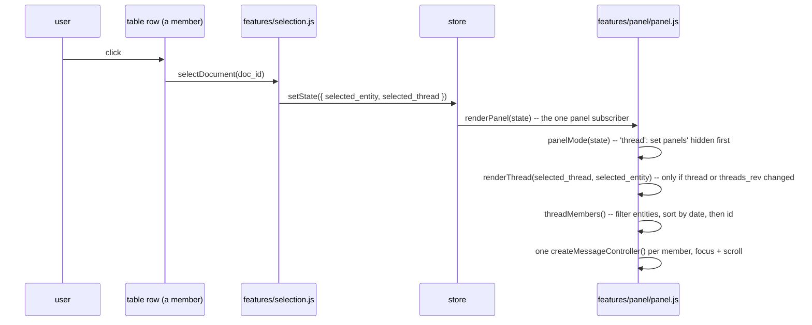

# Avelor — Side panel and structural edits

> The side panel and what the user organizes in it: the card every entity
> is shown as, a thread's members, projects, and the structural edits
> (titles) with how they are saved. The lenses and the vault panel are
> `ui.md`.

## Overview

The panel on the right shows what is selected: one card for an entity
outside any thread, or all members of a thread as a stack of cards. It can
be closed, expanded to full width and resized (`panel_size` in the store;
the widths are preferences, `ui.md#preferences`).

What the panel shows is state, not a sequence of render calls: the store
holds `selected_entity`, `selected_thread` and `threads_rev`, and
`renderPanel` derives everything else from them (`panel.md#panel-state`).

## Cards 

`createMessageController(doc, { selectable })`
(`app/static/features/panel/panel.js`) builds a `.msg` card:

- a header: icon, title, a pen that renames it
  (`panel.md#titles`), date, path, and for an entity in
  several threads a line of them (`panel.md#thread-switch`).

It is used from exactly two places:

- **`renderDocument(doc)`** — an entity outside any thread: one card
  appended into `#doc-content` (inside `#panel-doc-view`).
- **`renderMembers(thread_id, members)`** — every member of a thread, in
  thread order, appended into `#thread-messages` (inside
  `#panel-thread-view`).

The two containers share the CSS class `.msg-list` — `flex: 1;
min-height: 0; overflow: auto; display: flex; flex-direction: column` —
the single scrollable container; each card is a normal, non-scrolling flex
child of it.

Its option: `selectable` — a click selects
its entity (`panel.md#selection`), in a thread,
but not for a lone document, with nothing else on screen to select. A
card's head (title, date) follows its entity in place on `entities_rev`,
with its threads line (`refreshCardChips`).

## Panel state 

Three store keys decide what the panel shows:

- `selected_entity` — the selected entity,
- `selected_thread` — the thread it's shown in, or `null`,
- `threads_rev` — bumped by every thread/membership change, so the cards
  are rebuilt even when neither selection changes (e.g. a member was
  added).

`features/panel/panel.js` registers one subscriber over all of them, and
it calls `renderPanel(state)` — the only code that renders the panel.
`panelMode(state)` decides:

| Mode | When | Shows |
|---|---|---|
| `thread` | `selected_thread` exists and `selected_entity` (if any) is one of its members | `#panel-thread-view`, all members |
| `document` | `selected_entity` is a known entity | `#panel-doc-view`, one standalone card |
| `none` | nothing selected, or the selected entity was deleted | `#panel-doc-view`, empty preview |

`renderPanel` sets the two panels' `hidden` **first** and only then
renders, so a panel is never still `hidden` (`display: none`) when a
scroll call runs against it — scrolling inside a hidden ancestor is a
silent no-op with no layout box to scroll against. It is idempotent: it
remembers what it built (`renderedThreadId`, `renderedDocId`,
`renderedRev`) and only rebuilds cards when the shown thread or
standalone entity, or `threads_rev`, changed.

All card-building paths start from `destroyRenderedCards()`, which tears
down every rendered card's controller (content subscription) and empties
the containers. So switching from the standalone card to the thread (or
back; `renderedDocId` / `renderedMembers`) never leaves an entity's
content subscription twice. `renderEmpty()` is the `none` mode's builder:
after the teardown it shows a placeholder ("No document selected",
`.empty`) in `#doc-content`; the panel itself stays open.

Nothing else calls `renderThread`/`renderDocument`. Selection changes go
through `selectDocument`.

## Selection, focus and scrolling 

**`selectDocument(doc_id)`** (`features/selection.js`) sets
`selected_entity` and picks `selected_thread`: it keeps the current
thread if the entity is one of its
members — so clicking a card never jumps to another thread for an entity in
several — and otherwise uses the entity's first thread in the vault
(`threadOf`), or `null` for a standalone entity. A thread the entity still
names but that isn't in the vault is skipped.

Three related but independent things happen when an entity becomes "the
one in view":

- **Row selection.** The Documents lens marks the selected entity's rows
  `aria-selected` (`markSelection`, `features/lenses/documents.js`), and
  the rows of the thread the panel shows, whether or not the entity is a
  thread member (`ui.md#documents`).
- **Card focus.** `focusMessage(doc_id)` (`features/panel/panel.js`) sets
  `aria-selected="true"` on that entity's `.msg` card (clearing it from
  whichever card had it before), mirroring the row's own
  `[aria-selected="true"]` — no new visual language. It is not preserved
  across a rebuild; `renderThread` re-applies it for `selected_entity`.
- **Scrolling.** `scrollIntoView(doc_id)` (`{ block: 'center', behavior:
  'instant' }`) runs only when the thread's cards are rebuilt. Selecting
  another member of the thread already shown — a different row in the
  same thread, or clicking a card directly — only calls
  `focusMessage`: switching focus within an open thread never tears down
  and rebuilds every card, and never fights the user's own
  scroll position.

Clicking a card (anywhere except one of its own buttons —
`ev.target.closest('button')`) calls `selectDocument(doc_id)`, so
selecting from inside the panel is symmetric with selecting from the
Documents lens. Clicking inside the editor body itself (read-only text)
still selects the card — a card is mostly editor
body, and exempting more than buttons would leave most of it unclickable.

## Threads

Threads are created by the user and are linear: their members are separate
entities — letters, emails, tasks, events, … — ordered by date
(`vault.md#thread`).

`threadMembers(thread_id)` filters `entities` for entries whose `threads`
include the id and sorts them with `compareMembers`: by `date`, then by
`doc_id` — UUIDv7, so string order is creation order. Members without a
date come first. The order is always derived, never stored, so there is
nothing to reorder by hand.

In the Documents lens a thread's members fold under the thread's row
(`ui.md#documents`). "Is this a thread member" is simply "does its
`threads` list contain a thread", independent of its derived type: a
letter dragged into a thread stays a `doc`, an email stays an `eml`. The
panel header shows the thread's own title, with a pen that renames it
(`panel.md#titles`, `#thread-title`).

## Switching threads 

An entity in several threads shows the first thread of its `threads` list
that is in the vault (`threadOf`) when selected from a row outside a
thread's (`selectDocument`). Its card
then has a third line in its head, `.doc-head__threads`
(`renderCardThreads`): "Threads" and a chip per thread, in the order of its
`threads`. The thread shown is marked (`aria-current`); a click on another
calls `switchThread(doc_id, thread_id)`, which sets `selected_entity` and
`selected_thread` together, so `renderPanel` rebuilds the panel for that
thread with the entity focused and scrolled to. The line is per card, so
every member in several threads switches on its own. It is refreshed in
place on `entities_rev` (`refreshCardChips`): a thread that is renamed
shows without rebuilding the cards.

## Titles 

Every entity's title is set by the host through `set_title`
(`Index::set_title`), whatever its kind (`architecture.md#conventions`):
an empty title removes the `title` key, and the file keeps its name.

- The pen at the end of a card's title line and the thread header's
  (`#thread-rename-btn`) make the title editable in place (`renameEntity`
  → `editTextInPlace`, `ui/field.js`, which the project header uses
  too). It starts all selected. Enter or leaving it sends `set_title` if
  the text changed (whitespace runs, such as pasted line breaks, become
  one space), Esc cancels. The pushed `entity` renames the card and the
  thread header.
- The pen is hidden for an entity or thread the host can't write
  (`renderCardHead`, `renderThread`).
- While a title is edited, nothing overwrites it (`renderCardHead`,
  `renderThread`, the project header).

## Projects 

Projects are entities with the `project` role (`vault.md#project`); the
vault panel lists them and filters by them (`ui.md#vault-panel`).

- **Rename**: the pen on a sidebar project row (`editProject`), or the
  rename button in the vault header's project toolbar (`editProjectName`,
  which edits `#project-name` in place): the name
  becomes an input; Enter
  or leaving it sends `set_title` if the text changed, Esc cancels. The
  pushed `entity` bumps `projects_rev`, so the header follows.
- **Star**: the star at the start of a sidebar project row (`toggleStar`)
  sends `set_starred`; starred projects are listed first.
- **Archive**: the Archive button in the project header's toolbar, pressed
  while the project is archived (`toggleArchive`), sends `set_archived`;
  the sidebar folds archived projects under an "Archived" row
  (`toggleArchived`, not kept across restarts).

## Saving structural edits 

The vault file is the source of truth, a file is written only when
something in it changed, and the host answers with what is now on disk.

| | Structure |
|---|---|
| The page sends | an intent: `set_title`, … |
| The host writes | the matching `Index` op → `Index::save` |
| The host answers | `entity` / `entity_deleted` per changed entity, then the command's answer |
| Stale-reply guard | none needed: nothing is applied optimistically |
| On failure | an error answer, shown in the status bar; the page shows whatever the host pushed, so it never shows unsaved structure |
| File changed outside the app | `ok {conflict: {id, changed}}`, nothing written; the dialog offers Use theirs, after which the user makes the edit again |

- **The host owns the rules.** The rules live in av-vault where
  they are unit-tested, not in the page. Each op works on any entity,
  built on a property every entity has (`architecture.md#conventions`).
- **Validate, then write.** Every entity an edit will rewrite must be
  writable (`Entry::is_writable`: has a file, not read-only, frontmatter
  parsed) before anything changes; otherwise nothing is written and the
  error is `NotWritable`. Each file to rewrite must also be as the app
  last read or wrote it (its `FileStamp`, `saving.md#the-stamp`); a
  changed or deleted one makes the edit a `SaveOutcome::Conflict` that
  writes nothing. A save that still fails (I/O) restores that entity's
  in-memory roles and envelope, so the index keeps matching the disk.
  What was written is recorded (`vault::Changes`) and pushed
  (`architecture.md#vault-edits`).

## Flows

| # | Flow | Trigger → page | Host → events | Result |
|---|---|---|---|---|
| D1 | Open | an entity's row in Documents → `selectDocument` (`features/selection.js`) → `openPanel`, `selected_entity` / `selected_thread` → `renderPanel` (`features/panel/panel.js`) → `panelMode` | — | one card, or the thread's cards |
| D11 | Follow a link | an `id:` link in a preview (`openLink`) → `selectById` | — | the entity, thread or project selected |
| D12 | Rename | the pen in a card's head or the thread header → `renameEntity` → `editTextInPlace`; Enter or blur | `set_title` → `entity` | the card's head and the thread header follow; the file keeps its name |
| E1 | Show a thread | select a member → `threadOf` → `renderThread` | — | members by date, then id; focused and scrolled |
| E5 | Switch thread | a chip in the threads line of a card in several threads → `switchThread` | — | that thread shown, the entity still selected and focused |
| C2 | Rename a project | pill pen or header rename → inline input, Enter/blur | `set_title` → `entity` | header follows (`projects_rev`) |
| C3 | Star | star icon → `toggleStar` | `set_starred {starred}` → `entity` | starred first |
| C7 | Archive | header Archive → `toggleArchive` | `set_archived {archived}` → `entity` | pill moves under the folded "Archived" row, or back |
