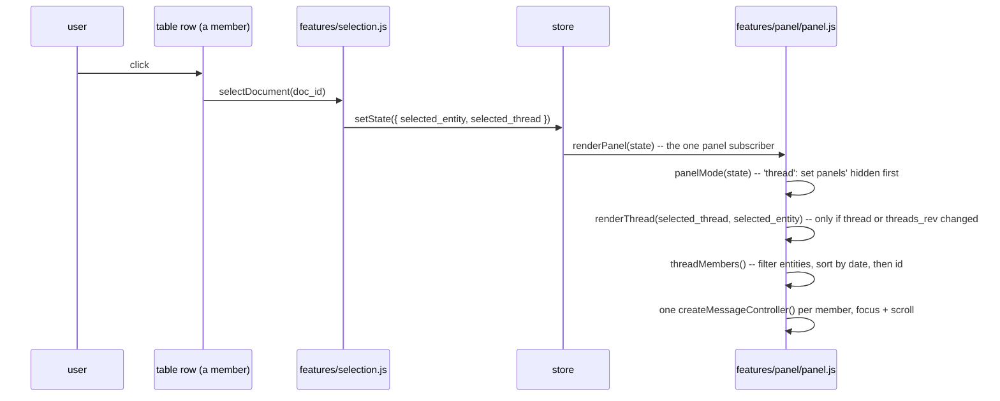

# Avelor — Side panel and structural edits

> The side panel and what the user organizes in it: the card every entity
> is shown as, a thread's members, the context column, links, labels,
> projects, and the structural edits (threads, projects, titles, labels,
> links, deletes) with how they are saved. The lenses and the vault panel
> are `ui.md`; the editor inside each card, `editor.md`; saving its
> content, `saving.md`.

## Overview

The panel on the right shows what is selected: one card for an entity
outside any thread, or all members of a thread as a stack of individually
editable cards. It can
be closed, expanded to full width and resized (`panel_size` in the store;
the widths are preferences, `ui.md#preferences`); expanded, it has the
context column (`panel.md#context-column`).

What the panel shows is state, not a sequence of render calls: the store
holds `selected_entity`, `selected_thread` and `threads_rev`, and
`renderPanel` derives everything else from them (`panel.md#panel-state`).

## Cards 

`createMessageController(doc, { selectable })`
(`app/static/features/panel/panel.js`) builds a `.msg` card:

- a header: icon, title, dirty dot, a pen that renames it
  (`panel.md#titles`), date, path, and for an entity in
  several threads a line of them (`panel.md#thread-switch`); in a thread,
  the header is the card's drag handle (`panel.md#structural-edits`);
- its project and label chips on one line, with the "+" menu that adds
  either (`panel.md#labels`, `panel.md#projects`), and its link chips
  (`panel.md#links`);
- an action toolbar (edit, cloned from
  `#preview-toolbar-template`), an editing toolbar (cloned from
  `#editor-toolbar-template`), and its own `createEditor()` instance.

It is used from exactly two places:

- **`renderDocument(doc)`** — an entity outside any thread: one card
  appended into `#doc-content` (inside `#panel-doc-view`).
- **`renderMembers(thread_id, members)`** — every member of a thread, in
  thread order, appended into `#thread-messages` (inside
  `#panel-thread-view`).

The two containers share the CSS class `.msg-list` — `flex: 1;
min-height: 0; overflow: auto; display: flex; flex-direction: column` —
the single scrollable container; each card is a normal, non-scrolling flex
child of it.

Its options: `thread` — a member of the thread shown, whose head drags it
out and whose remove-from-thread applies; `selectable` — a click selects
its entity (`panel.md#selection`), in a thread,
but not for a lone document, with nothing else on screen to select. A
card's head (title, date) follows its entity in place on `entities_rev`,
with its links and threads lines (`refreshCardChips`).

Two `<template>` elements in `index.html` hold the markup each card
clones from, via `createEditorToolbar()`/`createDocPreviewToolbar()`
(`ui/toolbar.js`) — cloning and appending only, never mutating or replacing the
template itself:

- **`#editor-toolbar-template`** — the bold/italic/heading/list/etc.
  editing toolbar, passed to `createEditor()`'s `toolbar` option.
- **`#preview-toolbar-template`** — the action row:
  `data-cmd="edit"` (edit mode, if the entity is `editable`; one card in
  edit mode at a time), `data-cmd="link"` (the context column's Linked
  tab), `data-cmd="thread"`
  (remove from thread) and `data-cmd="delete"`. The template's elements
  carry no ids, since it is cloned for every card.

## Panel state 

Three store keys decide what the panel shows:

- `selected_entity` — the selected entity,
- `selected_thread` — the thread it's shown in, or `null`,
- `threads_rev` — bumped by every thread/membership change, so the cards
  are rebuilt even when neither selection changes (e.g. a member was
  added).

`features/panel/panel.js` registers one subscriber over all of them, and
it calls `renderPanel(state)` — the only code that renders the panel.
`panelMode(state)` decides:

| Mode | When | Shows |
|---|---|---|
| `thread` | `selected_thread` exists and `selected_entity` (if any) is one of its members | `#panel-thread-view`, all members |
| `document` | `selected_entity` is a known entity | `#panel-doc-view`, one standalone card |
| `none` | nothing selected, or the selected entity was deleted | `#panel-doc-view`, empty preview |

`renderPanel` sets the two panels' `hidden` **first** and only then
renders, so a panel is never still `hidden` (`display: none`) when a
scroll call runs against it — scrolling inside a hidden ancestor is a
silent no-op with no layout box to scroll against. It is idempotent: it
remembers what it built (`renderedThreadId`, `renderedDocId`,
`renderedRev`) and only rebuilds cards when the shown thread or
standalone entity, or `threads_rev`, changed.

All card-building paths start from `destroyRenderedCards()`, which tears
down every rendered card's controller (editor, content subscription,
`editorRoots` entry) and empties the containers. So switching from the
standalone card to the thread (or back; `renderedDocId` /
`renderedMembers`) never leaves an entity's editor and content
subscription twice. `renderEmpty()` is the `none` mode's builder:
after the teardown it shows a placeholder ("No document selected",
`.empty`) in `#doc-content`; the panel itself stays open. This is what a
deleted standalone entity leaves behind: no card, and no controller that
could still autosave the deleted id.

Nothing else calls `renderThread`/`renderDocument`. Selection changes go
through `selectDocument`; membership changes go through
`commitThreadChange` (`panel.md#structural-edits`).

## Selection, focus and scrolling 

**`selectDocument(doc_id)`** (`features/selection.js`) sets
`selected_entity` and picks `selected_thread`: it keeps the current
thread if the entity is one of its
members — so clicking a card never jumps to another thread for an entity in
several — and otherwise uses the entity's first thread in the vault
(`threadOf`), or `null` for a standalone entity. A thread the entity still
names but that isn't in the vault — dissolved while the entity was in the
trash — is skipped.

Three related but independent things happen when an entity becomes "the
one in view":

- **Row selection.** The Documents lens marks the selected entity's rows
  `aria-selected` (`markSelection`, `features/lenses/documents.js`), and
  the rows of the thread the panel shows, whether or not the entity is a
  thread member (`ui.md#documents`).
- **Card focus.** `focusMessage(doc_id)` (`features/panel/panel.js`) sets
  `aria-selected="true"` on that entity's `.msg` card (clearing it from
  whichever card had it before), mirroring the row's own
  `[aria-selected="true"]` — no new visual language. It is not preserved
  across a rebuild; `renderThread` re-applies it for `selected_entity`.
- **Scrolling.** `scrollIntoView(doc_id)` (`{ block: 'center', behavior:
  'instant' }`) runs only when the thread's cards are rebuilt. Selecting
  another member of the thread already shown — a different row in the
  same thread, or clicking a card directly — only calls
  `focusMessage`: switching focus within an open thread never tears down
  and rebuilds every card's editor, and never fights the user's own
  scroll position.

Clicking a card (anywhere except one of its own toolbar buttons —
`ev.target.closest('button')`) calls `selectDocument(doc_id)`, so
selecting from inside the panel is symmetric with selecting from the
Documents lens. Clicking inside the editor body itself (read-only text,
or placing a cursor while editing) still selects the card — a card is mostly editor
body, and exempting more than buttons would leave most of it unclickable.

## Threads

Threads are created by the user and are linear: their members are separate
entities — letters, emails, tasks, events, … — ordered by date
(`vault.md#thread`). The user connects them in the panel: dragging a row
from the Documents lens onto the thread panel adds it, onto a standalone
card makes a thread of the two; dragging a card by its head from the
thread to the lens removes it (`panel.md#structural-edits`).

`threadMembers(thread_id)` filters `entities` for entries whose `threads`
include the id and sorts them with `compareMembers`: by `date`, then by
`doc_id` — UUIDv7, so string order is creation order. Members without a
date come first. The order is always derived, never stored, so there is
nothing to reorder by hand.

In the Documents lens a thread's members fold under the thread's row
(`ui.md#documents`). "Is this a thread member" is simply "does its
`threads` list contain a thread", independent of its derived type: a
letter dragged into a thread stays a `doc`, an email stays an `eml`. Each
member keeps its own `projects`, and a thread's projects are its members'
(`vault.md#thread`, `threadProjects`): the thread view's Project row lists
them, without an × — a member leaves a project on its own card
(`#thread-project`, refreshed with the cards' chips). The panel header
shows the thread's own title, with a pen that renames it
(`panel.md#titles`, `#thread-title`).

## Switching threads 

An entity in several threads shows the first thread of its `threads` list
that is in the vault (`threadOf`) when selected from a row outside a
thread's (`selectDocument`). Its card
then has a third line in its head, `.doc-head__threads`
(`renderCardThreads`): "Threads" and a chip per thread, in the order of its
`threads`. The thread shown is marked (`aria-current`); a click on another
calls `switchThread(doc_id, thread_id)`, which sets `selected_entity` and
`selected_thread` together, so `renderPanel` rebuilds the panel for that
thread with the entity focused and scrolled to. The line is per card, so
every member in several threads switches on its own. Like the link chips,
it is refreshed in place on `entities_rev` (`refreshCardChips`): a thread
that comes back from the trash, or is renamed, shows without rebuilding
the cards.

## Context column 

The context column of the expanded panel has tabs about what
the panel shows (`features/context.js`: `registerContextTab`,
`selectContextTab`).
A tab picked by its button focuses its first field.

- **Linked** — `panel.md#links`.

## Links 

An entity can be linked to one other entity: a task to the letter it comes
from, a reply to the letter it answers, a payment to its bill. The link is
the entity's `linked-to` (`vault.md#metadata`); the
other side is derived.

- A card lists its links as chips below its labels (`renderCardLinks`,
  `features/panel/panel.js`): the one it links to first, then those that link to
  it. A
  click selects the other entity, × removes the link (on an entity the app
  can't write, there is none). The chips are refreshed on `entities_rev`
  without rebuilding the card.
- The card's Link button (`openLinkedTab`, `features/context.js`) selects
  the card, expands the panel and opens the Linked tab with its search
  focused:
  "Links to", "Linked from" (chats and transactions included), and a
  search over the titles of the entities and threads in the vault panel's
  filter (project, labels; `matchesFilter`), so narrowing the
  filter narrows what is offered. Picking a result (a click or Enter)
  links the card to it, replacing an older link. With only a thread shown,
  the tab is about the thread.
- A link in a document's body to `id:<uuid>` (`vault.md#links-in-content`)
  selects that entity, thread or project when clicked in the preview
  (`editor.md#links`).

## Labels 

Labels are the entities' `tags`. A card shows its project chips, then its
label chips, on one line, and ends it with a "+" if the host can write the
entity (`renderCardChips`, `features/panel/panel.js`).

- The "+" opens a menu at once (`addChip`): a filter box, focused; the
  active projects, starred first; the labels in use. What the entity
  already has is left out. Typing keeps the entries that contain the text,
  and a text that names no label (in any case) adds "New label". Up and
  down move the highlight, Enter or a click picks, Esc closes.
- A project picked joins it (`joinProjectLocal` → `join_project`), a label
  is added (`setTagsLocal` → `set_tags`); a label chip's × removes it.
- The filter is `showMenu`'s (`ui/menu.js`), its `filter` option.

## Titles 

Every entity's title is set by the host through `set_title`
(`Index::set_title`), whatever its kind (`architecture.md#conventions`):
an empty title removes the `title` key, and the file keeps its name
(`vault.md#filenames`).

- The pen at the end of a card's title line and the thread header's
  (`#thread-rename-btn`) make the title editable in place (`renameEntity`
  → `editTextInPlace`, `ui/field.js`, which the project header uses
  too). It starts all selected. Enter or leaving it sends `set_title` if
  the text changed (whitespace runs, such as pasted line breaks, become
  one space), Esc cancels. The pushed `entity` renames the card, the thread
  header, and the chips and links that show the entity.
- The pen is hidden for an entity or thread the host can't write
  (`renderCardHead`, `renderThread`).
- While a title is edited, nothing overwrites it (`renderCardHead`,
  `renderThread`, the project header), and a thread card's head doesn't
  drag, so the mouse selects text.

## Projects 

Projects are entities with the `project` role (`vault.md#project`); the
vault panel lists them and filters by them (`ui.md#vault-panel`).

- **Create**: the sidebar's "+" (`addProject`) creates "New project" in
  `Projects/`, whose new pill opens in rename mode.
- **Rename**: the pen on a sidebar project row (`editProject`), or the
  rename button in the vault header's project toolbar (`editProjectName`,
  which edits `#project-name` in place, `panel.md#titles`): the name
  becomes an input; Enter
  or leaving it sends `set_title` if the text changed, Esc cancels. The
  pushed `entity` bumps `projects_rev`, so the header and the panel's
  project chips follow (`renameProjectChips`, without rebuilding the
  cards).
- **Star**: the star at the start of a sidebar project row (`toggleStar`)
  sends `set_starred`; starred projects are listed first.
- **Members**: an entity's row dropped on a project pill or on the
  project's row in the Documents lens (`ui.md#documents`), or a project
  picked in a card's "+" menu (`panel.md#labels`), joins the project
  (`joinProjectLocal` → `join_project`); the × on a project chip of a
  card (`projectChips`) leaves it (`leaveProjectLocal` →
  `leave_project`). The drop listeners sit on `#projects`, not the rows,
  since `renderSidebar` rebuilds those; only a pill is a valid target,
  highlighted (`.is-drop-target`) while dragged over. A card's head dragged
  out of a thread joins a project the same way.
- **Description**: the project file's body, under the vault header behind
  a fold chevron and edited with its pen (`#project-desc` via
  `bindDocContent`), loaded and saved like a document (`saving.md`).
- **Archive**: the Archive button in the project header's toolbar, pressed
  while the project is archived (`toggleArchive`), sends `set_archived`;
  the sidebar folds archived projects under an "Archived" row
  (`toggleArchived`, not kept across restarts).
- **Delete**: the project header's Delete, two clicks (`armedButton`):
  the description is saved first, then `delete_entity`. The host takes the
  project out of every member (all writable and unchanged, or nothing is
  written) and moves its file to `.trash`, pushing the members as `entity`
  and the project as `entity_deleted`; `onEntityDeleted` drops it and, if
  it was the filter, shows all documents.

## Membership and structural edits 

Membership is edited, and entities deleted, by the host, never on the page
(`panel.md#saving-structure` explains why). Each edit is a typed command
(`api.md#structure`) sent through `structureCall(cmd, args,
select)`; once it is answered, `select(id)` (the answer's `id`) is applied
through **`commitThreadChange({ selected_entity, selected_thread })`**,
which publishes it with a bumped `threads_rev`; `renderPanel` takes it
from there. By then the host's pushes have already updated `entities` and
`threads` to what is on disk. After a failure the current selection is
kept. Either way, an entity or thread that no longer exists is dropped
from the selection. The edits:

- **Drop on the thread panel** (`#thread-messages`):
  `joinThreadLocal(doc_id, thread_id)` sends `join_thread` (nothing, if
  the entity already is a member) and selects the entity in the thread, so
  its new card appears, focused, in its date position.
- **Drop on a standalone entity's card** (`#doc-content`):
  `createThreadLocal(target_id, dropped_id)` sends `create_thread` with
  the target's title and both entities as members; the thread's projects
  are theirs. The host
  (`Index::create_thread`) builds the thread with `Document::create`
  (`thread: {}`, `created: {}`, a fresh UUIDv7, dated now), writes it as a
  new file with its generated name (`filename::generated_name`) in the
  target's folder, never over an existing file, and adds both members. The
  target is then selected in the new thread. Dropping an entity on itself
  does nothing; an entity already in other threads just gains one more.
- **Remove-from-thread button** (`data-cmd="thread"`, enabled only on cards
  shown as members of the open thread): `leaveThreadLocal(doc_id,
  renderedThreadId)` sends `leave_thread`. The host (`Index::leave_thread`)
  removes the thread from the entity's `message.threads` (dropping an empty
  `message` role); if fewer than two members are left, the remaining one
  leaves as well and the thread's file moves to `.trash/` (`Index::trash`).
  The selection that follows, computed by `selectionWithout(doc_id,
  thread_id)` from the thread as it is before the request:
  - **thread dissolved** → `selected_thread = null`, and the remaining
    entity is selected, so it's shown standalone;
  - **thread still there** → it stays selected; if the removed entity was
    the selected one, its neighbor in thread order (the next member, else
    the previous one) is selected instead, otherwise the selection stays.
- **Dragging a card out**: in the thread panel, a card's head is
  draggable. Its drag carries the entity's id as `text/plain`, like an
  entity's row (so a drop on a project pill, or on a project's or thread's
  row in the Documents lens, joins that), and the thread it is shown in as
  `application/x-avelor-thread` (`MEMBER_DRAG`). The rest of the Documents
  lens (`#lens-documents`) accepts
  only such drags (`takeMemberDrops`, `ui/dropzone.js`), highlighted
  (`.is-drop-target`) while dragged over; a drop there calls
  `leaveThreadLocal`, exactly as the remove button does. Both card panels
  ignore them, so a card can't be dropped back into its own thread.
- **Delete button** (`data-cmd="delete"`, enabled when the entity's
  `deletable` is set: it has a file, and the file isn't read-only). Two
  clicks, no dialog, as every two-click confirm of the page (`armedButton`,
  `ui/confirm.js`): the first arms the button (`[data-armed]`, filled red,
  tooltip "Click again to delete"), which disarms after 3 s or when the
  pointer leaves it; the second calls `deleteEntityLocal(doc_id,
  thread_id)`. A card being edited is saved first (the save reaches the host
  before the delete, so a failed delete loses no edit), then `delete_entity`
  is sent. The host (`Index::delete`) dissolves every thread the entity
  leaves with fewer than two members, as for the remove button, then moves
  the entity's file to `.trash` unchanged — a restore brings it back as it
  was (`vault.md#trash`), but a dissolved thread stays dissolved. The
  selection follows `selectionWithout`; a deleted standalone entity leaves
  the panel empty. `onEntityDeleted` forgets the id everywhere (`entities`,
  `threads`, the save state of `saving.md#dirty-state`) and lowers the
  vault's file count.

Both drop targets of the card panels are wired through the same
`attachDropZone(containerEl, onDrop)`; while dragging, the panel's last
card is highlighted (`.is-drop-after`) as the drop target.

## Saving structural edits 

Structural edits are saved the way content is (`saving.md`): the vault
file is the source of truth, a file is written only when something in it
changed, and the host answers with what is now on disk. They differ in who
applies the edit:

| | Content (`saving.md`) | Structure |
|---|---|---|
| The page sends | the full body (state) | an intent: `create_thread`, `join_thread`, `leave_thread`, `join_project`, `leave_project`, `set_title`, `delete_entity`, … |
| The host writes | `Index::save_content` → `Index::save`, only if dirty | the matching `Index` op → the same `Index::save`; deletes move the file (`Index::trash`) |
| The host answers | `ok {source, html}` with the saved source | `entity` / `entity_deleted` per changed entity, then the command's answer |
| Stale-reply guard | `edit_seq`, kept with the call on the page | none needed: nothing is applied optimistically; the answer only says how to select |
| On failure | an error answer, shown in the status bar; the document stays dirty, the next poll retries | an error answer, shown in the status bar; the page shows whatever the host pushed, so it never shows unsaved structure |
| File changed outside the app | `ok {conflict: {id, changed}}`, nothing written; the dialog offers Use theirs / Use ours | `ok {conflict: {id, changed}}`, nothing written; the dialog offers Use theirs, after which the user makes the edit again |

- **The host owns the rules.** Edits span files (a dissolve rewrites another
  member and removes the thread's file), so the rules live in av-vault where
  they are unit-tested, not in the page. Each op works on any entity,
  built on a property every entity has (`architecture.md#conventions`).
- **Validate, then write.** Every entity an edit will rewrite must be
  writable (`Entry::is_writable`: has a file, not read-only, frontmatter
  parsed), and a deleted one deletable (`Entry::is_deletable`: broken
  frontmatter is fine, the file isn't rewritten), before anything changes; otherwise nothing is written and the
  error is `NotWritable`. Each file to rewrite must also be as the app
  last read or wrote it (its `FileStamp`, `saving.md#the-stamp`); a
  changed or deleted one makes the edit a `SaveOutcome::Conflict` that
  writes nothing. A trashed file isn't checked: it moves unchanged, so
  nothing is lost. A save that still fails (I/O) restores that entity's
  in-memory roles and envelope, so the index keeps matching the disk. A
  multi-file edit that fails part-way stays part-way: what was written is
  recorded (`vault::Changes`) and pushed
  (`architecture.md#vault-edits`).
- **Content and structure share the file.** `Index::save` writes the
  frontmatter together with the host's last saved body, so a pending
  content edit in an open card isn't lost: the next content save writes
  it along with the new frontmatter.

## What the host sends 

`app.rs` sends every scanned or written entity as the `entity` event,
one shape for every kind (`post_entity`); the page sorts it by its derived
type (`kind`, `Document::kind()`):

- `project` → `onProject` (the sidebar; its description is loaded and
  saved like a document),
- `thread` → `onThread` into the page's `threads` Map, which
  the Documents lens reads for a thread's row,
- everything else → `onDocMeta` into `entities`: an entity's rows in the
  Documents lens, including thread members.

The sidebar's per-project counts are derived on the page,
never sent: `renderSidebar` counts the `entities` entries whose `projects`
list the project, re-rendered at most once per frame
after any `entity` or `entity_deleted` event. So every structural edit, and
every scanned entity, keeps them current. The content load and save
messages are keyed by an arbitrary `doc_id`, so any number of cards load
and save their bodies at once.

## Flows

| # | Flow | Trigger → page | Host → events | Result |
|---|---|---|---|---|
| D1 | Open | an entity's row in Documents → `selectDocument` (`features/selection.js`) → `openPanel`, `selected_entity` / `selected_thread` → `renderPanel` (`features/panel/panel.js`) → `panelMode` | — | one card, or the thread's cards |
| D3 | Edit | card Edit (if `editable`) → `setMessageEditMode` | — | one card in edit mode at a time; Esc leaves |
| D5 | Delete | card delete, two clicks within 3 s → save first → `deleteEntityLocal` | `delete_entity` → `Index::delete` (dissolve threads, move to `.trash/`) → `entity_deleted`, changed members as `entity`, the answer | neighbour selected (`selectionWithout`) |
| D6 | Labels | card "+" → `addChip`'s menu: a label in use or "New label", Enter or a click; a chip's × → `setTagsLocal` | `set_tags` → `entity` | the card's chips follow |
| D9 | Link | the card's Link button → `openLinkedTab`; a result's click or Enter → `setLinkLocal` | `set_link {id, to}` → `Index::set_link` → `entity` | the card's chips and the tab follow; an older link is replaced |
| D10 | Unlink | × on a link chip or a Linked tab row → `setLinkLocal(id, null)` on the entity holding the link | `set_link {id, to: null}` → `entity` | the key removed |
| D11 | Follow a link | a link chip, a Linked tab row, or an `id:` link in a preview (`openLink`) → `selectById` | — | the entity, thread or project selected |
| D12 | Rename | the pen in a card's head or the thread header → `renameEntity` → `editTextInPlace`; Enter or blur | `set_title` → `entity` | the card's head, the thread header, chips and links follow; the file keeps its name |
| E1 | Show a thread | select a member → `threadOf` → `renderThread` | — | members by date, then id; focused and scrolled |
| E2 | Join | drop a row on `#thread-messages`, or a row or card on a thread's row in Documents → `joinThreadLocal` | `join_thread` → `entity` | card appears in date position |
| E3 | Create a thread | drop a row on a standalone card → `createThreadLocal` | `create_thread` → `Index::create_thread` writes a `thd` beside the target → `entity` ×3 (the thread, its two members) | target selected in the new thread |
| E4 | Leave | card thread button, or the card's head dropped on the Documents lens → `leaveThreadLocal` | `leave_thread`; below two members the thread file goes to `.trash/` | selection per `selectionWithout` |
| E5 | Switch thread | a chip in the threads line of a card in several threads → `switchThread` | — | that thread shown, the entity still selected and focused |
| C1 | Create a project | "+" → `addProject` → `structureCall('create_project', {title: 'New project'})` | `Index::create_project` in `Projects/` → `entity`, `ok {id}` | new pill in rename mode |
| C2 | Rename a project | pill pen or header rename → inline input, Enter/blur | `set_title` → `entity` | header and chips follow (`projects_rev`) |
| C3 | Star | star icon → `toggleStar` | `set_starred {starred}` → `entity` | starred first |
| C4 | Add to a project | drag an entity's row onto a pill or a project's row in Documents, or a project in a card's "+" menu → `joinProjectLocal` | `join_project` → `entity` | the card's chips and the counts update |
| C5 | Remove from a project | × on a project chip → `leaveProjectLocal` | `leave_project` → `entity` | chip gone, counts update |
| C6 | Description | fold chevron → `#project-desc` editor via `bindDocContent` | `load_doc_content` / `save_doc_content` as D2/D4 (`saving.md#flows`) | project file body edited in place |
| C7 | Archive | header Archive → `toggleArchive` | `set_archived {archived}` → `entity` | pill moves under the folded "Archived" row, or back |
| C8 | Delete a project | header Delete, two clicks within 3 s → description saved first → `structureCall('delete_entity')` | `Index::delete`: members leave the project, file to `.trash/` → `entity` per member, `entity_deleted`, the answer | filter back to all documents |
