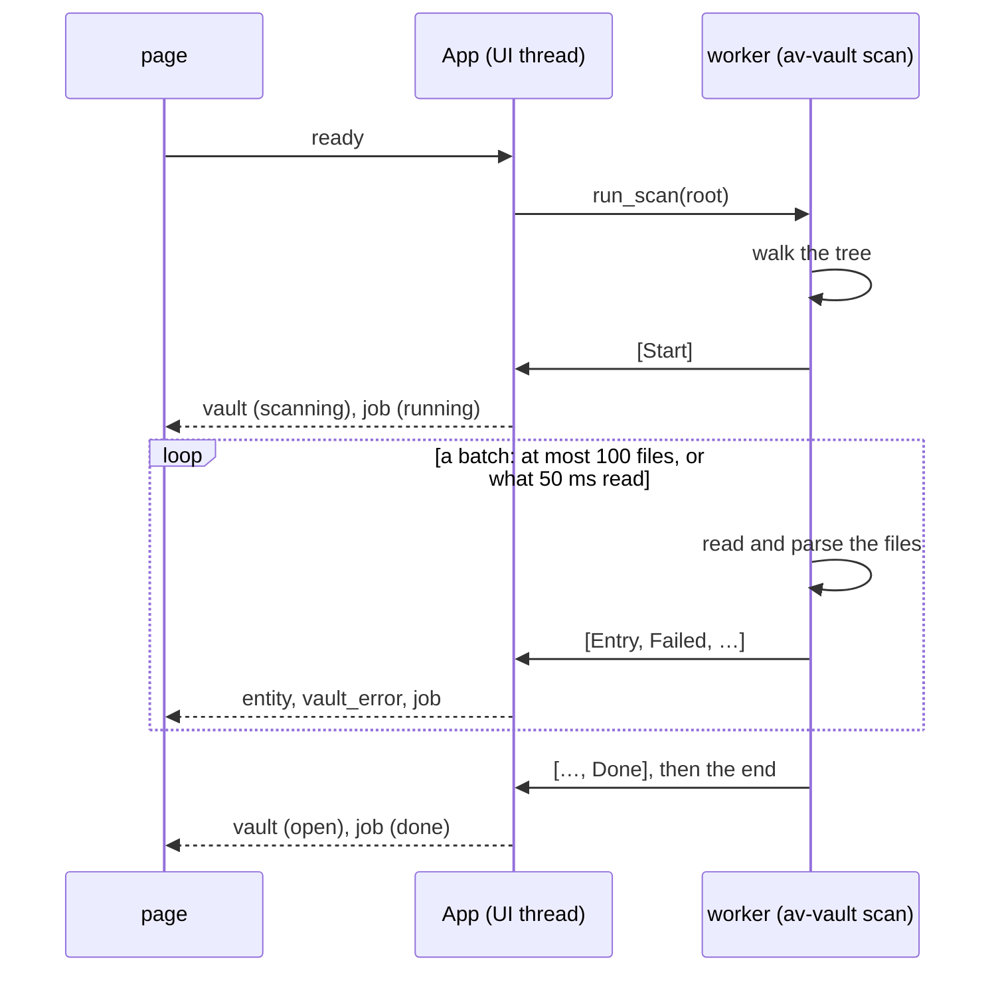

# Avelor — Vault

> The vault's file format and its life cycle: what an entity file holds,
> identity, roles, types and sources; opening, switching and scanning a
> vault.

## Principles <a id="principles"></a>

1. **Plain Text**: a folder tree of plain text files; documents are
   markdown with YAML frontmatter or pure YAML.
2. **Data Ownership**: the user owns the files, 3rd party tools might
   modify vault files at any time. No hidden state, no lock-in.
3. **One Structured Format**: YAML everywhere: frontmatter, standalone
   records, lists.
4. **Source of Truth**: the vault files are the source of truth for both
   documents (markdown) and structured records. There is no database; the
   index is rebuilt by a scan.
5. **ID-based Links**: every file has a unique ID (UUIDv7). Files can be
   renamed and moved freely; identity lives in frontmatter, not in the path.
6. **Transparency**: the vault's state is always accessible to the user,
   including errors and file system restrictions (read-only state).
7. **No view state**: how the app shows the vault (folds, sort orders,
   layouts, the selection) is kept, if at all, in the preferences
   (`ui.md#preferences`), never in a vault file, so looking around doesn't
   change the vault's history.

## Non-Goals

Obsidian interop is a COULD: we stay close where it's free (frontmatter,
`tags`) and diverge where the vault's model is better (ID-based links).

## Files <a id="files"></a>

Each file in the vault is either a markdown file with YAML frontmatter or a
pure YAML file (`*.md`, `*.yaml`). The YAML frontmatter holds the file's
metadata. The frontmatter keys the app doesn't know are kept as they are
(`Envelope.extra`).

Read-only files can't be edited (`Entry::is_editable` / `is_writable` /
`is_deletable`). A file whose frontmatter doesn't parse loads as a body
with the error kept, and is never rewritten.

In these documents, **entity** means any vault file, markdown or YAML.
**Document** refers to the `document` role (`vault.md#well-known-roles`) and its
derived type-id `doc`.

## Identity

Every entity — markdown file or YAML record — carries a stable `id`.

- Scheme: **UUIDv7** (48-bit Unix-ms timestamp + version/variant bits +
  74 random bits): time-ordered, standard, no coordination needed.
  Implemented in-house: timestamp from `SystemTime`, randomness
  from the system-preferred RNG.
- Filenames are display/convenience only. Hand-renaming in any tool is
  always safe: identity is the frontmatter `id`, never the path. The `id`
  never changes.
- All references between entities use IDs.
- A file without an `id` gets a new random one on every scan.

## Projects

Every entity can belong to zero or more projects; a thread's projects
are its members' (`vault.md#thread`). Projects are themselves entities
with a `project:` block and a `title`. Entities are linked to projects via
their `projects` metadata field.

## Roles, Types and Sources

An entity is described along two independent, stored axes:

* its **roles** — *what is this entity made of?*
* its **source** — *which door did it come through?*

A third property, the **type**, is not stored but derived from the roles
(`vault.md#types`).

### Roles <a id="roles"></a>

Roles describe the structural roles an entity plays. An entity may carry
multiple roles at the same time, combining their fields and semantics.

Each role is expressed by a role-named block in the frontmatter
(`document:`, `email:`, `message:`, `task:`, ...; `vault.md#well-known-roles`).
There is no separate `type:` field.

For example, a mail imported from an inbox might carry:

```yaml
document:
  genre: contract
email:
  from: legal@example.com
message:
  threads: [01a0c33f-4a20-7269-bc56-cf275a720bc1]
```

Together, these roles express that the file is:

* a document with user-facing document metadata (here: a contract),
* an email with mail-specific fields,
* and part of a message thread.

Roles are compositional: adding or removing a role adds or removes the
fields associated with that role without affecting the others.

Because the block itself acts as both the role marker and the container for
its fields, adopted roles are always written explicitly — even when empty
(e.g. `document: {}`) — so role information survives save/reload
round-trips.

An entity with no role blocks is considered a plain document (markdown) or
a plain record (YAML).

### Types <a id="types"></a>

Roles aren't a user-facing mechanism. Instead, roles let the user do
specific things with entities, like attaching them to a message thread, or
add metadata the application understands (email addresses, event
locations, etc.).

To simplify the representation of an entity's roles, the app maintains a
set of well-known types, which are derived only, never set or stored
(`vault.md#type-derivation`).

### Source <a id="source"></a>

The source describes the entity's provenance: the channel through which it
entered the vault.

Unlike roles, an entity has exactly one source. Like a role, it is written
as a top-level, channel-named block in the frontmatter, which carries the
channel-specific fields (`vault.md#sources`):

```yaml
scan:
  origin: scan_20260827T133609.jpg
```

Source block names and role block names are disjoint, so the app can tell
them apart by name alone. There is no separate `source:` field.

Typical sources include:

* `created` — authored inside the app,
* `file` — added from a local file,
* `remote` — synchronized from an external account such as email,
* `scan` — imported from scanned paper,
* `web` — clipped from a web page,
* `ai` — generated as part of an AI interaction,
* `import` — imported from an external export file.

The source is assigned when the entity enters the vault and is fixed
afterwards.

## Well-known Metadata Fields <a id="metadata"></a>

The frontmatter is an **envelope** (`av-vault/envelope.rs`): these
well-known fields, exactly one source block, any number of role blocks,
and everything else kept verbatim.

* `id`: UUIDv7,
* `projects`: [UUIDv7],
* `date`: Date,
* `title`: string,
* `rename`: boolean,
* `starred`: boolean,
* `archived`: boolean,
* `tags`: [string],
* `linked-to`: Entity ID.

`tags` are the labels the user sees.

`starred` marks a favorite. It is only written as `starred: true`; a
missing key means not starred.

`archived` puts an entity away without deleting it. Like `starred`, it is
only written as `archived: true`; a missing key means not archived.

`rename` says whether the app may rename the file to its generated name.

The `date` field always carries a UTC timestamp.

`linked-to` links the entity to one other entity it belongs with: a task
to the letter it originates from, an event to its booking confirmation, a
reply to the letter it answers, a chat to the document it discusses, an
attachment to its mail. Any entity can carry one. The other side is
derived, never stored: an entity is *linked from* every entity whose
`linked-to` names it.

### Links in content <a id="links-in-content"></a>

A markdown body links to another entity by its id, with the `id:` scheme:

```markdown
See [the landlord's letter](id:01a0c33f-4a20-74d4-bcd3-7cf22e58f379).
```

Such a link is not a `linked-to`.

## Shared Types <a id="shared-types"></a>

### ContactRef

* "@" + contact ID, or
* any name.

### ColorRef

* "#RRGGBB", "#RGB", or
* any name.

### Date

* ISO 8601 date string, or
* ISO 8601 date-time string.

### DateTime

* ISO 8601 date-time string.

### EmailAddress

* Email
* Name + "<" + Email + ">"

### Inline records

* {field: value, …}

## Well-known Roles <a id="well-known-roles"></a>

The following roles are well-known to the app. Each role is written as the
named block and carries a set of additional fields beyond the well-known
metadata fields above. The type-id each role leads to is listed in
`vault.md#type-derivation`.

### Project <a id="project"></a>

Block: `project:`

A project file is either a markdown or a pure YAML file. The content of
the markdown is the project's description. Entities are linked to the
project via their `projects` metadata field.

### Document <a id="document"></a>

Block: `document:`

A document is a markdown file with the following additional optional
fields:

* `genre`: string,
* `author`: ContactRef.

**Genre** — *what does the user call it?* A free-text label such as
"bill", "contract", "letter", or "statement". Purely a user-facing
distinction with no effect on which fields are valid — easy to change at
any time, only available for entities with the `document` role.

### Record

Block: `record:`

A record is a pure YAML file with additional custom fields.

### List

Block: `list:`

A list is a pure YAML file with the following additional fields:

* `items`: [string].

### Contact

Block: `contact:`

A contact is a markdown file with the following additional fields:

* `email`: [string],
* `phone`: [string],
* `address`: [string],
* `birthday`: Date,
* `IBAN`: string.

The content of the markdown can be used to store additional information
about the contact.

### Calendar

Block: `calendar:`

A calendar is a YAML file with the following additional fields:

* `color`: ColorRef,
* `timeZone`: string.

### Event <a id="event"></a>

Block: `event:`

An event is a markdown file with the following additional fields:

* `calendar`: Calendar ID,
* `status`: string (`confirmed`, `tentative`; `cancelled` once deleted in
  Google),
* `start`: Date, a date without a time for an all-day event,
* `end`: Date; for an all-day event the day after the last (as Google
  keeps it),
* `timeZone`: string, the IANA time zone the times are meant in (e.g.
  `Europe/Berlin`); a series repeats in it. Optional,
* `recurrence`: [string], a series' RFC 5545 lines as Google keeps them
  (`RRULE:FREQ=WEEKLY;BYDAY=MO`, `EXDATE:…`). A series is one entity.
  Optional,
* `location`: string,
* `attendees`: [ContactRef]; on an event synced from Google, Google's guest
  list (`Name <email>`),
* `exceptions`: [Exception], the occurrences of a series that Google
  reports changed, each with only what differs from the series:
  * `original`: Date, the start the series gives the occurrence,
  * `status`: `cancelled` for an occurrence deleted from the series,
  * `start`, `end`: Date, where it was moved to (also for another length),
  * `title`, `location`: string, its own.

  Optional.

The markdown content describes the event. The `date` of an event is its
start.

### Task <a id="task"></a>

Block: `task:`

A task is a markdown file with the following additional fields:

* `status`: string,
* `assignee`: ContactRef?,
* `due`: Date, when the task is due. Optional,
* `done`: Date, when the task was marked done. Optional.

The `date` metadata field keeps its usual meaning (when the task was
created); the due date lives in `due`.

### Thread <a id="thread"></a>

Block: `thread: {}`

A thread is a YAML file without additional fields. It is a user-created,
linear grouping of separate entities — messages, emails, letters, other
documents — that belong together, such as an exchange with an authority.

* **Members**: the entities whose `message.threads` lists the thread's `id`.
  The thread file itself holds no member list. An entity can be a member of
  several threads.
* **Order**: members are ordered by their `date`, ties broken by `id`
  (UUIDv7). There is exactly one path through a thread: no parent/child
  links, no siblings, no active branch.
* **Projects**: a thread has none of its own; its projects are its
  members' `projects`.

### Message <a id="message"></a>

Block: `message:`

The message role makes an entity a member of one or more threads. It
carries the following additional fields:

* `threads`: [Thread ID],
* `sender`: ContactRef,
* `recipient`: ContactRef.

If the entity also carries the `email` role, the email's `from` / `to`
fields are authoritative and `sender` / `recipient` are omitted.

### Email <a id="email"></a>

Block: `email:`

An email is a markdown file holding the mail's body with the following
additional fields:

* `subject`: string, the subject as the mail came; written only once the
  title differs from it, absent otherwise: the title is the subject,
* `kind`: string, what the mail is: `request`, `reply`, `notification`,
  `newsletter` or `other`,
* `from`: EmailAddress,
* `to`: [EmailAddress],
* `cc`: [EmailAddress],
* `bcc`: [EmailAddress].

### Conversation <a id="conversation"></a>

Block: `conversation:`

A conversation is a single YAML file holding all its messages inline, and
is shown as a single entity. It is used for chat exports and AI sessions,
where individual messages aren't entities on their own — as opposed to a
thread, whose members are separate entities.

It carries the following additional fields:

* `messages`: list of messages in the conversation with the following fields:
  * `id`: UUIDv7, ID of the message,
  * `parent`: UUIDv7, ID of the message's parent; absent for the first message,
  * `sender`: ContactRef,
  * `model`: string, the AI model that wrote the message; absent for a
    person's message,
  * `account`: UUIDv7, ID of the AI account the model was called through,
  * `date`: DateTime,
  * `content`: string, the message text as markdown,
  * `suggestions`: [string], questions offered to ask next.
* `active`: UUIDv7, ID of the leaf message of the currently shown path.

A message with a `model` is an AI reply. In an AI conversation (the `ai`
source) the user's own messages carry no `sender`.

Messages are ordered by their `parent` links, forming a tree. Messages that
share a parent are siblings, e.g. an AI re-run, or an AI re-run with a
modified prompt.

The tree itself is fixed: it is determined by the importer or the AI
conversation, and the user can't reorder messages.

### Bank Account

Block: `bank-account:`

A bank account is a pure YAML file with the following additional fields:

* `type`: string,
* `number`: string,
* `currency`: string,
* `balance`: number,
* `owner`: ContactRef,
* `institution`: string.

### Transactions

Block: `transactions:`

A transactions file is a YAML file containing a set of transactions for a
given bank account.

It carries the following additional fields:

* `account`: UUIDv7, account ID the given transactions belong to,
* `amount`: number,
* `transactions`: list of transactions with the following fields:
  * `id`: UUIDv7
  * `title`: string,
  * `date`: DateTime,
  * `status`: string,
  * `amount`: number,
  * `sender`: ContactRef,
  * `receiver`: ContactRef,
  * `linked-to`: Entity ID, e.g. the bill or task a payment belongs to. Optional.

## Type Derivation <a id="type-derivation"></a>

The type of an entity is derived by these rules, in order; the first match
wins. Specific structural roles win over generic ones (`record`,
`document`, `message`), so e.g. an email that is also a document and a
thread member derives as `eml`.

* if the entity has the `project` role: -> type-id: `prj`
* if the entity has the `calendar` role: -> type-id: `cal`
* if the entity has the `thread` role: -> type-id: `thd`
* if the entity has the `bank-account` role: -> type-id: `bnk`
* if the entity has the `contact` role: -> type-id: `cnt`
* if the entity has the `event` role: -> type-id: `evt`
* if the entity has the `task` role: -> type-id: `tsk`
* if the entity has the `list` role: -> type-id: `lst`
* if the entity has the `email` role: -> type-id: `eml`
* if the entity has the `conversation` role: -> type-id: `cvn`
* if the entity has the `transactions` role: -> type-id: `txs`
* if the entity has the `record` role: -> type-id: `rec`
* if the entity has the `document` role: -> type-id: `doc`
* if the entity has the `message` role: -> type-id: `msg`
* otherwise, a markdown file is a plain document: -> type-id: `doc`
* otherwise, a YAML file is a plain record: -> type-id: `rec`

For documents, the genre field can further be used to distinguish between
different types of documents. This doesn't change its type-id, but can be
used in iconography and filtering.

## Well-known Sources <a id="sources"></a>

Each source is written as a top-level block named after the channel.

### Created

Block: `created: {}`

The entity has been created inside the app.

### File

Block: `file: {}`

The entity arrived as a file in the Inbox.

### Remote <a id="remote"></a>

Block: `remote:`

* `account`: UUIDv7, ID of the account the entity was synchronized from,
* `remote`: list of properties to identify the entity inside the account.

Well-known properties:

* `message-id`: a mail's RFC 5322 Message-ID (e.g. `"<abc@example.com>"`),
* `gmail-id`: a mail's id in the Gmail account (e.g. `"18c2f0e4a1b2c3d4"`),
* `calendar-id`: on a calendar entity, the Google calendar it syncs with;
  its events belong to that source. On an event, the Google calendar it was
  last synced with,
* `sync-token`, `time-min`: on a calendar entity, where the next sync
  continues (Google's sync token), and the start of the window its first
  sync covered,
* `event-id`: an event's id in its Google calendar,
* `etag`: the version of the Google event last seen,
* `snapshot`: a hash of the event's synced fields at the last sync; an
  event whose fields hash differently has been changed in the vault since.

### Scan <a id="scan"></a>

Block: `scan:`

* `watch`: UUIDv7, ID of the folder watch the scan was imported from;
  absent for a scan that came another way,
* `origin`: string or list of strings, the scanned files (jpg, png, webp
  or pdf), in page order; relative to the watch's folder when `watch` is
  given.

```yaml
scan:
  watch: 0193a7c1-4b0e-7c1a-9d2f-3a51c8e05be0
  origin:
  - scan_20260928T0801.jpg
  - scan_20260928T0802.jpg
```

### Web

Block: `web:`

* `url`: string, URL of the imported web page

### AI

Block: `ai: {}`

The entity was generated by an LLM / AI, e.g. an assistant reply or an
AI-written summary.

### Import

Block: `import:`

The entity was imported from an external file.

* `origin`: string, filename of the imported file (csv, txt, json, ics, vcf)

## The forged vault

The forged vault (`data/forged`) shows the model in use:

| File | Type | Roles + source | Shows |
|---|---|---|---|
| `Threads/…0bc1.thd.yaml` | thread | `thread`, `created` | a thread has no member list and no projects |
| `Scans/…c1cf.msg.md`, `…ccdd.msg.md` | message | `message`, `scan` | scanned letters as thread members |
| `Mail/…f379.eml.md`, `…a44c.eml.md`, `…1136.eml.md` | email | `email` + `message`, `remote` | mails in the same thread |
| `Tasks/…3871.tsk.md` | task | `task` + `message`, `created` | a task in a thread, `linked-to` the letter |
| `Calendar/Personal/…7a3d.evt.md` | event | `event` + `message`, `created` | an event in a thread, `linked-to` the booking mail |
| `Calendar/…bdf8.cal.yaml` | calendar | `calendar`, `created` | events live in a folder named after it |
| `Conversations/…65ed.cvn.yaml` | conversation | `conversation`, `ai` | branched message tree, `active` leaf, `linked-to` a mail |
| `Accounts/…d9a1.bnk.yaml` | bank account | `bank-account`, `created` | |
| `Accounts/…675b.txs.yaml` | transactions | `transactions`, `import` | bookings `linked-to` the task they paid for |
| `Projects/…489b.prj.md` | project | `project`, `created` | body = project description (The Money Pit, starred) |

These are the ID card thread's entities; the whole vault has every type.

## Flows <a id="flows"></a>

| # | Flow | Trigger → page | Host → events | Result |
|---|---|---|---|---|
| A3 | Show in folder | vault menu → `reveal_vault` | `sys::open_path` on the vault folder after the handler (`on_ui`); `invalid_path` if none is open, shown in the status bar | Explorer (on Linux the file manager) shows the vault |

## Opening and scanning <a id="opening"></a>



The worker walks the vault and reads its files (`vault_scan.rs`,
av-vault's `scan`), and sends what it read in batches through
`run_with_progress`: the start alone, then a batch once it holds 100
events or 50 ms have passed since the one before, the end with the last
one. The UI thread puts each batch into the index and tells the page, so
a file that is slow to read (a network share, an online-only file of a
cloud folder) never blocks the window. The page gets one `entity` per
file. When it ends, the log says how many files the
scan read in how many milliseconds.

A vault scan can't be stopped; a new one replaces it (a vault switch). A
scan is named by an id: the one replaced is aborted, and the batches and
the end it already queued are dropped. Until the scan ends (`App::scanning`), the index holds
the files read so far.
