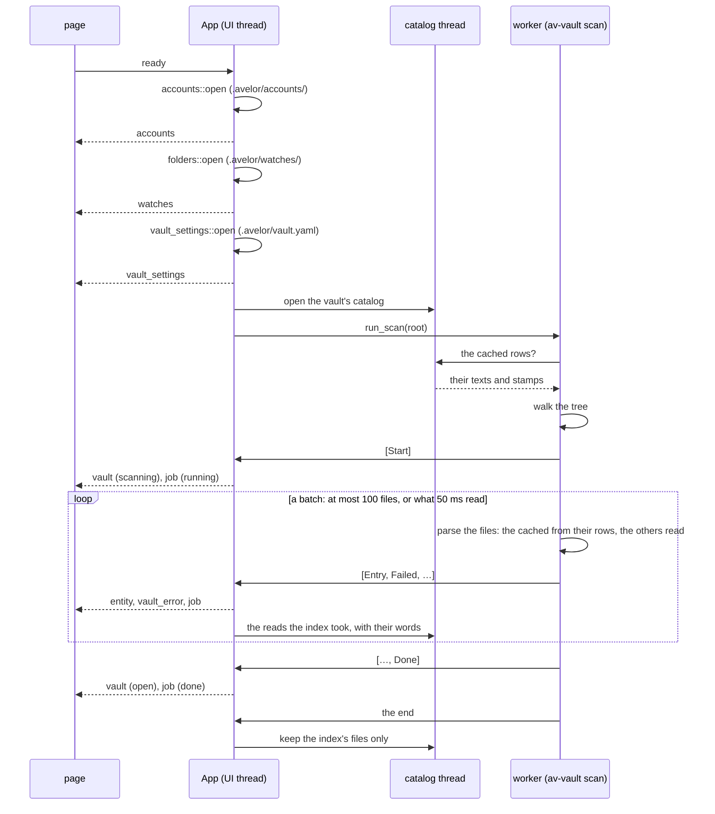

# Avelor — Vault

> The vault's file format and its life cycle: what an entity file holds,
> identity, roles, types and sources, file names, the layout; opening,
> switching and scanning a vault, the catalog, the search, the trash,
> the Vault page. The account
> and watch files in `.avelor/` are described in `accounts.md` and
> `import.md`, how an edited document reaches its file in `saving.md`.

## Principles <a id="principles"></a>

1. **Plain Text**: a folder tree of plain text files; documents are
   markdown with YAML frontmatter or pure YAML.
2. **Data Ownership**: the user owns the files, 3rd party tools might
   modify vault files at any time. No hidden state, no lock-in.
3. **One Structured Format**: YAML everywhere: frontmatter, standalone
   records, lists.
4. **Source of Truth**: the vault files are the source of truth for both
   documents (markdown) and structured records. The index is built by a
   scan; the catalog outside the vault holds nothing the files don't, and
   spares it reading the files that didn't change (`vault.md#catalog`), so
   deleting it loses nothing.
5. **ID-based Links**: every file has a unique ID (UUIDv7). Files can be
   renamed and moved freely; identity lives in frontmatter, not in the path.
6. **Transparency**: the vault's state is always accessible to the user,
   including errors and file system restrictions (read-only state).
7. **No view state**: how the app shows the vault (folds, sort orders,
   layouts, the selection) is kept, if at all, in the preferences
   (`ui.md#preferences`), never in a vault file, so looking around doesn't
   change the vault's history.

## Non-Goals

Obsidian interop is a COULD: we stay close where it's free (frontmatter,
`tags`) and diverge where the vault's model is better (ID-based links).

## Files <a id="files"></a>

Each file in the vault is either a markdown file with YAML frontmatter or a
pure YAML file (`*.md`, `*.yaml`). The YAML frontmatter holds the file's
metadata. The BOM, the line endings and frontmatter keys the app doesn't
know are kept as they are (`av_utils::text::renormalize`, `Envelope.extra`).

Read-only files can't be edited (`Entry::is_editable` / `is_writable` /
`is_deletable`). A file whose frontmatter doesn't parse loads as a body
with the error kept, and is never rewritten.

In these documents, **entity** means any vault file, markdown or YAML.
**Document** refers to the `document` role (`vault.md#well-known-roles`) and its
derived type-id `doc`.

## Identity

Every entity — markdown file or YAML record — carries a stable `id`.

- Scheme: **UUIDv7** (48-bit Unix-ms timestamp + version/variant bits +
  74 random bits): time-ordered, standard, no coordination needed.
  Implemented in-house: timestamp from `SystemTime`, randomness
  from the system-preferred RNG.
- Filenames are display/convenience only and are app-generated
  (`vault.md#filenames`). Hand-renaming in any tool is always safe: identity
  is the frontmatter `id`, never the path. The `id` never changes.
- All references between entities use IDs.
- A file without an `id` gets a new random one on every scan.

## Projects

Every entity can belong to zero or more projects; a thread's projects
are its members' (`vault.md#thread`). Projects are themselves entities
with a `project:` block and a `title`. Entities are linked to projects via
their `projects` metadata field. Creating, renaming, starring,
archiving and deleting projects is in `panel.md#projects`.

## External Edits

The vault files can be edited by other programs at any time. The app
detects such a change before it writes and when it looks at a file again;
if nothing of the app's own is lost, it takes the change in, otherwise it
asks the user which version to keep. The rules are in `saving.md#conflicts`.
A file changed while the app was closed shows by its stamp at the next
open (`vault.md#catalog`).

## Saving and Versioning <a id="versioning"></a>

There are no drafts or temporary copies: the app always saves edits
directly to the original vault file. As a safety net, the vault is meant to
be versioned with git, so any earlier state of a file can be recovered.

## Trash <a id="trash"></a>

Deleting an entity moves its file, unchanged, to `.trash/` at its
vault-relative path: `Documents/a.md` goes to `.trash/Documents/a.md`. If
a file of that name is already there, the new one gets the prefix
`YYYYMMDD_hhmmss.`, the time of the delete. The scan skips `.trash/` like
every dot-folder.

- **Workspace > Trash** (`features/workspace/trash.js`) lists what is there,
  newest first.
- **Restore** moves a file back to where it was, without that prefix, and
  selects it: the entity is in the vault again. It is refused when a file
  is already in that place, or when an entity with the file's `id` is in
  the vault.
- A restore brings back what the file holds, not what the delete did
  elsewhere: a thread the delete dissolved stays dissolved (its other
  member left it), and a project deleted since then is gone (its members
  left it). The file still names them in `threads` and `projects`; the app
  doesn't show references to entities that aren't in the vault, the same
  as links (`vault.md#metadata`).
- **Calendar events.** A two-way calendar sync deletes in Google the
  trashed events of its calendar that it synced, and rewrites each trashed
  file with `status: cancelled`: it stays in the trash, and a restore
  brings it back cancelled. An event changed in Google before that sync is
  restored instead, with Google's version. An event deleted for good before
  the sync isn't deleted in Google (`calendar.md#two-way-sync`).
- **Delete** in the trash and **Empty trash** remove files for good; both
  take two clicks. Empty removes the markdown and YAML files the trash
  lists, and the folders this leaves empty; anything else put into
  `.trash/` stays.

## Roles, Types and Sources

An entity is described along two independent, stored axes:

* its **roles** — *what is this entity made of?*
* its **source** — *which door did it come through?*

A third property, the **type**, is not stored but derived from the roles
(`vault.md#types`).

### Roles <a id="roles"></a>

Roles describe the structural roles an entity plays. An entity may carry
multiple roles at the same time, combining their fields and semantics.

Each role is expressed by a role-named block in the frontmatter
(`document:`, `email:`, `message:`, `task:`, ...; `vault.md#well-known-roles`).
There is no separate `type:` field.

For example, a mail imported from an inbox might carry:

```yaml
document:
  genre: contract
email:
  from: legal@example.com
message:
  threads: [01a0c33f-4a20-7269-bc56-cf275a720bc1]
```

Together, these roles express that the file is:

* a document with user-facing document metadata (here: a contract),
* an email with mail-specific fields,
* and part of a message thread.

Roles are compositional: adding or removing a role adds or removes the
fields associated with that role without affecting the others. For example,
dragging a letter into a thread adds the `message` role (listing that
thread) to it.

Because the block itself acts as both the role marker and the container for
its fields, adopted roles are always written explicitly — even when empty
(e.g. `document: {}`) — so role information survives save/reload
round-trips.

An entity with no role blocks is considered a plain document (markdown) or
a plain record (YAML).

### Types <a id="types"></a>

Roles aren't a user-facing mechanism. Instead, roles let the user do
specific things with entities, like attaching them to a message thread, or
add metadata the application understands (email addresses, event
locations, etc.).

To simplify the representation of an entity's roles, the app maintains a
set of well-known types, which are derived only, never set or stored
(`vault.md#type-derivation`).

The type of an entity is used for filtering, sorting, and visual indication
using icons. It is also used in the filename, so users can filter by type
in any file manager.

### Source <a id="source"></a>

The source describes the entity's provenance: the channel through which it
entered the vault.

Unlike roles, an entity has exactly one source. Like a role, it is written
as a top-level, channel-named block in the frontmatter, which carries the
channel-specific fields (`vault.md#sources`):

```yaml
scan:
  origin: scan_20260827T133609.jpg
```

Source block names and role block names are disjoint, so the app can tell
them apart by name alone. There is no separate `source:` field.

Typical sources include:

* `created` — authored inside the app,
* `file` — added from a local file,
* `remote` — synchronized from an external account such as email,
* `scan` — imported from scanned paper,
* `web` — clipped from a web page,
* `ai` — generated as part of an AI interaction,
* `import` — imported from an external export file.

The source is assigned when the entity enters the vault and is fixed
afterwards.

## Well-known Metadata Fields <a id="metadata"></a>

The frontmatter is an **envelope** (`av-vault/envelope.rs`): these
well-known fields, exactly one source block, any number of role blocks,
and everything else kept verbatim.

* `id`: UUIDv7,
* `projects`: [UUIDv7],
* `date`: Date,
* `title`: string,
* `rename`: boolean,
* `starred`: boolean,
* `archived`: boolean,
* `tags`: [string],
* `linked-to`: Entity ID.

`tags` are the labels the user sees.

`starred` marks a favorite. It is only written as `starred: true`; a
missing key means not starred.

`archived` puts an entity away without deleting it. Like `starred`, it is
only written as `archived: true`; a missing key means not archived.

`rename` says whether the app may rename the file to its generated name
(`vault.md#filenames`).

The `date` field always carries a UTC timestamp.

`linked-to` links the entity to one other entity it belongs with: a task
to the letter it originates from, an event to its booking confirmation, a
reply to the letter it answers, a chat to the document it discusses, an
attachment to its mail. Any entity can carry one; setting another link
replaces it, and removing it removes the key. The other side is
derived, never stored: an entity is *linked from* every entity whose
`linked-to` names it. Deleting an entity leaves the links to it in place,
so restoring it from `.trash` brings them back; a link to an id that isn't
in the vault is not shown.

### Links in content <a id="links-in-content"></a>

A markdown body links to another entity by its id, with the `id:` scheme:

```markdown
See [the landlord's letter](id:01a0c33f-4a20-74d4-bcd3-7cf22e58f379).
```

Such a link is not a `linked-to`.

## Shared Types <a id="shared-types"></a>

### ContactRef

* "@" + contact ID, or
* any name.

### ColorRef

* "#RRGGBB", "#RGB", or
* any name.

### Date

* ISO 8601 date string, or
* ISO 8601 date-time string.

### DateTime

* ISO 8601 date-time string.

### EmailAddress

* Email
* Name + "<" + Email + ">"

### Inline records

* {field: value, …}

## Well-known Roles <a id="well-known-roles"></a>

The following roles are well-known to the app. Each role is written as the
named block and carries a set of additional fields beyond the well-known
metadata fields above. The type-id each role leads to is listed in
`vault.md#type-derivation`.

### Project <a id="project"></a>

Block: `project:`

A project file is either a markdown or a pure YAML file. The content of
the markdown is the project's description, shown and edited under the
vault header. Entities are linked to the project via their `projects`
metadata field.

### Document <a id="document"></a>

Block: `document:`

A document is a markdown file with the following additional optional
fields:

* `genre`: string,
* `author`: ContactRef.

**Genre** — *what does the user call it?* A free-text label such as
"bill", "contract", "letter", or "statement". Purely a user-facing
distinction with no effect on which fields are valid — easy to change at
any time, only available for entities with the `document` role.

Emails can be imported directly from a Google account.

### Record

Block: `record:`

A record is a pure YAML file with additional custom fields.

### List

Block: `list:`

A list is a pure YAML file with the following additional fields:

* `items`: [string].

### Contact

Block: `contact:`

A contact is a markdown file with the following additional fields:

* `email`: [string],
* `phone`: [string],
* `address`: [string],
* `birthday`: Date,
* `IBAN`: string.

The content of the markdown can be used to store additional information
about the contact.

### Calendar

Block: `calendar:`

A calendar is a YAML file with the following additional fields:

* `color`: ColorRef,
* `timeZone`: string.

### Event <a id="event"></a>

Block: `event:`

An event is a markdown file with the following additional fields:

* `calendar`: Calendar ID,
* `status`: string (`confirmed`, `tentative`; `cancelled` once deleted in
  Google -- the file stays, the calendar doesn't show it),
* `start`: Date, a date without a time for an all-day event,
* `end`: Date; for an all-day event the day after the last (as Google
  keeps it),
* `timeZone`: string, the IANA time zone the times are meant in (e.g.
  `Europe/Berlin`); a series repeats in it. Optional,
* `recurrence`: [string], a series' RFC 5545 lines as Google keeps them
  (`RRULE:FREQ=WEEKLY;BYDAY=MO`, `EXDATE:…`). A series is one entity; the
  calendar shows its occurrences. Optional,
* `location`: string,
* `attendees`: [ContactRef]; on an event synced from Google, Google's guest
  list (`Name <email>`), replaced whenever Google's version is taken,
* `exceptions`: [Exception], the occurrences of a series that Google
  reports changed, each with only what differs from the series:
  * `original`: Date, the start the series gives the occurrence,
  * `status`: `cancelled` for an occurrence deleted from the series,
  * `start`, `end`: Date, where it was moved to (also for another length),
  * `title`, `location`: string, its own.

  Taken from Google only and never written back; an occurrence that
  differs in nothing kept here (e.g. only its description or guests) isn't
  listed. Optional.

The markdown content describes the event. The `date` of an event is its
start.

### Task <a id="task"></a>

Block: `task:`

A task is a markdown file with the following additional fields:

* `status`: string,
* `assignee`: ContactRef?,
* `due`: Date, when the task is due. Optional,
* `done`: Date, when the task was marked done. The app writes it when the
  status becomes `done` and removes it when the status changes again; a
  file edited by hand may lack it. Optional.

The `date` metadata field keeps its usual meaning (when the task was
created); the due date lives in `due`.

### Thread <a id="thread"></a>

Block: `thread: {}`

A thread is a YAML file without additional fields. It is a user-created,
linear grouping of separate entities — messages, emails, letters, other
documents — that belong together, such as an exchange with an authority.

* **Members**: the entities whose `message.threads` lists the thread's `id`.
  The thread file itself holds no member list. The user adds and removes
  members at any time; an entity can be a member of several threads.
* **Order**: members are ordered by their `date`, ties broken by `id`
  (UUIDv7). There is exactly one path through a thread: no parent/child
  links, no siblings, no active branch.
* **Presentation**: the thread manages its members, which are separate
  entities; the Documents lens folds them under the thread's row
  (`ui.md#documents`). The thread's `title` describes the thread itself.
* **Projects**: a thread has none of its own; its projects are its
  members' `projects`. The app writes none into a thread file, and a
  `projects` key an older thread file has is kept but not read.

### Message <a id="message"></a>

Block: `message:`

The message role makes an entity a member of one or more threads. It
carries the following additional fields:

* `threads`: [Thread ID],
* `sender`: ContactRef,
* `recipient`: ContactRef.

Adding an entity to a thread appends the thread's `id` to `threads`, adding
the `message` role if it's missing. Removing an entity from a thread removes
the `id` again; if the `message` block ends up empty, the role is dropped.
The entity keeps all its other roles.

If the entity also carries the `email` role, the email's `from` / `to`
fields are authoritative and `sender` / `recipient` are omitted.

### Email <a id="email"></a>

Block: `email:`

An email is a markdown file holding the mail's body with the following
additional fields:

* `subject`: string, the subject as the mail came; written only once the
  title differs from it (the mail analysis, `mail.md#analysis`), absent
  otherwise: the title is the subject,
* `kind`: string, what the mail is, as the mail analysis found:
  `request`, `reply`, `notification`, `newsletter` or `other`; absent if
  it wasn't analysed,
* `from`: EmailAddress,
* `to`: [EmailAddress],
* `cc`: [EmailAddress],
* `bcc`: [EmailAddress].

### Conversation <a id="conversation"></a>

Block: `conversation:`

A conversation is a single YAML file holding all its messages inline, and
is shown as a single entity. It is used for chat exports and AI sessions,
where individual messages aren't entities on their own — as opposed to a
thread, whose members are separate entities.

It carries the following additional fields:

* `messages`: list of messages in the conversation with the following fields:
  * `id`: UUIDv7, ID of the message,
  * `parent`: UUIDv7, ID of the message's parent; absent for the first message,
  * `sender`: ContactRef,
  * `model`: string, the AI model that wrote the message; absent for a
    person's message,
  * `account`: UUIDv7, ID of the AI account the model was called through,
  * `date`: DateTime,
  * `content`: string, the message text as markdown,
  * `suggestions`: [string], questions offered to ask next, shown while the
    message ends the shown path (the mail analysis's chat,
    `mail.md#analysis`).
* `active`: UUIDv7, ID of the leaf message of the currently shown path.

A message with a `model` is an AI reply. In an AI conversation (the `ai`
source) the user's own messages carry no `sender`. The app writes its
chats to `Conversations/`, `linked-to` (the metadata field) the document
or thread shown when the chat started; a reply is written once it is
complete or stopped, and a failed reply isn't written at all. The mail
analysis writes a chat that starts with replies, `linked-to` its mail.

Messages are ordered by their `parent` links, forming a tree. Messages that
share a parent are siblings, e.g. an AI re-run, or an AI re-run with a
modified prompt. The UI shows the path from the first message to `active`
and lets the user toggle between siblings along it; toggling writes the new
leaf to `active`. The tree's rules are av-vault's `conversation` module
(`path_to`, `leaf_from`, `add`, `activate`).

The tree itself is fixed: it is determined by the importer or the AI
conversation, and the user can't reorder messages.

### Bank Account

Block: `bank-account:`

A bank account is a pure YAML file with the following additional fields:

* `type`: string,
* `number`: string,
* `currency`: string,
* `balance`: number,
* `owner`: ContactRef,
* `institution`: string.

### Transactions

Block: `transactions:`

A transactions file is a YAML file containing a set of transactions for a
given bank account.

It carries the following additional fields:

* `account`: UUIDv7, account ID the given transactions belong to,
* `amount`: number,
* `transactions`: list of transactions with the following fields:
  * `id`: UUIDv7
  * `title`: string,
  * `date`: DateTime,
  * `status`: string,
  * `amount`: number,
  * `sender`: ContactRef,
  * `receiver`: ContactRef,
  * `linked-to`: Entity ID, e.g. the bill or task a payment belongs to. Optional.

## Type Derivation <a id="type-derivation"></a>

The type of an entity is derived by these rules, in order; the first match
wins. Specific structural roles win over generic ones (`record`,
`document`, `message`), so e.g. an email that is also a document and a
thread member derives as `eml`.

* if the entity has the `project` role: -> type-id: `prj`
* if the entity has the `calendar` role: -> type-id: `cal`
* if the entity has the `thread` role: -> type-id: `thd`
* if the entity has the `bank-account` role: -> type-id: `bnk`
* if the entity has the `contact` role: -> type-id: `cnt`
* if the entity has the `event` role: -> type-id: `evt`
* if the entity has the `task` role: -> type-id: `tsk`
* if the entity has the `list` role: -> type-id: `lst`
* if the entity has the `email` role: -> type-id: `eml`
* if the entity has the `conversation` role: -> type-id: `cvn`
* if the entity has the `transactions` role: -> type-id: `txs`
* if the entity has the `record` role: -> type-id: `rec`
* if the entity has the `document` role: -> type-id: `doc`
* if the entity has the `message` role: -> type-id: `msg`
* otherwise, a markdown file is a plain document: -> type-id: `doc`
* otherwise, a YAML file is a plain record: -> type-id: `rec`

For documents, the genre field can further be used to distinguish between
different types of documents. This doesn't change its type-id, but can be
used in iconography and filtering.

## Well-known Sources <a id="sources"></a>

Each source is written as a top-level block named after the channel.

### Created

Block: `created: {}`

The entity has been created inside the app.

### File

Block: `file: {}`

The entity arrived as a file in the Inbox.

### Remote <a id="remote"></a>

Block: `remote:`

* `account`: UUIDv7, ID of the account the entity was synchronized from,
* `remote`: list of properties to identify the entity inside the account.

Well-known properties (named in `av_vault::schema::remote`):

* `message-id`: a mail's RFC 5322 Message-ID (e.g. `"<abc@example.com>"`),
* `gmail-id`: a mail's id in the Gmail account (e.g. `"18c2f0e4a1b2c3d4"`),
  so the import recognizes mails it already fetched without reading their
  headers,
* `calendar-id`: on a calendar entity, the Google calendar it syncs with;
  its events belong to that source. On an event, the Google calendar it was
  last synced with,
* `sync-token`, `time-min`: on a calendar entity, where the next sync
  continues (Google's sync token), and the start of the window its first
  sync covered,
* `event-id`: an event's id in its Google calendar,
* `etag`: the version of the Google event last seen,
* `snapshot`: a hash of the event's synced fields at the last sync; an
  event whose fields hash differently has been changed in the vault since.

### Scan <a id="scan"></a>

Block: `scan:`

* `watch`: UUIDv7, ID of the folder watch the scan was imported from
  (`import.md#folder-watches`); absent for a scan that came another way,
* `origin`: string or list of strings, the scanned files (jpg, png, webp
  or pdf), in page order; relative to the watch's folder when `watch` is
  given. The import knows a file as in the vault by its watch and origin.

```yaml
scan:
  watch: 0193a7c1-4b0e-7c1a-9d2f-3a51c8e05be0
  origin:
  - scan_20260928T0801.jpg
  - scan_20260928T0802.jpg
```

### Web

Block: `web:`

* `url`: string, URL of the imported web page

### AI

Block: `ai: {}`

The entity was generated by an LLM / AI, e.g. an assistant reply or an
AI-written summary.

### Import

Block: `import:`

The entity was imported from an external file.

* `origin`: string, filename of the imported file (csv, txt, json, ics, vcf)

## Filenames <a id="filenames"></a>

Filenames are a **generated presentation layer** over the well-known
metadata fields (`av-vault/filename.rs`).

Formula: `{YYYYMMDDThhmm}.{slug(title)}.{id4}.{type-id}.{ext}`

Every field boundary is a dot — one separator, no special characters. The
slug never contains a dot (the slug rule replaces them), so the name is
always exactly five dot-separated segments: `prefix.slug.id4.type-id.ext`.

- **`YYYYMMDDThhmm`** — a datetime prefix on **every** file, using the
  `date` field of the frontmatter, so a plain directory sort is
  chronological. No dashes, `T` separator, `hhmm` 24h. Date-only sources
  (all-day events, most letters) use `T0000`. No seconds — the prefix is
  to-the-minute only; exact chronological order within a minute comes from
  sorting on the `id` (UUIDv7), not the filename.
- **slug** — from `title`: lowercased, ASCII-folded
  (`Meißen` → `meissen`), spaces and dots → `-`, truncated to ~20 chars.
  Deterministic: the same title always yields the same slug.
- **`id4`** — last 4 hex of the `id`. Mandatory. Guarantees filename
  uniqueness so no `foo 2.md` collision counters: two documents with the
  same title still differ here.
- **`type-id`** — three-letter code for the entity's derived type, one per
  well-known type, so glob filters (`*.evt.md`) are type-aware.
- **`ext`** — `md` for markdown files, `yaml` for pure YAML files.

Only the files the app creates get generated names, and the app renames no
file later: a file keeps the slug of the title it was created with, and the
`rename` key is ignored.

## Vault Configuration <a id="vault-config"></a>

What the vault's entities name by id is kept in the vault, in `.avelor/`, which
the scan skips like every dot-folder:

- `.avelor/accounts/` (`av_vault::schema::layout::ACCOUNTS`): one YAML file per
  Google or AI account, and beside an AI account its monthly spending. An
  entity names the account it arrived from in its `remote:` block, an
  assistant reply the AI account it came through. The secrets stay with the
  app and never enter the vault. `accounts.md#account-files`.
- `.avelor/watches/` (`av_vault::schema::layout::WATCHES`): one YAML file per
  folder watch; the documents a watch imported name it in `scan.watch`.
  `import.md#watch-files`.
- `.avelor/vault.yaml` (`av_vault::schema::layout::VAULT_SETTINGS`): the
  vault's own settings, read when it opens (`vault_settings.rs`; changed
  with `set_vault_settings`, pushed as `vault_settings`). `chat-model`, the model the assistant answers with, `{account, model}`
  (`accounts.md#model-choice`); a missing file is the defaults, a broken
  one too (logged), and keys the app doesn't know are kept.

```yaml
chat-model:
  account: 0193a7c1-4b0e-7c1a-9d2f-3a51c8e05be0
  model: gpt-5-mini
```

Opening another vault switches to its accounts, watches and settings.

## Vault layout <a id="vault-layout"></a>

A convention, not law. The folders the app writes into are named in
`av_vault::schema::layout`. Typed collections get conventional folders;
markdown documents may live anywhere — discovery is by frontmatter scan,
not by location:

```
Vault/
  .avelor/                 # vault config
    accounts/          # *.yaml per account (Google, AI providers), without secrets;
                       # *.spend.yaml: an AI account's spending per month
    watches/           # watch_<type>.yaml per folder watch
    vault.yaml         # the vault's own settings (the chat model)
  Projects/            # *.md / *.yaml project descriptors
  Conversations/       # *.yaml conversations
  Documents/           # *.md notes made with New
  Contacts/            # *.md per contact
  Records/             # *.yaml (IDs, passports, …)
  Tasks/               # *.md per task
  Lists/               # *.yaml
  Calendar/            # *.yaml calendar descriptors + subfolders of *.md events each
    Created Here/      # *.md events made with New, in no calendar
  Mail/                # *.md emails fetched from an account
  Scans/               # *.md documents imported from a folder watch's scans
  .trash/              # deleted entities, at their vault-relative path (§ Trash)
  …any user folders for notes, letters, tasks…
```

New in the app (`create_entity`, `Index::create_new`) writes a document into
`Documents/`, a task into `Tasks/`, an event into `Calendar/Created Here/`,
a contact into `Contacts/`, a list into `Lists/` and a record into
`Records/`, each with its generated name (`vault.md#filenames`). A new
thread goes beside its first member; calendar sync writes a calendar's
events into `Calendar/<calendar>/`.

## The forged vault

The forged vault (`data/forged`) shows the model in use:

| File | Type | Roles + source | Shows |
|---|---|---|---|
| `Threads/…0bc1.thd.yaml` | thread | `thread`, `created` | a thread has no member list and no projects |
| `Scans/…c1cf.msg.md`, `…ccdd.msg.md` | message | `message`, `scan` | scanned letters as thread members |
| `Mail/…f379.eml.md`, `…a44c.eml.md`, `…1136.eml.md` | email | `email` + `message`, `remote` | mails in the same thread |
| `Tasks/…3871.tsk.md` | task | `task` + `message`, `created` | a task in a thread, `linked-to` the letter |
| `Calendar/Personal/…7a3d.evt.md` | event | `event` + `message`, `created` | an event in a thread, `linked-to` the booking mail |
| `Calendar/…bdf8.cal.yaml` | calendar | `calendar`, `created` | events live in a folder named after it |
| `Conversations/…65ed.cvn.yaml` | conversation | `conversation`, `ai` | branched message tree, `active` leaf, `linked-to` a mail |
| `Accounts/…d9a1.bnk.yaml` | bank account | `bank-account`, `created` | |
| `Accounts/…675b.txs.yaml` | transactions | `transactions`, `import` | bookings `linked-to` the task they paid for |
| `Projects/…489b.prj.md` | project | `project`, `created` | body = project description (The Money Pit, starred) |

These are the ID card thread's entities; the whole vault has every type.

## Flows <a id="flows"></a>

| # | Flow | Trigger → page | Host → events | Result |
|---|---|---|---|---|
| A1 | Startup | page load → `rpcCall('ready')` (`app.js`) | the page comes with its preferences (`ui.md#preferences`); `api::ready`: if `config.vault` is set, `open_vault`: its accounts (`accounts`), its watches (`watches`), its settings (`vault_settings`), then the scan: `vault` (scanning), the scan's `job`, per file an `entity` and a `job` update, `vault_error` per unreadable file, `vault` (open), the `job` ended (with a note if files failed); answered `{google}` once the scan has started | sidebar, lens and counts fill while scanning; the Vault page lists unreadable files |
| A2 | Switch vault | vault menu → "Switch vault…", or the Vault page → `switchVault`: `sendEdits` (every editor leaves edit mode, `leaveEditModes`; `save_doc_content` per unsaved edit), then `switch_vault` (no path) | modal folder picker (cancel: `path: null`, nothing else happens); the old vault's jobs and the assistant's replies stopped, the new vault opened once they have ended (`architecture.md#jobs`); `config.vault` saved; new scan as A1 | `vault` (scanning) → `forgetVault`: the page forgets the old vault, the scan fills it with the new one; the next start opens the new vault |
| A3 | Show in folder | vault menu or Vault page → `reveal_vault` | `sys::open_path` on the vault folder after the handler (`on_ui`); `invalid_path` if none is open, shown in the status bar | Explorer (on Linux the file manager) shows the vault |
| A4 | Vault page | Workspace → Vault (op `settings`) → `renderVault` (`features/workspace/vault.js`) | — | name, path, file count ("Scanning" until `vault` says `open`), Show in folder, Rebuild index, Switch vault, the unreadable files |
| A5 | Rebuild index | Vault page → `rebuildIndex`: `sendEdits` as A2, then `rebuild_index` | the vault's jobs stopped as for a switch, then the vault opened again with its catalog emptied (`vault.md#catalog`); nothing remembered; new scan as A1, every file read; `not_initialized` if none is open, shown in the status bar | `vault` (scanning) → `forgetVault`: the page starts over as on a switch, the selection gone; the log says 0 files came from the catalog |
| E6 | Restore | Workspace > Trash, Restore → `restore_entity` | `Index::restore` moves the file back → `entity` | the restored entity selected; a thread the delete dissolved stays dissolved |

## Opening and scanning <a id="opening"></a>



The worker asks the vault's catalog for its cached rows
(`vault.md#catalog`), walks the vault and reads its files
(`vault_scan.rs`, av-vault's `scan`), taking a file whose stamp is its
row's from the row instead, and sends what it read in batches through
`run_with_progress`: the start alone, then a batch once it holds 100
events or 50 ms have passed since the one before, the end with the last
one. The UI thread puts each batch into the index, hands the reads the
index took to the catalog and tells the page, so a file that is slow to
read (a network share, an online-only file of a cloud folder) never
blocks the window. The page gets one `entity` per file, as from any edit.
When it ends, the log says how many files the scan read in how many
milliseconds and how many came from the catalog, the catalog keeps the
index's files only, and the auto-syncs that are due start.

A vault scan can't be stopped; a new one replaces it (a vault switch). A
scan is named by an id: the one replaced is aborted, and the batches and
the end it already queued are dropped, so none of it reaches the index or
the catalog; its worker runs on until it next looks. While
the worker walks, the app
may write a file the walk then finds too (New, a restore): `Index::apply`
skips an entry whose id the index already has, since the app's own entry
is the newer one. Until the scan ends (`App::scanning`), the index holds
the files read so far: a command for an entity not read yet answers
`not_found`, and the auto-syncs wait.

A scan starts only when a vault opens, so `vault` (scanning) starts the
page's vault over (`forgetVault`, `model/events.js`). The page forgets:

- the entities, projects and threads and their content (`docContent`);
- the unsaved state. No editor of the old vault saves any more: its edits
  were sent before the switch, when every editor left edit mode
  (`sendEdits`).
- the conflicts;
- the selection and the filter;
- a page about the old vault: New, Fetch mail, Import scans, and the Task
  tab's drafts (`features/new.js`).

The lens, the calendar's day, the panel's size and the Vault page stay.
The accounts and folder watches arrive before the scan as the new
vault's (`accounts`, `watches`), so
they aren't touched.

## The catalog <a id="catalog"></a>

The vault's files as the app holds them, a row per file of the index with
the words a search reads (`vault.md#search`), in SQLite outside the vault
(`av-store`'s `Catalog`, on a thread of its own, `catalog.rs`). What memory doesn't hold is looked up there before a file
is read: a scan takes a file unchanged since its row from the row. It
holds nothing the files don't: deleting it costs one full read.

- **Where**: an SQLite file per vault in `%LOCALAPPDATA%\Avelor\catalog`,
  on Linux `$XDG_CACHE_HOME/avelor/catalog` (`architecture.md#platforms`),
  named by a hash of the vault's path and the format,
  `<fnv1a_64 in hex>-v<format>.db`. The path is kept inside: a file made
  for another vault under the same name starts empty. Not in the vault,
  where a sync service or git would carry it along (`vault.md#principles`).
- **A row** is a file's vault-relative path, its parts joined by `/`, and
  its text as the app holds it: as read, BOM and line endings kept, or as
  the app wrote it (`Entry::file_text`). A file whose path isn't Unicode
  can't have one, so the scan reports it as unreadable (`vault_error`),
  and it isn't in the index either.
- **Its words**: the file's title, labels and text as a search reads them
  (`search::words_of`, made on the scan's worker for a read, on the UI
  thread for the app's own rows), in an FTS5 table of trigrams under the
  row's rowid, written in the same transaction. The app makes them, so a
  change of how is another format.
- **The stamp** makes a row a cache (`saving.md#the-stamp`). A text read
  from its file keeps the stamp the file had then, once the file had
  settled: changed at least 2 s before it was read (`SETTLED`), since a
  second change within the same clock tick and of the same size keeps the
  stamp, and the stale text would come back on every start. The walk
  takes each file's stamp from the directory listing; a file whose stamp
  is its row's is parsed from the row, as a file read is, and isn't
  opened. Every other file is read, and its row replaced. A change of the
  parser never makes a row wrong.
- **One writer**: `Vault`, the one way the index changes, sends every
  change to the catalog's thread in the order it changed the index: the
  reads of a scan's batch the index took, an edit (`App::edit`), an
  editor's save, a change taken in (`Vault::reload`, `Vault::refresh`), a
  trashed file's row dropped. The app's own rows have no stamp: a file the
  app just wrote or read again hasn't settled, and is read again at the
  next open. What is asked of the catalog after a change sees it.
- **What goes**: once a scan read every file, the catalog keeps exactly
  the index's files: the rows of the files gone or unreadable go with
  their words, and those of a file whose id another file has. A file the app made meanwhile
  stays. A stopped or replaced scan drops nothing.
- **Rebuild index** on the Vault page empties the catalog and opens the
  vault again as a switch to it does (flow A5), so every file is read: for
  a change the stamp can't tell (`saving.md#limits`).
- **Changes outside the app** reach the catalog as they reach the index:
  when the app looks at the file again (`saving.md#file-checks`), or at the
  next open. Until then both hold the old text.
- **Formats**: another format is another file; the next scan reads every
  file once into it. A vault's files of other formats are removed when it
  opens, unless another instance holds them.
- **Failures** are logged; the page sees nothing. A catalog that can't be
  opened leaves the vault without one, and every file is read at each
  open. A write that fails leaves its rows as they were and the catalog
  behind, so a search fails (`vault.md#search`) until the next open sets
  them right, since such a row's stamp isn't its file's. Only a file
  SQLite calls no database, or damaged, is removed and made anew; one
  that is busy or can't be written is left alone.
- **Several instances** share a file (WAL, a busy timeout): a row counts
  only while its stamp is the file's, so two writers cost at most a read,
  never a wrong text. Another instance's scan can drop the row of a file
  this one made, and its Rebuild index empties this one's rows, until this
  one opens the vault again.
- **Size**: a few times the vault's markdown and YAML: the texts, the
  words and their trigrams. The catalog of a vault no longer opened stays
  until the folder is deleted.

## Search <a id="search"></a>

A search reads an entity's words: its title, its labels and its text
(`search::words_of`). The text is the body as plain text, a line per
block, list item, table row and code line (`markdown::plain_text`), then
the envelope's texts: the names, places, items and messages its roles
hold, and every string a record keeps (`Envelope::text`); no ids, dates,
states or sources. The catalog keeps every file's words
(`vault.md#catalog`). The command `search` finds the entities holding
every word of a text (`search.rs`):

- **The rule**: every word is in the title, a label or the text, in any
  order and case, also inside a longer word ("rechnung" finds
  "Stromrechnung"); one function decides (`search::holds`).
- **The catalog's rows** are read on its thread, after every change asked
  before it (`run_superseding_on_catalog`), so an edit is found by its new
  words at once: the words of 3 characters or more narrow the rows by
  their trigrams (FTS5's MATCH, each word as a string); shorter ones are
  left to the rule, which then reads every row. A row stands for the
  entity at its path now.
- **The excerpt**, for an entity whose title lacks some of the words: the
  first line of its text holding one, from a word at most 40 characters
  before it, at most 200 long, with "…" where it was cut; else such a
  label, as `where: "Label"`.
- **Failures**: without a catalog, or after a write to it failed, the
  search fails until the vault opens again; so does a catalog that can't
  be read.
- **Limits**: a word of 1 or 2 letters reads every row. SQLite, Rust and
  the page fold a few letters' case differently (`İ`, `ẞ`), so such a
  word may miss a row or a mark. Diacritics count: "Koln" doesn't find
  "Köln". A change made outside the app is found once the app takes it
  in (`vault.md#catalog`).
